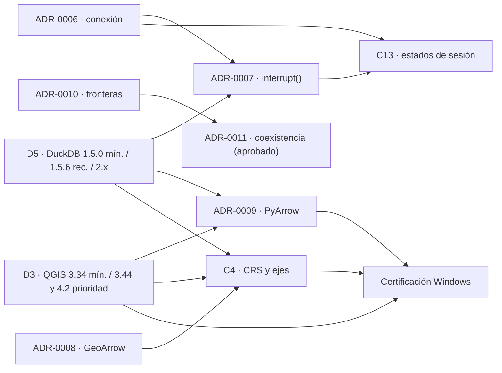

# Revisión arquitectónica de G0: dependencias y consecuencias (2026-11-01)

**Estado:** Para revisión del arquitecto. Documento índice: **no decide nada**. Cada decisión está en su
propio PR. **No modifica** `spec/`. G0 sigue abierto; no hay tags ni releases.

## 1. Qué se presenta y dónde

| PR | Cambio | Tipo | Estado de la decisión |
|---|---|---|---|
| #25 | Registro de D3 (QGIS) y D5 (DuckDB) en `docs/g0/decisions.md` | Solo documentación | Decidido por el propietario |
| #26 | Aplicar D5: recomendada 1.5.6 en código, pruebas y documentos | Código + pruebas | **Borrador**, apilado sobre #25 |
| #27 | ADR-0006, 0007, 0009 y 0010, revisión 2 (contenido vigente) | Solo documentación | Pendiente del arquitecto |
| #28 | C4: contrato de CRS y orden de ejes (+ evidencia QGIS 3.44/4.2) | Documentación + evidencia | Pendiente del arquitecto |
| #29 | C13: unificación de estados de sesión | Solo documentación | Pendiente del arquitecto |

## 2. Dependencias entre decisiones

| Decisión | Depende de | Por qué |
|---|---|---|
| ADR-0007 | ADR-0006, D5 | La cancelación actúa sobre la conexión del único hilo propietario; `interrupt()` solo se usa en versiones exactas verificadas (1.5.0–1.5.6 y 2.0.0), que D5 delimita. |
| ADR-0009 | D3, D5 | La celda de PyArrow depende del Python y NumPy que trae cada QGIS (D3) y de la versión de DuckDB (D5). |
| C4 | ADR-0008, D3, D5 | El CRS viaja en los metadatos GeoArrow (ADR-0008); `geometry_always_xy` cambia de 2.0 a 2.1 (D5); el comportamiento de ejes se verificó en QGIS 3.44 y 4.2 (D3). |
| C13 | ADR-0006, ADR-0007 | Los estados `BUSY` y `ERROR_RECOVERABLE` dependen de cómo el worker serializa, cancela y cierra. |
| ADR-0011 | ADR-0010 | La regla de no mutación ajena se hace cumplir con el mismo tipo de test AST. |
| Certificación Windows | D3, ADR-0009, C4 | Qué celdas certificar primero (3.44 y 4.2), con qué PyArrow, y qué comprobar en geometría. |

**Orden de revisión sugerido:** #25 → #27 → #28 → #29 → #26. Las decisiones del propietario (#25) fijan el
marco; los ADR (#27) fijan el motor; C4 y C13 se apoyan en ambos; #26 solo aplica D5 cuando #25 esté aprobado.

## 3. Consecuencias

### D3 · QGIS
- El mínimo declarado sigue siendo `qgisMinimumVersion=3.34` (no cambia `metadata.txt`).
- La certificación completa prioriza QGIS **3.44 LTR** y **4.2.x** en Windows; en 3.34 se mantiene la
  regresión (la prueba de humo de 3.34.15 ya pasó).
- QGIS < 3.34 sigue fuera de alcance: DuckDB ≥ 1.5 no publica wheels para Python ≤ 3.9 (D8).

### D5 · DuckDB
- `MINIMUM` sigue en 1.5.0; `RECOMMENDED` pasa de 1.5.4 a 1.5.6 (#26).
- 1.5.4 y 1.5.5 quedan «soportadas, no recomendadas»; por debajo de 1.5.4 el diagnóstico sigue avisando
  de los defectos de geometría F-04/F-05.
- 2.x: soporte verificado con 2.0.0. Cada versión nueva exige pasar la suite de motor antes de ampliar
  `INTERRUPT_VERIFIED` (ADR-0007).
- Riesgo conocido: F-12 (una base escrita por 2.0 no la lee 1.5). No afecta a G0, que solo usa `:memory:`.

### ADR-0006 / 0007 (#27)
- No hay cambios de código: la revisión 2 describe lo que ya está implementado y probado.
- Abierto para G1/G2: el manejo de `TRANSACTION_ABORTED` (F-07).

### ADR-0009 (#27)
- En Windows, si QGIS ya trae PyArrow, GeoDuck usa esa y solo se instala `duckdb`, siempre con
  `--no-deps` (F-13, F-15).
- El procedimiento de instalación definitivo queda para un ADR posterior (issue #10).

### C4 (#28)
- GeoDuck no reordena ejes ni fija `geometry_always_xy`; muestra su valor efectivo.
- Requiere modificar `spatial-spec` §4 y añadir AX-1..AX-4 a §8, **solo si se aprueba**.
- Cuando llegue DuckDB 2.1 (valor por defecto `true`), el resultado no debería cambiar para datos en
  orden x/y; AX-3 lo comprobará.

### C13 (#29)
- Requiere modificar `architecture.md` §3 y añadir la tabla de transiciones a `session-spec` §5, **solo si
  se aprueba**.
- Sin cambios de código en G0.
- Requisito nuevo para G1: el motor debe avisar de un cierre inesperado (`BUSY → ERROR_RECOVERABLE`).

## 4. Cambios en `spec/` que el arquitecto haría si aprueba

| Archivo | Sección | Origen |
|---|---|---|
| `spec/specs/spatial-spec.md` | §4 (orden de ejes y CRS), §8 (pruebas AX-1..AX-4) | C4 (#28) |
| `spec/docs/architecture.md` | §3 (estados) | C13 (#29) |
| `spec/specs/session-spec.md` | §5 (tabla de transiciones) | C13 (#29) |
| `spec/docs/technology.md` | «Decisión PyArrow» (selección por celda; usar la de QGIS si existe) — opcional: hoy no fija versiones | ADR-0009 (#27) |
| `spec/manifest.json` | Regenerar sumas tras cualquier cambio | Todas |

Ninguno de estos PR toca `spec/`: sigue idéntico al ZIP recibido.

## 5. Qué distingue la evidencia

- **CI (Ubuntu):** reproduce versiones de DuckDB, PyArrow y NumPy, y ejecuta QGIS 3.44.14 y 4.2.3 sin
  interfaz (conda-forge). **No es certificación Windows.**
- **Windows (máquina del propietario):** solo QGIS 3.34.15 + DuckDB 2.0.0, prueba de humo. Pendiente:
  suites completas, DuckDB 1.5.x, QGIS 3.44 y 4.2.

## 6. Después de la revisión

Continuar la certificación Windows paso a paso, en el orden de D3: QGIS 3.44 LTR, luego 4.2.x, y por
último la regresión en 3.34.
