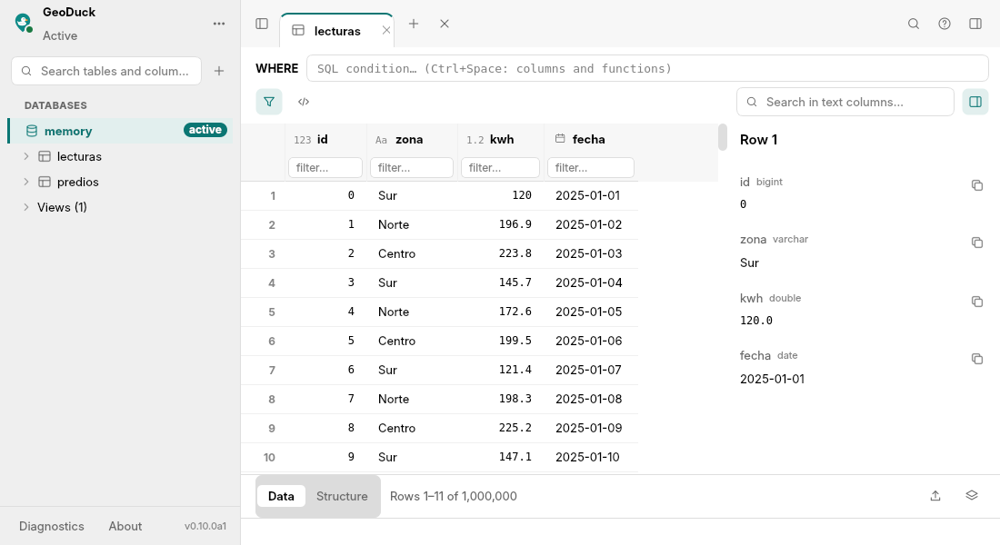

# Explore a table

4 minutes

Double-click a table or view in the explorer (or find it with **Ctrl+K**).

## Scroll

The wheel, the arrows, Page Up/Page Down, Ctrl+Home/End or the scroll bar take you to any row, even with a
billion. GeoDuck only asks for the rows you see; while they arrive, you see grey bars.

## Sort and filter

- **Sort:** hover over the header and click ⇅.
- **Filter by column:** the funnel shows a box under each header. It accepts:
    - text (contains): `south`
    - comparisons: `>50`, `10..50`, `=South`
    - empty values: `empty`, `not empty`
    - regular expressions: `/^A\d+/i`
    - SQL starting with an operator: `> 50 AND < 100`, `IN (1, 5)`, `LIKE 'a%'`
- **Right-click on cells:** filter or exclude those values.
- **WHERE bar:** any SQL condition, spatial too: `ST_Area(geom) > 1000`.

If a filter has an error, it stays red with its reason and the table keeps the last valid filter.

## Select and copy

Click a cell, a column name or a row number; Shift or Ctrl for several. **Ctrl+C** copies the selection,
tab-separated, ready for a spreadsheet.

## Summary and detail

- Pick a column: the footer shows sum, average, minimum, maximum and nulls over **all** filtered rows.
- The right panel (◫) shows the chosen row in full, with the geometry summarised.

## See the SQL

The **SQL** icon opens the exact query (with filters and order) in a new query tab.
