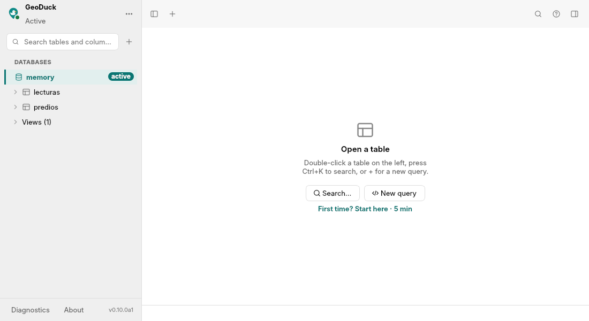

# Start here

<span class="gd-time">5 minutes</span>

GeoDuck is an analytical database inside QGIS. You open databases, query large tables with SQL and bring the
result to the map, without leaving QGIS.



## 1. Start GeoDuck

1. In QGIS, open **Database › GeoDuck › GeoDuck** or click the duck on the toolbar.
2. Click **Start GeoDuck**.

The dot on the logo turns green: the session is active. You already have an in-memory database, `memory`,
ready to use.

## 2. Open a database

- **One you already have:** "+" › **Open database…** and choose a `.duckdb` file.
- **A new one:** "+" › **Create database…** (a file) or **New database in memory…** (lost when the session
  closes).
- **Loose files** (CSV, Parquet, GeoPackage, Shapefile…): drag them onto a database in the explorer. See
  [Import files](import-files.md).

## 3. Look at a table

Double-click a table in the explorer. It opens in a tab: scroll, sort and filter. GeoDuck only reads the rows
you see, even with millions of rows. See [Explore a table](explore-table.md).

## 4. Put it on the map

Drag the table onto the QGIS map and choose:

- **Copy**: the data moves into QGIS; the layer no longer depends on the database.
- **Connected**: the layer reads straight from the database; what you edit is saved in the database.

See [Load into QGIS](load-into-qgis.md).

## 5. Write a query

1. Click **+** (new query).
2. Type, for example:

    ```sql
    SELECT zona, count(*) AS readings, avg(kwh) AS average
    FROM lecturas
    GROUP BY zona
    ORDER BY average DESC;
    ```

3. Press **Ctrl+Enter**.

The result appears below. From there you can export it or load it into QGIS. See [SQL editor](sql-editor.md).

!!! tip "Something not working?"
    See [Common errors](errors.md) or open **? › Environment diagnostics**.
