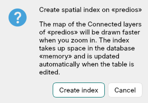

# Spatial index

2 minutes

A spatial index makes the map of a **Connected** layer draw faster when you zoom in, on large tables (around
10 million geometries or more). Smaller tables don't need it.

## Create

1. Right-click the table › **Create spatial index…**
2. **Create index.**

The footer shows the progress, with **Cancel**. The table gets the "index" mark in the explorer.

## Remove

Right-click › **Remove spatial index**. It doesn't ask: you can create it again.

!!! note "Tables without an integer key"
    If the table has no integer primary key, its Connected layers don't use the index. Editor queries do.
