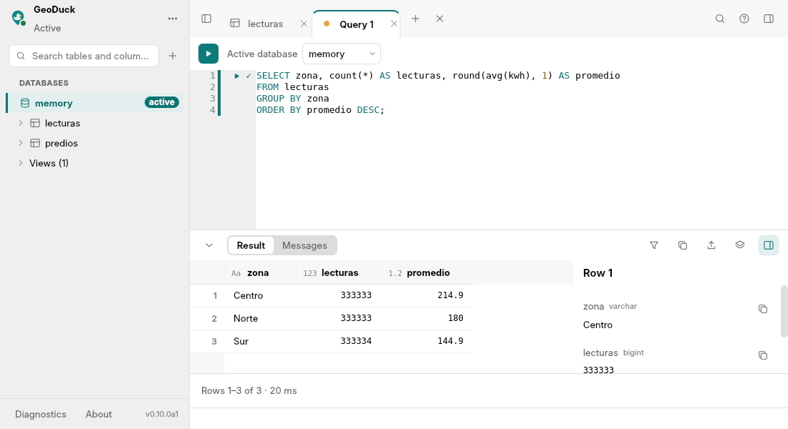

# SQL editor

5 minutes

**+** opens a new query. You write DuckDB SQL, with spatial functions (`ST_Area`, `ST_Buffer`,
`ST_Intersects`…).

## Run

- **Ctrl+Enter** runs the selection or, with no selection, the **marked statement** (the teal bar to the left
  of the text). The ▶ button says what will run: "Run · line 5".
- **Ctrl+Shift+Enter** runs everything.
- **Esc** cancels while it runs.

The query runs in the active database ("Active database ▾" above the editor). Name another database in full:
`other.main.table`.

## The result

Below, the same grid as tables: sort, filter, copy, summary and detail. From its bar: **Export ▾** and **Load
in QGIS ▾**. **Ctrl+J** folds or opens the result.

If the query took more than 300 ms, GeoDuck stores the result once ("Preparing…") so scrolling, sorting or
exporting doesn't repeat it.

## Messages and errors

Each statement gets ✓, ✕ or – (didn't run) in the margin. An error opens **Messages** by itself, with the line
and the word where it is, and a button to fix it when the engine suggests something ("Change to «predios»",
"Use TRY_CAST"…). Fixes only change the text: they never run anything. See [Common errors](errors.md).

Half a second after you stop typing, the parser checks the syntax and underlines what is wrong, without
running anything.

## Type fast

- Autocomplete for databases, tables, columns and functions (Ctrl+Space).
- When you open `(` after a function, its parameters.
- Snippets: type `sel`, `cnt`, `gb`, `join`… and press Tab.
- Double-clicking a column in the explorer writes its name in the editor.

All shortcuts: [Keyboard shortcuts](shortcuts.md).

## Save

**Ctrl+S** saves the query as `.sql`. While you type, GeoDuck keeps a recovery copy: if QGIS closes suddenly,
it offers **Recover** next time.
