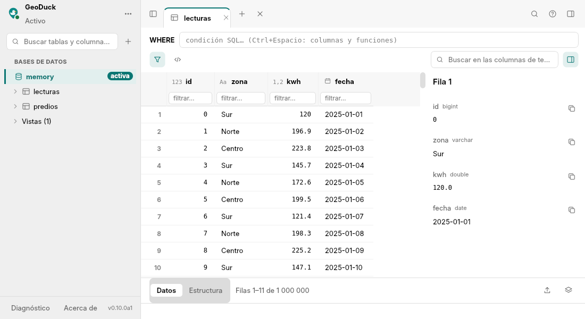

# Explorar una tabla

4 minutos

Doble clic en una tabla o vista del explorador (o búscala con **Ctrl+K**).

## Desplazarte

La rueda, las flechas, Re Pág/Av Pág, Ctrl+Inicio/Fin o la barra llevan a cualquier fila, también con mil
millones. GeoDuck pide solo las filas que ves; mientras llegan, se ven barras grises.

## Ordenar y filtrar

- **Ordenar:** pasa el ratón por el encabezado y pulsa ⇅.
- **Filtrar por columna:** el embudo muestra una casilla bajo cada encabezado. Acepta:
    - texto (contiene): `sur`
    - comparaciones: `>50`, `10..50`, `=Sur`
    - vacíos: `vacío`, `no vacío`
    - expresiones regulares: `/^A\d+/i`
    - SQL que empieza con un operador: `> 50 AND < 100`, `IN (1, 5)`, `LIKE 'a%'`
- **Clic derecho en celdas:** filtrar o excluir esos valores.
- **Barra WHERE:** una condición SQL libre, también espacial: `ST_Area(geom) > 1000`.

Si un filtro tiene un error, queda en rojo con su motivo y la tabla sigue con el último filtro válido.

## Seleccionar y copiar

Clic en una celda, en el nombre de una columna o en el número de una fila; Mayús o Ctrl para varias. **Ctrl+C**
copia lo elegido, separado por tabuladores, listo para una hoja de cálculo.

## Resumen y detalle

- Elige una columna: el pie muestra suma, promedio, mínimo, máximo y nulos de **todas** las filas filtradas.
- El panel de la derecha (◫) muestra la fila elegida completa, con la geometría resumida.

## Ver el SQL

El icono **SQL** abre la consulta exacta (con filtros y orden) en una pestaña de consulta nueva.
