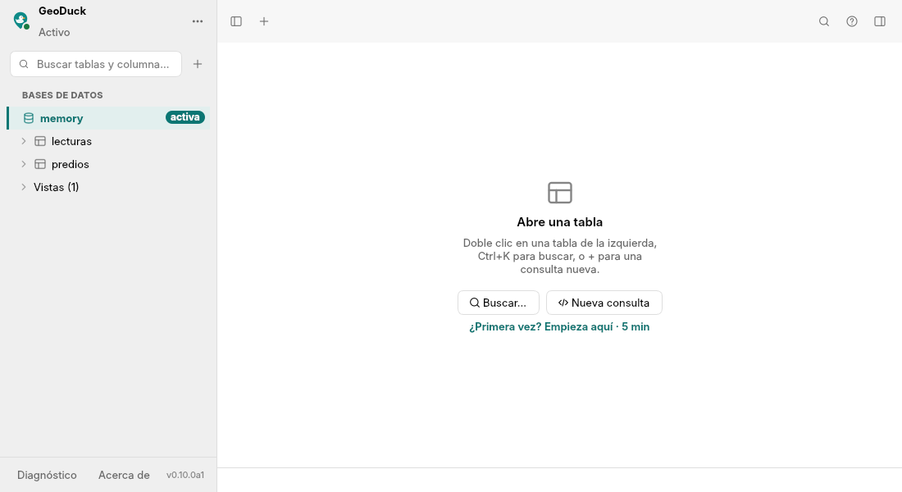

# Empieza aquí

<span class="gd-time">5 minutos</span>

GeoDuck es una base de datos analítica dentro de QGIS. Abres bases, consultas tablas grandes con SQL y llevas
el resultado al mapa, sin salir de QGIS.



## 1. Inicia GeoDuck

1. En QGIS, abre **Base de datos › GeoDuck › GeoDuck** o pulsa el pato de la barra de herramientas.
2. Pulsa **Iniciar GeoDuck**.

El punto del logo se pone verde: la sesión está activa. Ya tienes una base en memoria, `memory`, lista para usar.

## 2. Abre una base

- **Una base que ya tienes:** «+» › **Abrir base…** y elige un archivo `.duckdb`.
- **Una base nueva:** «+» › **Crear base…** (un archivo), o **Abrir base…** con `:memory:` como archivo (en
  memoria: se pierde al cerrar la sesión).
- **Archivos sueltos** (CSV, Parquet, GeoPackage, Shapefile…): arrástralos sobre una base del explorador.
  Ver [Importar archivos](import-files.md).

## 3. Mira una tabla

Doble clic en una tabla del explorador. Se abre en una pestaña: desplázate, ordena y filtra. GeoDuck solo lee
las filas que ves, también con millones de filas. Ver [Explorar una tabla](explore-table.md).

## 4. Llévala al mapa

Arrastra la tabla al mapa de QGIS y elige:

- **Copia**: los datos pasan a QGIS; la capa ya no depende de la base.
- **Conectada**: la capa lee directo de la base; lo que edites se guarda en la base.

Ver [Cargar en QGIS](load-into-qgis.md).

## 5. Escribe una consulta

1. Pulsa **+** (nueva consulta).
2. Escribe, por ejemplo:

    ```sql
    SELECT zona, count(*) AS lecturas, avg(kwh) AS promedio
    FROM lecturas
    GROUP BY zona
    ORDER BY promedio DESC;
    ```

3. Pulsa **Ctrl+Intro**.

El resultado aparece abajo. Desde ahí puedes exportarlo o cargarlo en QGIS. Ver [Editor SQL](sql-editor.md).

!!! tip "¿Algo no sale?"
    Mira [Errores frecuentes](errors.md) o abre **? › Diagnóstico del entorno**.
