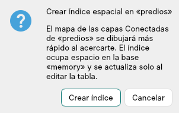

# Índice espacial

2 minutos

Un índice espacial hace que el mapa de una capa **Conectada** se dibuje más rápido al acercarte, en tablas
grandes (unos 10 millones de geometrías o más). Con tablas más chicas no hace falta.

## Crear

1. Clic derecho en la tabla › **Crear índice espacial…**
2. **Crear índice.**

El pie muestra el avance, con **Cancelar**. La tabla lleva la marca «índice» en el explorador.

## Quitar

Clic derecho › **Quitar índice espacial**. No pregunta: lo puedes volver a crear.

!!! note "Tablas sin clave entera"
    Si la tabla no tiene una clave primaria entera, sus capas Conectadas no usan el índice. Las consultas del
    editor sí.
