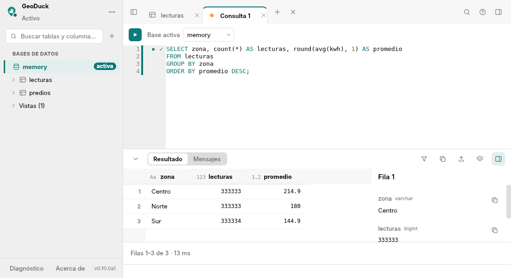

# Editor SQL

5 minutos

**+** abre una consulta nueva. Escribes SQL de DuckDB, con funciones espaciales (`ST_Area`, `ST_Buffer`,
`ST_Intersects`…).

## Ejecutar

- **Ctrl+Intro** (o el botón ▶) ejecuta **todo**; si seleccionas una parte, solo **la selección**.
- **Ctrl+Shift+Intro** ejecuta solo la **sentencia marcada**: la del cursor, con la barra turquesa a la
  izquierda del texto. También el ▶ del margen.
- **Esc** cancela mientras corre.

La consulta se ejecuta en la base activa («Base activa ▾» arriba del editor). Otra base se nombra completa:
`otra.main.tabla`.

## El resultado

Abajo, la misma grilla de las tablas: ordenar, filtrar, copiar, resumen y detalle. Desde su barra:
**Exportar ▾** y **Cargar en QGIS ▾**. **Ctrl+J** pliega o abre el resultado.

Si la consulta tardó más de 300 ms, GeoDuck guarda el resultado una vez («Preparando…») para que desplazarte,
ordenar o exportar no la repitan.

## Mensajes y errores

Cada sentencia lleva ✓, ✕ o – (no corrió) en el margen. Un error se abre solo en **Mensajes**, con la línea y
la palabra donde está, y un botón para arreglarlo cuando el motor sugiere algo («Cambiar a «predios»», «Usar
TRY_CAST»…). Los arreglos solo cambian el texto: nunca ejecutan nada. Ver [Errores frecuentes](errors.md).

Medio segundo después de dejar de escribir, el analizador revisa la sintaxis y subraya lo que está mal, sin
ejecutar nada.

## Escribir rápido

- Autocompletado de bases, tablas, columnas y funciones (Ctrl+Espacio).
- Al abrir `(` tras una función, sus parámetros.
- Fragmentos: escribe `sel`, `cnt`, `gb`, `join`… y pulsa Tab.
- Doble clic en una columna del explorador escribe su nombre en el editor.

Todos los atajos: [Atajos del teclado](shortcuts.md).

## Guardar

**Ctrl+S** guarda la consulta como `.sql`. Mientras escribes, GeoDuck guarda una copia de recuperación: si QGIS
se cierra de golpe, al volver ofrece **Recuperar**.
