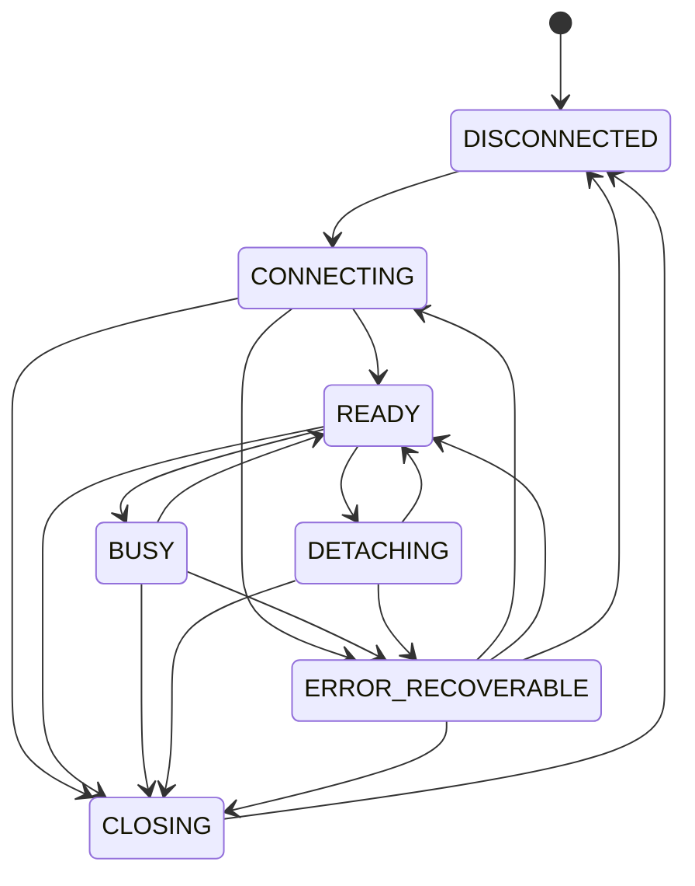

# Propuesta C13 — unificación de los estados de sesión

**Estado:** Propuesta para el arquitecto (2026-11-01). **No modifica** `spec/`: el texto propuesto se
incorpora solo si se aprueba.
**Afecta a:** `spec/docs/architecture.md` §3 (y aclara la relación con `spec/specs/ui-ux-spec.md` §6).
**Depende de:** ADR-0006 y ADR-0007 (motor y cancelación).

## 1. La contradicción

Tres textos hablan de estados y no coinciden:

| Documento | Estados |
|---|---|
| `architecture.md` §3 | `STOPPED → STARTING → READY → BUSY → READY → CLOSING → STOPPED`; `FAILED` para errores recuperables |
| `session-spec.md` §5 | `DISCONNECTED`, `CONNECTING`, `READY`, `BUSY`, `DETACHING`, `CLOSING`, `ERROR_RECOVERABLE` |
| `ui-ux-spec.md` §6 (UI) | `sin sesión`, `conectando`, `listo`, `ejecutando`, `preview disponible`, `resolución espacial`, `transfiriendo`, `cancelando`, `entrega exitosa`, `fallo recuperable` |

G0 implementó el conjunto de `session-spec` §5, el más específico (incluye `DETACHING`), en
`geoduck/domain/session.py`.

## 2. Propuesta

1. **Fuente única:** los estados de **sesión** son los 7 de `session-spec` §5. `architecture.md` §3 los
   adopta con esos mismos nombres.
2. **Equivalencias** para la transición del texto:

| `architecture.md` (actual) | Estado unificado |
|---|---|
| `STOPPED` | `DISCONNECTED` |
| `STARTING` | `CONNECTING` |
| `READY` | `READY` |
| `BUSY` | `BUSY` |
| — (no existía) | `DETACHING` |
| `CLOSING` | `CLOSING` |
| `FAILED` | `ERROR_RECOVERABLE` |

3. **Separar sesión y operación.** Varios estados de `ui-ux-spec` §6 no describen la sesión sino una
   operación o un resultado: `preview disponible`, `resolución espacial`, `transfiriendo`, `cancelando` y
   `entrega exitosa`. Se propone que la UI derive sus estados de dos máquinas distintas:
   - la **máquina de sesión** (7 estados, esta propuesta);
   - una **máquina de operación**, que se definirá en G2/G3 con su propio ADR (por ejemplo: en cola,
     ejecutando, cancelando, completada, cancelada, fallida; y para la entrega: transfiriendo, publicada,
     descartada).
4. **Transiciones normativas.** Se adopta como contrato la tabla ya implementada y probada:

| Desde | Puede pasar a |
|---|---|
| `DISCONNECTED` | `CONNECTING` |
| `CONNECTING` | `READY`, `ERROR_RECOVERABLE`, `CLOSING` |
| `READY` | `BUSY`, `DETACHING`, `CLOSING` |
| `BUSY` | `READY`, `CLOSING`, `ERROR_RECOVERABLE` |
| `DETACHING` | `READY`, `ERROR_RECOVERABLE`, `CLOSING` |
| `CLOSING` | `DISCONNECTED` |
| `ERROR_RECOVERABLE` | `CONNECTING`, `READY`, `CLOSING`, `DISCONNECTED` |

5. **Correspondencia con la UI** (el texto visible se mantiene en español):

| Estado de sesión | Texto en el panel | `ui-ux-spec` §6 |
|---|---|---|
| `DISCONNECTED` | Sin sesión | sin sesión |
| `CONNECTING` | Conectando… | conectando |
| `READY` | Lista | listo |
| `BUSY` | Ejecutando… | ejecutando (el detalle lo da la máquina de operación) |
| `DETACHING` | Desadjuntando… | — (nuevo en la UI) |
| `CLOSING` | Cerrando… | — (nuevo en la UI) |
| `ERROR_RECOVERABLE` | Fallo recuperable | fallo recuperable |

## 3. Texto propuesto para `architecture.md` §3 (sustituye la primera línea)

> Estados de sesión (fuente única: `session-spec` §5): `DISCONNECTED → CONNECTING → READY ⇄ BUSY`,
> `READY → DETACHING → READY`, `* → CLOSING → DISCONNECTED`; `ERROR_RECOVERABLE` registra fallos de los que
> se puede salir reintentando, volviendo a `READY` o cerrando. La tabla de transiciones de `session-spec` §5
> es normativa. Los estados de operación y de entrega (`cancelando`, `transfiriendo`, `entrega exitosa`…)
> pertenecen a la máquina de operación, no a la de sesión.

Y en `session-spec` §5, añadir la tabla de transiciones del punto 2.4.

## 4. Estado de la implementación y brecha detectada

- **Implementado en G0:** `DISCONNECTED`, `CONNECTING`, `READY`, `CLOSING` y `ERROR_RECOVERABLE`, por el
  coordinador (`geoduck/app/coordinator.py`). `BUSY` y `DETACHING` están definidos y el panel tiene su
  texto, pero ningún caso de uso de G0 los activa: no hay SQL del usuario ni `ATTACH`/`DETACH` hasta G1/G2.
- **Brecha (honesta, para G1/G2):** si tras una interrupción la conexión no responde, el worker cierra la
  sesión (ADR-0007 §3), pero hoy **no avisa al coordinador**, que seguiría mostrando `READY`. En G0 no
  ocurre en la práctica: solo se interrumpe al cerrar, y el coordinador ya está en `CLOSING`. Cuando G1/G2
  introduzcan `BUSY`, el motor deberá notificar un cierre inesperado y el coordinador pasará
  `BUSY → ERROR_RECOVERABLE`, una transición que ya existe en la tabla. Se propone registrarlo como
  requisito de G1.

## 5. Pruebas relacionadas

- Existentes:
  - `tests/unit/test_domain.py::TestSessionStateMachine`: recorrido completo, transición inválida rechazada
    sin cambiar el estado, todas las transiciones definidas y `CLOSING` solo hacia `DISCONNECTED`.
  - `tests/unit/test_coordinator.py`: secuencia `CONNECTING → READY → CLOSING → DISCONNECTED`, fallo de
    arranque → `ERROR_RECOVERABLE` y reintento, y cierre durante el arranque.
  - `tests/qgis/test_plugin.py`: texto del panel en «Lista» y «Sin sesión».
- A añadir si se aprueba:
  - un test que compare la tabla de `geoduck/domain/session.py` con la tabla normativa de la
    especificación, para que no vuelvan a divergir;
  - en G1, el test de la brecha: conexión que no responde → `ERROR_RECOVERABLE`.

## 6. Consecuencias

- Pro: un solo vocabulario en especificación, código, UI y pruebas.
- Pro: separar sesión y operación evita una máquina de sesión con 10 estados que mezcla conceptos.
- Contra: `ui-ux-spec` §6 requerirá una aclaración cuando se defina la máquina de operación (G2/G3).
- Sin cambios de código en G0: la implementación ya sigue esta propuesta.

## 7. Preguntas para el arquitecto

1. ¿Se aprueba separar la máquina de sesión de la de operación?
2. ¿`ERROR_RECOVERABLE → READY` debe seguir permitido (fallo de una operación con la conexión intacta), o
   todo fallo de operación debe dejar la sesión en `READY` sin pasar por `ERROR_RECOVERABLE`?
