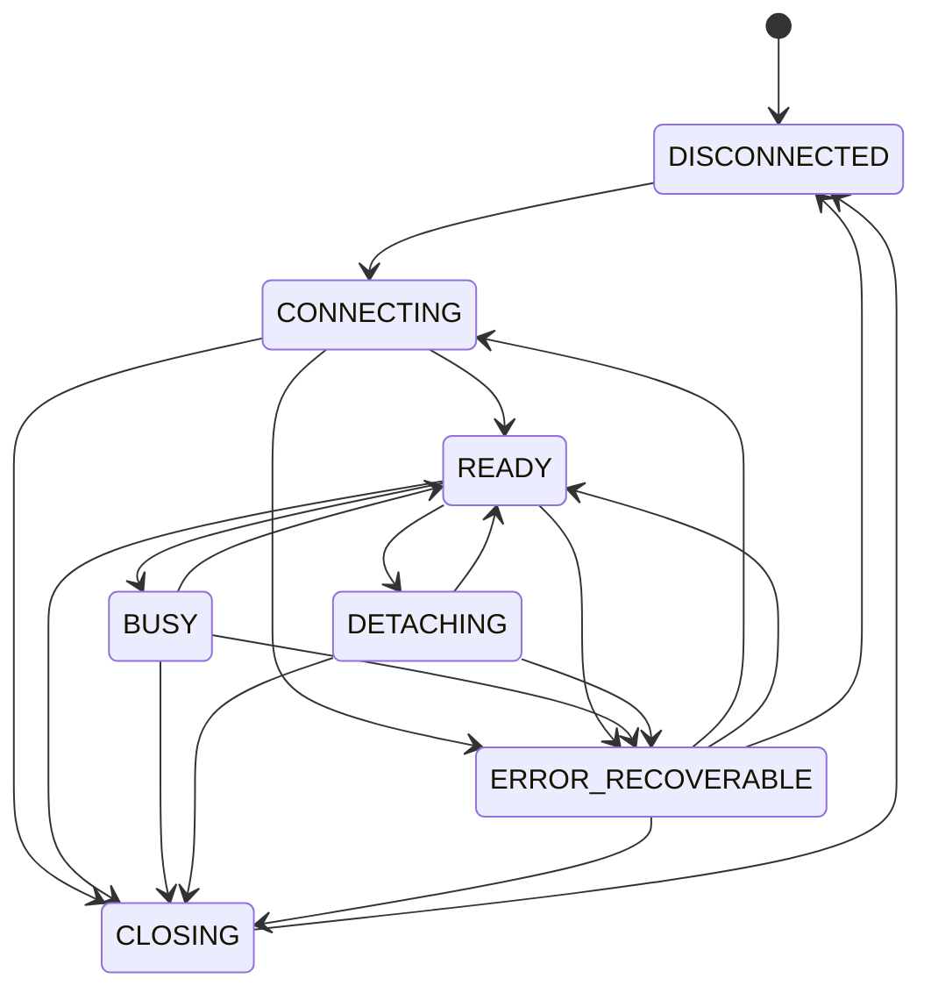

# Propuesta C13 — unificación de los estados de sesión

**Estado:** **Aprobado arquitectónicamente** (2026-11-01). La notificación única de invalidación de sesión
(§4 bis) es **requisito obligatorio de G1**. Revisión 2. **No modifica** `spec/`: el texto propuesto se
incorpora solo si se aprueba.
**Afecta a:** `spec/docs/architecture.md` §3 (y aclara la relación con `spec/specs/ui-ux-spec.md` §6).
**Depende de:** ADR-0006 y ADR-0007 (motor y cancelación).

## 1. La contradicción

Tres textos hablan de estados y no coinciden:

| Documento | Estados |
|---|---|
| `architecture.md` §3 | `STOPPED → STARTING → READY → BUSY → READY → CLOSING → STOPPED`; `FAILED` para errores recuperables |
| `session-spec.md` §5 | `DISCONNECTED`, `CONNECTING`, `READY`, `BUSY`, `DETACHING`, `CLOSING`, `ERROR_RECOVERABLE` |
| `ui-ux-spec.md` §6 (UI) | `sin sesión`, `conectando`, `listo`, `ejecutando`, `preview disponible`, `resolución espacial`, `transfiriendo`, `cancelando`, `entrega exitosa`, `fallo recuperable` |

G0 implementó el conjunto de `session-spec` §5, el más específico (incluye `DETACHING`), en
`geoduck/domain/session.py`.

## 2. Propuesta

1. **Fuente única:** los estados de **sesión** son los 7 de `session-spec` §5. `architecture.md` §3 los
   adopta con esos mismos nombres.
2. **Equivalencias** para la transición del texto:

| `architecture.md` (actual) | Estado unificado |
|---|---|
| `STOPPED` | `DISCONNECTED` |
| `STARTING` | `CONNECTING` |
| `READY` | `READY` |
| `BUSY` | `BUSY` |
| — (no existía) | `DETACHING` |
| `CLOSING` | `CLOSING` |
| `FAILED` | `ERROR_RECOVERABLE` |

3. **Separar sesión y operación.** Varios estados de `ui-ux-spec` §6 no describen la sesión sino una
   operación o un resultado: `preview disponible`, `resolución espacial`, `transfiriendo`, `cancelando` y
   `entrega exitosa`. Se propone que la UI derive sus estados de dos máquinas distintas:
   - la **máquina de sesión** (7 estados, esta propuesta);
   - una **máquina de operación**, que se definirá en G2/G3 con su propio ADR (por ejemplo: en cola,
     ejecutando, cancelando, completada, cancelada, fallida; y para la entrega: transfiriendo, publicada,
     descartada).
4. **Transiciones normativas.** Se adopta como contrato la tabla ya implementada y probada, más una
   transición nueva (¹) que exige la invalidación de sesión:

| Desde | Puede pasar a |
|---|---|
| `DISCONNECTED` | `CONNECTING` |
| `CONNECTING` | `READY`, `ERROR_RECOVERABLE`, `CLOSING` |
| `READY` | `BUSY`, `DETACHING`, `CLOSING`, `ERROR_RECOVERABLE` ¹ |
| `BUSY` | `READY`, `CLOSING`, `ERROR_RECOVERABLE` |
| `DETACHING` | `READY`, `ERROR_RECOVERABLE`, `CLOSING` |
| `CLOSING` | `DISCONNECTED` |
| `ERROR_RECOVERABLE` | `CONNECTING`, `READY` ², `CLOSING`, `DISCONNECTED` |

¹ Nueva en la revisión 2, solo para la invalidación (§4 bis): el hilo puede terminar con la sesión
inactiva. Hoy no está en `geoduck/domain/session.py`; se añade en G1.
² Prohibida si la causa fue una invalidación (§4 bis, regla 4).

5. **Correspondencia con la UI** (el texto visible se mantiene en español):

| Estado de sesión | Texto en el panel | `ui-ux-spec` §6 |
|---|---|---|
| `DISCONNECTED` | Sin sesión | sin sesión |
| `CONNECTING` | Conectando… | conectando |
| `READY` | Lista | listo |
| `BUSY` | Ejecutando… | ejecutando (el detalle lo da la máquina de operación) |
| `DETACHING` | Desadjuntando… | — (nuevo en la UI) |
| `CLOSING` | Cerrando… | — (nuevo en la UI) |
| `ERROR_RECOVERABLE` | Fallo recuperable | fallo recuperable |

## 3. Texto propuesto para `architecture.md` §3 (sustituye la primera línea)

> Estados de sesión (fuente única: `session-spec` §5): `DISCONNECTED → CONNECTING → READY ⇄ BUSY`,
> `READY → DETACHING → READY`, `* → CLOSING → DISCONNECTED`; `ERROR_RECOVERABLE` registra fallos de los que
> se puede salir reintentando, volviendo a `READY` o cerrando. La tabla de transiciones de `session-spec` §5
> es normativa. Los estados de operación y de entrega (`cancelando`, `transfiriendo`, `entrega exitosa`…)
> pertenecen a la máquina de operación, no a la de sesión.

Y en `session-spec` §5, añadir la tabla de transiciones del punto 2.4.

## 4. Estado de la implementación y brecha detectada

- **Implementado en G0:** `DISCONNECTED`, `CONNECTING`, `READY`, `CLOSING` y `ERROR_RECOVERABLE`, por el
  coordinador (`geoduck/app/coordinator.py`). `BUSY` y `DETACHING` están definidos y el panel tiene su
  texto, pero ningún caso de uso de G0 los activa: no hay SQL del usuario ni `ATTACH`/`DETACH` hasta G1/G2.
- **Brecha detectada:** si tras una interrupción la conexión no responde, el worker cierra la sesión
  (ADR-0007 §3) y rechaza toda operación posterior, pero hoy **no avisa al coordinador**, que seguiría
  mostrando `READY`. En G0 no ocurre en la práctica: solo se interrumpe al cerrar, y el coordinador ya está
  en `CLOSING`. §4 bis especifica cómo se cierra la brecha; se implementa en G1, antes de que exista `BUSY`.

## 4 bis. Invalidación de sesión (requisito del dictamen)

**Definición.** Una sesión queda **invalidada** cuando GeoDuck ya no puede garantizar que su conexión
DuckDB es utilizable y coherente. Causas:

| Causa | Cuándo |
|---|---|
| La conexión no responde a `SELECT 1` tras una interrupción | ADR-0007 §3 |
| El hilo propietario termina sin que se haya pedido el cierre | Excepción no controlada en el bucle del worker |
| El motor informa un error fatal o de base invalidada | `duckdb.FatalException` y equivalentes |

**Reglas normativas.**

1. **Notificación única e inequívoca.** El motor emite exactamente **un** evento `SessionInvalidated`, con
   la causa (código estable `SESSION_INVALIDATED` y detalle técnico), a través del puerto del motor y del
   despachador del hilo principal. No se emite cuando el cierre lo pidió el usuario o el complemento: ese
   caso sigue siendo `CLOSING → DISCONNECTED`. La notificación no depende de que haya una operación en
   curso ni de que alguien consulte el estado.
2. **Orden.** Primero la invalidación se hace efectiva y después se notifica:
   1. el worker deja de aceptar trabajo (`submit` lanza `SessionClosedError`);
   2. todas las operaciones pendientes o en curso terminan con error `SESSION_INVALIDATED`, nunca con un
      resultado (una lectura Arrow en curso queda `completed=False`, ADR-0006 §5);
   3. el envoltorio de conexión queda cerrado y la conexión se cierra en su hilo;
   4. se emite `SessionInvalidated`.
   Así, cuando la UI recibe la notificación, ya no queda ningún camino para usar la conexión.
3. **Prohibición de uso posterior.** Ninguna operación puede ejecutarse sobre una conexión invalidada. Toda
   llamada se rechaza **antes de llegar a DuckDB**, en dos barreras: `SessionWorker.submit` y
   `ConnectionHandle._guard`. La conexión invalidada **no se reutiliza ni se repara**: salir del fallo exige
   una sesión nueva, con hilo y conexión nuevos.
4. **Transición.** El coordinador pasa a `ERROR_RECOVERABLE` desde `CONNECTING`, `READY`, `BUSY` o
   `DETACHING`. Desde ese `ERROR_RECOVERABLE` solo se permite `CONNECTING` (sesión nueva), `CLOSING` o
   `DISCONNECTED`; **`ERROR_RECOVERABLE → READY` queda prohibido cuando la causa es una invalidación**,
   porque implicaría volver a una conexión inválida. Para registrarlo sin ambigüedad, el coordinador guarda
   la causa del `ERROR_RECOVERABLE` (fallo de operación con conexión intacta o invalidación).
5. **Interfaz.** El panel muestra «Sesión invalidada: <causa>» y deshabilita toda acción que use la sesión,
   salvo «Nueva sesión» y «Cerrar». Las capas ya publicadas en QGIS no se ven afectadas, porque no mantienen
   conexión con DuckDB.

**Qué ya existe en G0 y qué falta.**

| Regla | G0 |
|---|---|
| 3 · Rechazo antes de DuckDB | **Implementado**: `submit` y `_guard` lanzan `SessionClosedError`; prueba `test_submit_after_close_is_rejected` |
| 2.2 · Pendientes fallan, nunca éxito | **Implementado** para el cierre: las pendientes terminan con `SessionClosedError` |
| 1 · Evento `SessionInvalidated` | **Falta** (G1) |
| 2.2 · Código `SESSION_INVALIDATED` distinto de `SESSION_CLOSED` | **Falta** (G1) |
| 4 · Causa en `ERROR_RECOVERABLE` y prohibición de volver a `READY` | **Falta** (G1) |
| 5 · Mensaje y acciones del panel | **Falta** (G1) |

**Texto propuesto para `session-spec` §5** (añadir tras la lista de mensajes):

> `SESSION_INVALIDATED`: la conexión dejó de ser utilizable (no responde tras una interrupción, el hilo
> propietario terminó o el motor informó un error fatal). El motor lo notifica una sola vez, después de
> rechazar todo trabajo nuevo y de fallar el pendiente. La sesión pasa a `ERROR_RECOVERABLE` y solo puede
> salir hacia una sesión nueva (`CONNECTING`), `CLOSING` o `DISCONNECTED`; nunca vuelve a `READY` con la
> misma conexión. Ninguna operación posterior llega a DuckDB.

## 5. Pruebas relacionadas

- Existentes:
  - `tests/unit/test_domain.py::TestSessionStateMachine`: recorrido completo, transición inválida rechazada
    sin cambiar el estado, todas las transiciones definidas y `CLOSING` solo hacia `DISCONNECTED`.
  - `tests/unit/test_coordinator.py`: secuencia `CONNECTING → READY → CLOSING → DISCONNECTED`, fallo de
    arranque → `ERROR_RECOVERABLE` y reintento, y cierre durante el arranque.
  - `tests/qgis/test_plugin.py`: texto del panel en «Lista» y «Sin sesión».
- A añadir si se aprueba:
  - un test que compare la tabla de `geoduck/domain/session.py` con la tabla normativa de la
    especificación, para que no vuelvan a divergir;
  - en G1, para §4 bis, con una conexión simulada que no responde tras la interrupción:
    - **INV-1:** se emite exactamente un `SessionInvalidated` con código `SESSION_INVALIDATED`;
    - **INV-2:** las operaciones pendientes y la lectura Arrow en curso terminan con error, ninguna con
      resultado ni con `completed=True`;
    - **INV-3:** `submit` posterior lanza `SessionClosedError` sin llamar a DuckDB (conexión espía con cero
      llamadas);
    - **INV-4:** el coordinador pasa a `ERROR_RECOVERABLE` y rechaza `→ READY`; «Nueva sesión» crea un worker
      y una conexión distintos;
    - **INV-5:** un cierre pedido por el usuario no emite `SessionInvalidated`.

## 6. Consecuencias

- Pro: un solo vocabulario en especificación, código, UI y pruebas.
- Pro: separar sesión y operación evita una máquina de sesión con 10 estados que mezcla conceptos.
- Contra: `ui-ux-spec` §6 requerirá una aclaración cuando se defina la máquina de operación (G2/G3).
- Sin cambios de código en G0: la implementación ya sigue esta propuesta.

## 7. Preguntas para el arquitecto

1. ~~¿Se aprueba separar la máquina de sesión de la de operación?~~ **Aprobado** en el dictamen del
   2026-11-01.
2. **Abierta.** ¿`ERROR_RECOVERABLE → READY` debe seguir permitido para un fallo de operación con la conexión intacta
   (la invalidación ya lo prohíbe, §4 bis), o todo fallo de operación debe dejar la sesión en `READY` sin
   pasar por `ERROR_RECOVERABLE`?
3. ~~¿Se aprueba añadir `READY → ERROR_RECOVERABLE` (solo para invalidación) y el código
   `SESSION_INVALIDATED` en `session-spec` §5?~~ **Resuelta** (2026-11-01): aprobada con la notificación
   única de invalidación.
