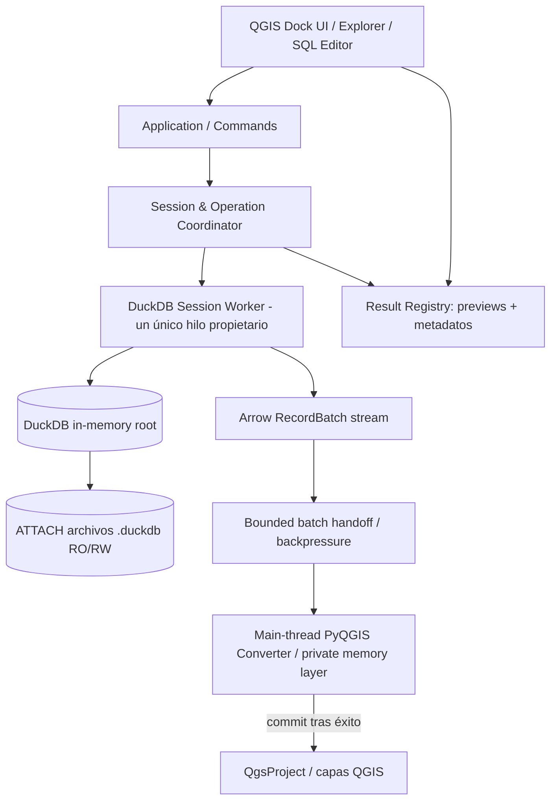
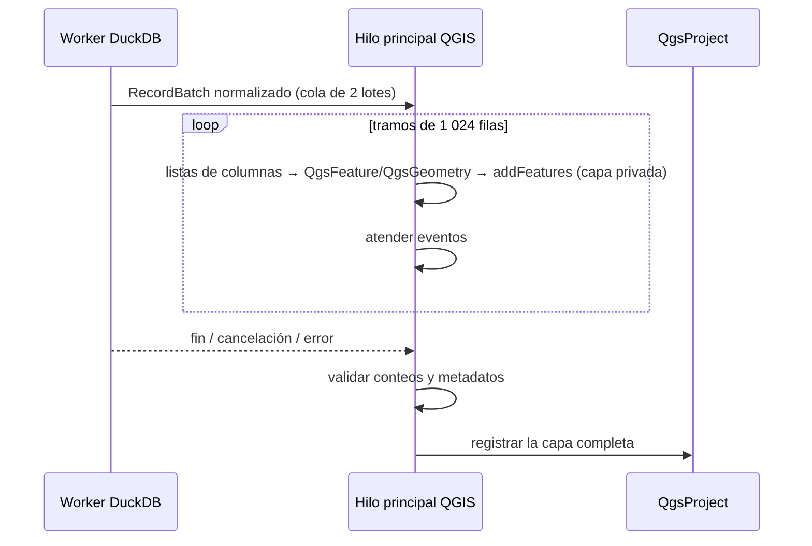

# GEODUCK — ESPECIFICACIÓN MAESTRA CONSOLIDADA

**Revisión 2026-11-01: mínimo DuckDB >= 1.5.0.** Los archivos individuales del ZIP son normativos.

## Índice de capítulos
- [01. README.md](#capitulo-1)
- [02. docs/vision.md](#capitulo-2)
- [03. docs/product-spec.md](#capitulo-3)
- [04. docs/architecture.md](#capitulo-4)
- [05. docs/technology.md](#capitulo-5)
- [06. specs/session-spec.md](#capitulo-6)
- [07. specs/sql-editor-spec.md](#capitulo-7)
- [08. specs/qgis-bridge-spec.md](#capitulo-8)
- [09. specs/spatial-spec.md](#capitulo-9)
- [10. specs/ui-ux-spec.md](#capitulo-10)
- [11. docs/security.md](#capitulo-11)
- [12. docs/compatibility-distribution.md](#capitulo-12)
- [13. qa/test-strategy.md](#capitulo-13)
- [14. qa/benchmarks.md](#capitulo-14)
- [15. docs/roadmap.md](#capitulo-15)
- [16. docs/implementation-handoff.md](#capitulo-16)
- [17. docs/references.md](#capitulo-17)


---

<a id="capitulo-1"></a>

## CAPÍTULO 01 — `README.md`

# GeoDuck — Documentation & Specification Pack

> **Estado:** Draft de arquitectura v0.1 · **Fecha base:** 2026-11-01 · **Clasificación:** especificación, no software ejecutable.
> **Roles:** propietario del producto = usuario; arquitecto y especificador = ChatGPT; implementador = Claude Code. Claude Code no modifica unilateralmente decisiones de producto ni declara estable una versión.

## Propósito
GeoDuck es una **extensión de escritorio para QGIS, en Python**, que ofrece una sesión DuckDB de primera clase, un editor SQL profesional y un camino fiable para entregar tablas, vistas y resultados SQL como **capas nativas de memoria de QGIS**. Cuando la entrega concluye, QGIS administra esas capas sin vínculo vivo con GeoDuck o DuckDB.

**Flujo canónico:** abrir extensión → iniciar `:memory:` o seleccionar un archivo `.duckdb` (RO/RW) → opcionalmente `ATTACH` otras bases → elegir tabla/vista o ejecutar SQL → seleccionar resultado y, si corresponde, geometría/CRS → **Cargar en QGIS** → entregar capa(s) independientes → QGIS administra.

## Principios no negociables
1. No inventar otro SQL: DuckDB interpreta y ejecuta sus sentencias.
2. Priorizar `DuckDBPyRelation` para consultas y el lector Arrow por lotes; usar `DuckDBPyConnection.execute()` para administración/DDL/DML/transacciones.
3. **No** mezclar «Ejecutar SQL» con «Cargar en QGIS»; el usuario decide qué resultado entregar.
4. Una sola sesión lógica, propiedad de un ejecutor serializado; `ATTACH`/`DETACH` reales, desde SQL o UI.
5. Una transferencia incompleta **nunca** se registra como capa definitiva en el proyecto QGIS.
6. No prometer carga *zero-copy*: Arrow es transporte, PyQGIS realiza la conversión final.
7. UX moderna y minimalista, compatible con las ramas QGIS 3/4 certificadas.
8. Alpha prolongada. No existe fecha prevista para v1.0.0.

## Navegación

| Documento | Función |
|---|---|
| [Visión](docs/vision.md) | Problema, experiencia y límites |
| [Contrato de producto](docs/product-spec.md) | Requisitos verificables, ID y criterios |
| [Arquitectura](docs/architecture.md) | Componentes, hilos, estado y trazabilidad |
| [Tecnologías](docs/technology.md) | Stack, versiones y criterios de adopción |
| [Sesiones](specs/session-spec.md) | Raíz en memoria, ATTACH/DETACH, permisos y fallos |
| [SQL](specs/sql-editor-spec.md) | Scripts, resultados, editor, reejecución controlada |
| [Puente QGIS](specs/qgis-bridge-spec.md) | Arrow, tipos, atomicidad, entrega |
| [Espacial](specs/spatial-spec.md) | Multi-geometría, CRS, WKB, errores |
| [UI/UX](specs/ui-ux-spec.md) | Experiencia, componentes, estados y accesibilidad |
| [Seguridad](docs/security.md) | Riesgos y límites de confianza |
| [Compatibilidad](docs/compatibility-distribution.md) | Matriz QGIS/Python/Qt y entrega Windows |
| [Calidad](qa/test-strategy.md) | Pirámide CI, criterios y pruebas de aceptación |
| [Benchmarks](qa/benchmarks.md) | Metodología, escenarios y métricas |
| [Roadmap](docs/roadmap.md) | Fases Alpha, gates y dependencias |
| [Guía a Claude Code](docs/implementation-handoff.md) | Orden de trabajo, DoD y contrato de cambios |
| [ADRs](docs/adr/README.md) | Registro de decisiones arquitectónicas |
| [Fuentes](docs/references.md) | Referencias oficiales verificables |

## Alcance v0.x
- Incluye: conexión y exploración DuckDB, SQL completo local, scripts multi-sentencia, resultados, carga de tablas sin geometría y capas geográficas en memoria, resolución de CRS, gestión explícita de conexiones, pruebas y UX.
- Excluye por ahora: proveedor dinámico DuckDB↔QGIS, sincronización de capas, servidores, URLs, dashboards, importación bidireccional QGIS→DuckDB, colaboración y servicios web. Su inclusión requiere ADR y decisión del propietario.

## Instrucciones de uso de este paquete
- Leer primero `docs/vision.md`, `docs/product-spec.md`, `docs/architecture.md`, luego las cuatro SPEC.
- Cada implementación debe referenciar los IDs `GD-*` y sus pruebas `AT-*`.
- Los archivos de este paquete **no son código implementado** ni demuestran compatibilidad en un entorno QGIS instalado.
- No fijar automáticamente versiones nuevas de dependencias sin ensayar la matriz; los ejemplos SQL son orientativos, no pruebas de runtime.


---

<a id="capitulo-2"></a>

## CAPÍTULO 02 — `docs/vision.md`

# GeoDuck — Visión y límites del producto

**Estado:** aprobado en principio · **Owner:** propietario del producto · **Fecha base:** 2026-11-01

## 1. Problema y oportunidad
El usuario de QGIS que ya usa DuckDB debería poder abrir una sesión, adjuntar archivos `.duckdb`, escribir SQL y entregar resultados como capas nativas sin exportar manualmente CSV, GeoPackage ni depender de un servidor. El valor de GeoDuck no es reinventar QGIS: es hacer que DuckDB se sienta **integrado, completo y transparente** dentro de QGIS.

## 2. Propuesta de valor
> **DuckDB procesa; GeoDuck interpreta el resultado y lo entrega; QGIS lo administra.**

GeoDuck privilegia la fidelidad semántica y la facilidad de uso por encima de interfaces cargadas de botones y promesas de rendimiento no demostradas.

## 3. Usuarios principales
- Especialista GIS que escribe SQL para análisis espacial.
- Analista de datos que dispone de tablas DuckDB, espaciales y no espaciales.
- Profesional que necesita combinar bases persistentes adjuntas y explorar sus datos dentro de QGIS.

No se necesita saber programar Python; sí son útiles conocimientos de SQL para la experiencia avanzada. Acciones de UI cubrirán los casos de selección de tabla/vista y ATTACH/DETACH.

## 4. Principios UX
1. Un panel acoplable en QGIS con explorador, editor y resultados, y diseño visual sobrio.
2. El siguiente paso evidente: abrir → consultar → entregar a QGIS.
3. Predeterminados inteligentes solo cuando no existe ambigüedad; preguntar cuando hay varias geometrías o CRS incierto.
4. Explicar los efectos de acciones sensibles, sin restringir artificialmente el SQL completo.
5. No alterar capas entregadas a QGIS, incluso tras `DETACH` o cierre de GeoDuck.
6. Mostrar límites reales: la vista previa no es el resultado completo; QGIS memory consume RAM.
7. Progreso y cancelación claros; no declarar éxito anticipado.

## 5. Frontera de propiedad
**GeoDuck es responsable** de instalación, sesión DuckDB, editor SQL, exploración, preview, selección de geometría, conversión de tipos, transferencia y validación antes de la entrega.

**QGIS es responsable**, después de una entrega exitosa, de renderizar, simbolizar, editar, guardar, exportar, eliminar y conservar las capas de memoria según sus propias reglas. Las capas no llevan conexión viva a DuckDB.

## 6. No objetivos de la Alpha inicial
No dashboards, no URLs/web, no API server, no capas DuckDB en modo vivo, no sincronización automática, no cambios en los datos fuente por editar la capa QGIS, no sustitución del administrador de capas, no soporte de QGIS 2.

## 7. Métrica de éxito
Flujo extremo a extremo reproducible; SQL de DuckDB sin dialecto inventado; `DETACH` sin residuos de GeoDuck ni pérdida de capas ya entregadas; manejo correcto de geometrías/CRS; interfaz QGIS responsiva; instalación y pruebas de compatibilidad verificadas.


---

<a id="capitulo-3"></a>

## CAPÍTULO 03 — `docs/product-spec.md`

# GeoDuck — Especificación funcional maestra (Product SPEC)

**Estado:** Draft aprobado para implementar mediante gates · **Versión del documento:** 0.1 · **Referencia:** `docs/roadmap.md`

## 1. Contrato y términos
- **Sesión:** contexto de ejecución DuckDB de GeoDuck, cuya raíz es `:memory:` y que puede tener catálogos adjuntos.
- **Base principal visible:** archivo seleccionado al iniciar; internamente se adjunta a la raíz. No confundir con la conexión física principal.
- **Resultado:** salida rastreable de una sentencia (estado o conjunto tabular).
- **Vista previa:** conjunto limitado de filas; nunca equivale por definición a la totalidad.
- **Entrega:** transferencia completa a una o más capas QGIS y registro en el proyecto *después* de validar el éxito. Modalidades (ADR-0012): **Memoria** (capa `memory`), **Instantánea** (GeoPackage en `/vsimem`) y **Conectada** (proveedor `geoduck`, lectura bajo demanda sin copia).
- **Geometría primaria:** columna espacial usada para generar una capa QGIS determinada.
- **Estado Alpha:** producto en desarrollo, aunque determinadas versiones ya sean útiles.

## 2. Requisitos funcionales y aceptación

| ID | Prioridad | Requisito | Aceptación esencial |
|---|---|---|---|
| GD-BOOT-001 | P0 | Plugin Python aparece en QGIS y abre panel | AT-BOOT-001 |
| GD-BOOT-002 | P0 | Diagnóstico de dependencias con mensajes accionables | AT-BOOT-002 |
| GD-SES-001 | P0 | Iniciar sesión raíz `:memory:` | AT-SES-001 |
| GD-SES-002 | P0 | Adjuntar archivo de inicio RO/RW | AT-SES-002 |
| GD-SES-003 | P0 | `ATTACH`/`DETACH` por UI y SQL, sincronizados | AT-SES-003 |
| GD-SES-004 | P0 | `DETACH` real libera uso propio y no afecta capas QGIS ya entregadas | AT-SES-004 |
| GD-SES-005 | P0 | `USE`, temporales, parámetros de sesión y transacciones coherentes | AT-SES-005 |
| GD-CAT-001 | P0 | Explorar catálogos, esquemas, vistas y tablas | AT-CAT-001 |
| GD-CAT-002 | P1 | Columnas de cada tabla y vista en el explorador (nombre, tipo, geometría, nulos), leídas al expandir; insertar su nombre en el editor | AT-CAT-002 |
| GD-SQL-001 | P0 | SQL nativo DuckDB completo, sujeto a privilegios reales | AT-SQL-001 |
| GD-SQL-002 | P0 | Script multi-sentencia, en orden, con estado por instrucción | AT-SQL-002 |
| GD-SQL-003 | P0 | Resultados tabulares independientes y vinculados a sentencia | AT-SQL-003 |
| GD-SQL-004 | P0 | Ejecutar actual, selección o todo | AT-SQL-004 |
| GD-SQL-005 | P0 | Preview limitado sin `fetchall()` de datasets grandes | AT-SQL-005 |
| GD-SQL-006 | P0 | No reejecutar DDL/DML al cargar capas; política de SELECT explícita | AT-SQL-006 |
| GD-SQL-007 | P1 | Autocompletado, varias pestañas de editor, historial de la sesión y «Explicar» (G6) | AT-SQL-007..010 |
| GD-SQL-008 | P1 | Formato SQL, historial guardado en disco, búsqueda y reemplazo, snippets, `EXPLAIN ANALYZE` (sin fase asignada) | — |
| GD-BRD-001 | P0 | Cargar resultado tabular como capa de memoria QGIS (modalidad Memoria) | AT-BRD-001 |
| GD-BRD-002 | P0 | Transporte Arrow por lotes con conversión explícita | AT-BRD-002 |
| GD-BRD-003 | P0 | Progreso y cancelación sin manipular QGIS desde worker | AT-BRD-003 |
| GD-BRD-004 | P0 | Sin capas publicadas parcialmente ante error/cancelación | AT-BRD-004 |
| GD-BRD-005 | P0 | Memoria e Instantánea: no gestionar ni vincular capas después de la entrega (salvo liberar `/vsimem` cuando QGIS quita la capa) | AT-BRD-005 |
| GD-BRD-006 | P0 | Instantánea: copia por GDAL a GeoPackage en `/vsimem`, editable, con CRS e integridad; desactivada con motivo si GDAL < 3.8 | AT-BRD-006 |
| GD-BRD-007 | P0 | Normalización de tipos según qgis-bridge-spec §7, común a las tres modalidades; ninguna conversión silenciosa | AT-BRD-007 |
| GD-BRD-008 | P0 | Conectada: capa de tabla, vista o resultado SQL leída bajo demanda, con pushdown de extensión, atributos, FID y columnas | AT-BRD-008 |
| GD-BRD-009 | P0 | Conectada: control de contención entre el SQL del usuario y el dibujado (prioridad, páginas acotadas, cancelación) | AT-BRD-009 |
| GD-BRD-010 | P0 | Conectada: edición atómica con detección de conflictos y escritura por lotes; QGIS nunca informa éxito si DuckDB no confirmó | AT-BRD-010 |
| GD-BRD-011 | P0 | Conectada: ATTACH/DETACH, cierre y reapertura sin errores ni bloqueos; capas no disponibles y reconectables | AT-BRD-011 |
| GD-BRD-012 | P0 | Interfaz sencilla para elegir la modalidad, con progreso y cancelación | AT-BRD-012 |
| GD-SPA-001 | P0 | Detectar ausencia, una o varias columnas espaciales | AT-SPA-001 |
| GD-SPA-002 | P0 | Preguntar columnas cuando existan varias; opción capas separadas | AT-SPA-002 |
| GD-SPA-003 | P0 | Preservar/solicitar CRS; prohibido asignar CRS inventado | AT-SPA-003 |
| GD-SPA-004 | P0 | Gestionar nulos, incompatibilidad geométrica y errores WKB | AT-SPA-004 |
| GD-UX-001 | P0 | UI minimalista QGIS 3/4 con accesibilidad | AT-UX-001, AT-UX-013 |
| GD-UX-002 | P0 | Un solo workspace con dos presentaciones: ventana propia (por defecto) y panel acoplado a QGIS (ADR-0013) | AT-UX-002, AT-UX-003 |
| GD-UX-003 | P0 | Alternar ventana ↔ panel sin perder estado, sin repetir SQL ni cargas y sin señales duplicadas | AT-UX-004, AT-UX-005, AT-UX-012, AT-UX-014 |
| GD-UX-004 | P1 | Preferencias de presentación versionadas (modo, geometría, divisores, pestañas, filtros); nunca datos ni estado de DuckDB | AT-UX-010 |
| GD-UX-005 | P0 | Explorador con búsqueda local, grupos Tablas/Vistas/Tablas temporales y acceso por base | AT-UX-006 |
| GD-UX-006 | P0 | Resultados con tipo por columna, `NULL` distinguible y «hay más»; registro filtrable Todo/OK/Error | AT-UX-007, AT-UX-009 |
| GD-UX-007 | P0 | «Cargar en QGIS ▾», barra de estado y «Ver en el mapa» en ambos modos, sin cambiar G3/G4 | AT-UX-008 |
| GD-UX-008 | P0 | Cerrar u ocultar la superficie no cierra la sesión ni invalida capas | AT-UX-011 |
| GD-I18N-001 | P1 | Interfaz con textos en inglés y traducción al español (`.ts`/`.qm`) según el idioma de QGIS (issue #68) | AT-I18N-001 |
| GD-SEC-001 | P0 | Configuración de extensiones seguras y acceso explícito | AT-SEC-001 |
| GD-CFG-001 | P1 | Persistir preferencias, SQL guardado y conexiones recientes; no capas/datos | AT-CFG-001 |
| GD-COMP-001 | P0 | Probar pares QGIS/Python/Qt/DUCKDB/PyArrow | AT-COMP-001 |
| GD-QA-001 | P0 | CI, integración QGIS y benchmarks sin métricas fabricadas | AT-QA-001 |

## 3. Reglas de proceso
### 3.1 Inicio
1. Al abrir GeoDuck se ve un formulario compacto de sesión.
2. Modo en memoria: se inicia sesión editable en `:memory:`.
3. Modo archivo: la sesión física sigue siendo en memoria y el archivo se `ATTACH` como catálogo principal visible, con RO/RW explícito.
4. Una vez iniciada la sesión, habilitar explorador y editor.
5. Si falla abrir el archivo o cargar dependencias, explicar error y permitir corregirlo sin perder el estado útil previo.

### 3.2 Consultas, scripts y resultados
- Una o varias sentencias; el parser de DuckDB define los límites; no `split(';')` ingenuo.
- Ejecución ordenada, con un registro por sentencia: ID, SQL saneado, tipo, inicio/fin, estado, error y, si corresponde, preview.
- Cuando una sentencia falla: parar el script, explicar efectos ya aplicados; no rollback implícito.
- `CREATE`, `ATTACH`, `DETACH`, DML no producen capas automáticamente.
- Una instrucción con filas (`SELECT`, `RETURNING`, etc.) puede mostrar preview; un `RETURNING` no se reejecuta al cargar.
- «Cargar resultado activo» y «Cargar seleccionados» son acciones explícitas; cada resultado, si corresponde, puede crear 0/1/N capas por geometría.
- El soporte de cargar SELECT por reejecución es consciente del estado mutable; consultar `specs/sql-editor-spec.md`.

### 3.3 Capas QGIS
- Si no hay geometría, crear una tabla sin geometría.
- Si hay una geometría, elegirla automáticamente cuando el tipo y CRS son inequívocos.
- Si hay varias, preguntar y permitir una o varias capas; no inferir que el primer campo es el correcto.
- Transformación/corrección CRS solo con consentimiento, no automática oculta.
- Solo añadir al proyecto las capas ya completas; capas temporales privadas se descartan en error.

## 4. Reglas no funcionales
- **NF-01 Integridad:** 0 filas silenciosamente perdidas, duplicadas o truncadas por la transferencia.
- **NF-02 Memoria:** procesar resultados Arrow por lotes, sin `fetchall` no acotado; QGIS memory consume RAM real.
- **NF-03 Responsividad:** no ejecutar SQL pesado ni acceder al almacenamiento durante largo tiempo desde hilo principal.
- **NF-04 Compatibilidad:** soportar matrices certificadas; no atribuir compatibilidad solo por metadatos del plugin.
- **NF-05 Seguridad:** las extensiones ejecutan código nativo y las operaciones de archivos tienen efectos reales.
- **NF-06 Observabilidad:** log técnico opt-in, sin datos sensibles ni SQL completo por defecto.
- **NF-07 Simplicidad:** sin servicio externo ni dependencia obligatoria de servidor.
- **NF-08 Recuperabilidad:** fallos de conversión/cancelación no publican capas inválidas.

## 5. Estructura de trazabilidad
Los criterios `AT-*` aparecen en `qa/test-strategy.md`. Los detalles de diseño son normativos en `specs/*` y ADR. En caso de contradicción, una decisión explícita posterior del propietario resuelve el conflicto; Claude Code solicita la aclaración mediante issue/ADR y no improvisa el contrato.

## 6. No objetivos v0.x y entrada al backlog
Dashboards, mapa por URL, servidor GeoDuck, capas dinámicas, live refresh, reverse sync QGIS→DuckDB, múltiples motores de consulta, editor visual drag-and-drop y conectores no DuckDB propios. Registrar ideas, no implementarlas por iniciativa del implementador.


---

<a id="capitulo-4"></a>

## CAPÍTULO 04 — `docs/architecture.md`

# GeoDuck — Arquitectura de referencia

**Estado:** ADR-001..ADR-004 propuestos como baseline. **Ámbito:** plugin local QGIS con un proceso y un ejecutor de sesión.

## 1. Vista de componentes



## 2. Subsistemas
**UI shell (PyQGIS/Qt):** `QDockWidget`, explorador, editor, inspector de resultados, selectors de geometría y CRS, notificaciones accesibles. Nunca contiene SQL de negocio ni accesos a DuckDB directos.

**Application layer:** comandos `StartSession`, `AttachDatabase`, `DetachDatabase`, `ExecuteScript`, `PreviewResult`, `LoadResultToQGIS`, `CancelOperation`, `CloseSession`; errores tipados y estado del flujo.

**Session Worker:** único propietario de `duckdb.DuckDBPyConnection`, creada expresamente en su hilo. Cola serial de operaciones que cambian estado o consumen lectores. No usar `duckdb.sql()` global ni `:default:`. No usar el mismo objeto `con` simultáneamente desde hilos.

**Result Registry:** guarda metadatos de sentencia, preview limitado, SQL reejecutable cuando procede, contexto y estado de disponibilidad; no contiene un resultado completo en memoria ni un lector Arrow indefinido.

**Arrow Bridge:** transfiere `RecordBatch` con control de presión y cierre garantizado del reader, tras normalizar los tipos en SQL (qgis-bridge-spec §7). Tres destinos (ADR-0012): capa memory (conversión en el hilo principal), GeoPackage en `/vsimem` (GDAL `WriteArrow` dentro de la operación del worker) y proveedor Conectado (páginas bajo demanda).

**QGIS Committer:** crea o alimenta una capa temporal no registrada, exclusivamente en hilo principal. Publica todas las capas del pedido tras validar integridad, o descarta todas en fracaso.

**Conectado (`qgis_bridge.provider`):** proveedor PyQGIS que traduce cada petición de QGIS a SQL y la envía al worker como páginas prioritarias. **Registro de capas conectadas:** sigue esas capas para marcarlas no disponibles o reconectarlas ante DETACH/ATTACH/cierre, y aplica el guardado atómico con control optimista (qgis-bridge-spec §5.4).

## 3. Máquina de estados de sesión
Estados de sesión (fuente única: `session-spec` §5): `DISCONNECTED → CONNECTING → READY ⇄ BUSY`, `READY → DETACHING → READY`, `* → CLOSING → DISCONNECTED`; `ERROR_RECOVERABLE` registra fallos de los que se puede salir reintentando, volviendo a `READY` (solo si la conexión y la transacción siguen utilizables) o cerrando. La tabla de transiciones de `session-spec` §5 es normativa. Los estados de operación y de entrega (`cancelando`, `transfiriendo`, `entrega exitosa`…) pertenecen a la máquina de operación, no a la de sesión.

- `READY`: admite operaciones nuevas.
- `BUSY`: operaciones seriales ocupan la conexión, incluidas lecturas Arrow. `DETACH` entra en cola, espera o pide cancelar la operación anterior.
- `CLOSING`: cerrar lectores, terminar/cancelar trabajos, `DETACH` de las bases que proceda, cerrar la instancia y limpiar referencias.
- Evitar cerrar prematuramente un reader: el contrato de algunas versiones de DuckDB pueden impedir consultas concurrentes mientras está abierto.
- `ERROR_RECOVERABLE`: fallo recuperable. Si la causa es la invalidación de la conexión (`SESSION_INVALIDATED`, `session-spec` §5), solo se sale hacia una sesión nueva o el cierre.

## 4. Secuencia cargar capa
1. UI escoge resultado tabular y su geometría/CRS.
2. Application valida que la consulta puede volver a ejecutarse con seguridad para ese caso; si no, ofrece explicación.
3. Worker prepara relación `con.sql(read_query)` sobre la consulta normalizada (qgis-bridge-spec §7) y abre `rel.to_arrow_reader(batch_size=config)` en `with`.
4. Worker entrega lotes sin acceso a objetos Qt/QGIS del hilo principal; cola acotada y ACK mantienen memoria predecible. En la Instantánea, GDAL escribe cada lote en `/vsimem` dentro de la misma operación.
5. Main thread valida campos, convierte cada lote y agrega a una capa **privada** de memoria (Memoria), o abre la capa GeoPackage privada (Instantánea).

La modalidad **Conectada** no copia: crea una capa con el proveedor `geoduck` y la registra; las lecturas posteriores las piden QGIS y el proveedor como páginas prioritarias del worker (qgis-bridge-spec §5).
6. Si se cancela o falla, limpiar reader y descartar capa privada; ninguna publicación.
7. Al final, cotejar recuentos, esquema y errores; registrar capa(s) en `QgsProject` y emitir éxito.
8. Desde ese momento la propiedad es exclusivamente de QGIS y la capa no retiene referencia a DuckDB.

## 5. Política de concurrencia y cancelación
- Un worker serializado para una sesión: conserva `TEMP`, `USE`, transacciones y contexto del script sin sorpresas.
- Cada operación tiene `id`, token de cancelación cooperativo y estado observable.
- Para consultas largas sin lotes, `interrupt()` se usa solo como excepción controlada y en las versiones exactas de DuckDB verificadas (ADR-0007). En las demás, la cancelación es solo cooperativa. **No asumir** cancelación inmediata ni segura sin prueba.
- Propiedad exclusiva de la conexión, cola serial y lectores Arrow con ciclo de vida explícito: ADR-0006.
- El cierre de GeoDuck o `DETACH` solicita cancelación y espera liberación ordenada; jamás se desprende una base en mitad de la transferencia activa.
- Las funciones de PyQGIS/QObject del proyecto se llaman en main thread; prohibido `QgsVectorLayer`, `QgsProject`, widgets o data providers dentro del worker.
- Backpressure obligatorio: n lotes máximo en tránsito; decidir tamaño con benchmarks.

## 6. Estructura sugerida del código a implementar

```text
geoduck/
  __init__.py
  metadata.txt
  plugin.py
  ui/
    dock.py, sql_editor.py, explorer.py, results.py, dialogs.py
  app/
    commands.py, coordinator.py, state.py, events.py
  duckdb/
    session.py, catalog.py, script_runner.py, relations.py
  bridge/
    transfer.py, arrow_adapter.py, qgis_types.py, geometry.py
  infra/
    compatibility.py, configuration.py, logging.py
  resources/
  tests/
    unit/, integration/, qgis/, perf/
```

Es una estructura orientativa: Claude Code puede simplificar carpetas **sin cambiar fronteras ni requisitos**, registrando el cambio. No crear capas abstractas sin uso real ni usar infraestructura distribuida.

## 7. Riesgos a probar antes de congelar la implementación
1. QGIS 3/4 y librería editor SQL nativa: qué bindings PyQGIS hay por Windows.
2. PyArrow/duckdb DLL y dependencias dentro de Python embebido de QGIS.
3. Devolver RecordBatch de worker a main thread sin degradar latencia/estabilidad.
4. `USE`/`DETACH` en script y revalidación de resultados previos.
5. Materialización de varios millones en `QgsVectorLayer(memory)`: consumo real de RAM.
6. QGIS 4 tipado de campos y manejo de geometrías con CRS.

## 8. Fuente de verdad
`docs/product-spec.md` y `specs/*.md` son los contratos. Esta arquitectura puede refinarse tras un spike, pero ninguna optimización puede violar el límite de responsabilidad con QGIS.


---

<a id="capitulo-5"></a>

## CAPÍTULO 05 — `docs/technology.md`

# GeoDuck — Selección tecnológica y restricciones

**Fecha base:** 2026-11-01 · **Política:** elegir tecnologías de primera línea sin incluir dependencias por moda.

| Pieza | Elección | Motivo | Riesgo/prueba |
|---|---|---|---|
| Host GIS | QGIS 3/4 Desktop | Plugin nativo y capas administradas por QGIS | Qt5/Qt6 y bindings |
| Lenguaje plugin | Python de QGIS | API PyQGIS y mantenibilidad | QGIS controla el runtime |
| UI | PyQGIS + `qgis.PyQt`, widgets Qt | Integración y diseño nativo minimalista | diferencias Qt5/Qt6 |
| SQL editor | Preferir `QgsCodeEditorSQL` si el binding existe; fallback QScintilla/Qt | evitar editor web innecesario | spike Windows QGIS3/4 |
| Motor | DuckDB Python `>=1.5.0` certificado | SQL + relaciones + Spatial | versiones de almacenamiento y DLL |
| Spatial | extensión oficial DuckDB `spatial` | geometría y funciones `ST_*` | instalación/carga y permisos |
| Transporte | PyArrow RecordBatch | lotes, tipos columnares, transferencias acotadas | conversión a QVariant y RAM |
| Geometría | WKB → `QgsGeometry` | intercambio binario estándar | CRS separado y geometría mixta |
| Testing | pytest + pruebas reales QGIS | detección temprana | runners Windows QGIS instalados |
| Calidad | ruff, mypy orientativo, CI | consistencia | imports de PyQGIS en static checks |
| Benchmarks | harness reproducible | evidencia y regresiones | hardware fijo, métricas exactas |

## Política de versiones
- Windows x64 primero.
- Certificación inicial de referencia: QGIS 4.2.x actual y QGIS 3.44.x LTR, ambas instaladas, con PyQGIS real y dependencias reales.
- QGIS 4.0.x, otras 4.x y QGIS 3 anteriores: matriz gradual; ninguna garantía genérica de «todos QGIS 3».
- QGIS 2: fuera de soporte.
- DuckDB 1.5.0 es la versión mínima soportada. DuckDB 1.5.x y 2.x se certifican por matriz de CI; las versiones nuevas se incorporan tras validación. Usar APIs comunes verificadas, sin asumir que todas las APIs de 2.x existen en 1.5.
- La compatibilidad Python depende del wheel concreto de DuckDB 1.5.x/2.x y del runtime QGIS. Verificarla con instalación real por combinación; no imponer el requisito de Python de DuckDB 2.x a la rama 1.5.
- Elegir PyArrow que publique wheel compatible con el Python/ABI/arquitectura del QGIS de destino. No asumir que `pyarrow` funciona por tener instalado un Python separado.
- Usar rango compatible más lock/constraints por combinación certificada; evitar depender de «último» sin pruebas.

## Contrato de compatibilidad DuckDB (GD-COMP-DB-001)
- **Mínimo funcional: DuckDB Python 1.5.0** (inclusive). **Soporte objetivo: 1.5.x y versiones 2.x y superiores verificadas**; «superior» no equivale a certificación automática para versiones futuras.
- **Recomendada en la rama 1.5: DuckDB 1.5.6** (decisión D5, 2026-11-01). Por debajo de 1.5.4 el diagnóstico advierte de defectos conocidos de geometría.
- Exigir pruebas funcionales idénticas en 1.5.x y 2.x para SQL multisentencia, `ATTACH/DETACH`, `spatial`, relaciones lazy, `to_arrow_reader()`, tipos Arrow y entrega de capas PyQGIS.
- Las diferencias reales de APIs, semántica de conexión, lectores Arrow, transacciones, CRS y almacenamiento deben documentarse en una **matriz de capacidades por versión**. No introducir una rama de código especial sin una prueba reproducible.
- El runtime Python de QGIS, PyArrow y las ruedas nativas DuckDB determinan qué combinaciones se pueden certificar. La aplicación mostrará mensajes claros si la combinación no es soportada.
- La lectura/escritura de archivos DuckDB creados con otras versiones se probará separadamente: **compatibilidad de API Python no garantiza compatibilidad del formato de almacenamiento**.
- La transferencia a QGIS usa la misma interfaz lógica independientemente de la versión de DuckDB, con un adaptador mínimo solamente si hace falta.

## APIs DuckDB preferidas
- `duckdb.connect(database=":memory:")` explícito y sin conexiones globales.
- `con.execute(sql)` para DDL, DML, transacciones, ATTACH/DETACH y configuración.
- `con.sql(sql)`/`con.table(name)` para consultas y relaciones.
- `relation.to_arrow_reader(batch_size=...)` + `with` como transporte de lectura.
- `con.extract_statements()` para parseo de script, con una capa que conserve SQL original/posición si la API lo soporta.
- `duckdb_databases()`, `information_schema` para introspección.
- Nunca usar `con.execute(...).to_arrow_reader()` como vía «streaming» en DuckDB 2.0: ese camino copia filas y advierte.

## Decisión PyArrow
**Mínimo de PyArrow: 18.1.0.** La versión se elige según la matriz real de QGIS, Python, NumPy y DuckDB; si QGIS incluye PyArrow, se prioriza esa y solo se instala `duckdb` (ADR-0009). El método de instalación definitivo se decide en el spike G0-A.

PyArrow **no es el backend de almacenamiento QGIS**; es el medio de transporte entre DuckDB y el convertidor PyQGIS. La copia final al proveedor `memory` está prevista. La prioridad es reducir picos de memoria, no anunciar zero-copy.

## Empaquetado
El complemento debe registrar un verificador de entorno que inspeccione Python, QGIS, Qt, architecture, `duckdb`, `pyarrow` y capacidad `spatial`. No ejecutar `pip install` silencioso dentro de QGIS; decidir el flujo de instalación Windows mediante un spike con instrucciones y paquete reproducible.

## Criterios para añadir librerías
Toda dependencia nueva requiere: necesidad no resuelta por QGIS/DuckDB, soporte a QGIS 3/4 en Windows, wheel/instalación viable, licencia compatible, mantenimiento razonable, plan de pruebas y evaluación de riesgo.


---

<a id="capitulo-6"></a>

## CAPÍTULO 06 — `specs/session-spec.md`

# SPEC GD-SES — Sesiones y bases DuckDB

**Estado:** baseline para Alpha · **IDs:** GD-SES-001..005

## 1. Semántica general
GeoDuck mantiene una **única sesión lógica** con conexión física raíz en `:memory:`. Seleccionar archivo persistente en la pantalla de inicio equivale a adjuntarlo con alias asignado a su base principal visible. El archivo se puede `DETACH` sin cerrar todo GeoDuck. La raíz en memoria no se puede `DETACH` desde la UI.

La sesión es propiedad exclusiva del Session Worker; no existe un objeto `con` compartido simultáneamente con la UI. Los objetos temporales persisten durante la sesión; al salir de ella desaparecen.

## 2. Contratos de operación
### `StartSession(mode, path?, access?)`
- `mode=memory`: usa `duckdb.connect(":memory:")`; no requiere path adicional.
- `mode=file`: crea la raíz `:memory:`, comprueba archivo/path, solicita modo `READ_ONLY` o `READ_WRITE`, luego `ATTACH '...duckdb' AS <alias> (<modo>)`.
- No se inventan archivos por defecto sin que el usuario haya pedido crearlos. Hay dos acciones explícitas: **«Abrir existente»** (el archivo debe existir; si no, `DB_NOT_FOUND`) y **«Crear nueva»** (el archivo no debe existir; nunca se sobrescribe). Ningún archivo se crea de forma implícita (decisión del 2026-11-01).
- Si falla el attach inicial, la sesión puede quedarse en memoria y el usuario recibe información explícita de qué ocurrió.

### `AttachDatabase(path, alias?, access)`
- Valida un alias único, una ruta válida y un modo explícito.
- Usa sentencias parametrizadas cuando sea posible o quoting correcto de identificadores/rutas; jamás interpolación ingenua de texto del usuario.
- Actualiza explorador después del éxito, no antes.
- Permite `ATTACH` desde SQL sin interferir: el registro de bases se reconcilia con `duckdb_databases()` después de la sentencia.
- El motor decide cuándo un mismo archivo puede o no adjuntarse simultáneamente o en modo RW por bloqueos.

### `DetachDatabase(alias)`
- Comprueba que no sea la raíz y que la base esté adjunta.
- Rechaza o encola la operación cuando hay transferencias/consultas activas; ofrece cancelar primero.
- Si el catálogo elegido es predeterminado, cambia primero al catálogo raíz identificado en introspección, no asume que se llama `memory`.
- Ejecuta `DETACH` real; verifica desaparición del catálogo; libera readers/resultados propios relacionados.
- **No modifica ni elimina capas QGIS previamente entregadas** (Memoria e Instantánea).
- Capas **Conectadas** de esa base (qgis-bridge-spec §5.5): si alguna tiene cambios sin guardar, el DETACH se rechaza con la lista de capas; si no, quedan «no disponibles» y vuelven al adjuntar de nuevo la base con el mismo alias.
- Si fracasa, informa el error y no marca la base como desconectada.
- Aun con `DETACH` exitoso no garantiza que otro proceso no mantenga bloqueos externos. Probar apertura RW desde proceso independiente.

### `ExecuteSQL("ATTACH ..." / "DETACH ...")`
- Se ejecuta a través del mismo worker serializado.
- Tras operaciones con cambios de catálogo, reconsulta estado real antes de actualizar UI.
- No convertir `DETACH` en borrado de archivo ni en cierre ficticio.

### `ListColumns(database, schema, object)` (G6 · GD-CAT-002)
- Lo pide el explorador al expandir una tabla o vista, y el autocompletado cuando necesita las columnas de un objeto. Nunca se enumeran todas las columnas de todas las bases.
- Se ejecuta en el mismo worker serializado, con `duckdb_columns()` filtrado por base, esquema y objeto; solo metadatos, nunca filas. Devuelve, en el orden de la tabla: nombre, tipo exacto tal como lo informa DuckDB y si admite `NULL`.
- La respuesta lleva el `catalog_epoch` de la petición (sql-editor-spec §2). Tras `ATTACH`/`DETACH`, DDL desde SQL o invalidación de sesión (INV-1..INV-5) las columnas guardadas se descartan, y una respuesta de un epoch anterior no se muestra.
- Si el objeto ya no existe, el error se muestra en el nodo y el catálogo se refresca; no bloquea la sesión.

### `CloseSession()`
Solo lo inicia «Cerrar sesión» o la descarga de GeoDuck. Ocultar o cerrar la ventana propia o el panel (ui-ux-spec §8) **no** es `CloseSession`: no hay `DETACH`, `ROLLBACK`, cancelación ni capas invalidadas.

- Solicitar cancelación cooperativa; cerrar los lectores; cerrar la conexión y no retener referencias.
- **Transacción abierta al cerrar** (decisión del 2026-11-01): se pregunta al usuario con tres opciones, `COMMIT`, `ROLLBACK` o **Cancelar cierre**. Cancelar no modifica la transacción y la sesión sigue abierta. Si `COMMIT` no es válido (por ejemplo, transacción abortada, `TRANSACTION_ABORTED`), la opción `COMMIT` se deshabilita.
- No borrar archivos de usuario ni capas QGIS.
- Capas **Conectadas** con cambios sin guardar: el cierre se cancela y se pide guardarlos o descartarlos. Tras el cierre, todas las capas conectadas quedan «no disponibles».

## 3. Read-only y escritura
- `READ_ONLY` protege esa base según reglas DuckDB. **No** es sandbox del proceso ni impide escribir en memoria u otros archivos permitidos.
- El SQL completo se conserva. Acciones potencialmente destructivas pueden requerir confirmación UX, pero la seguridad no dependerá exclusivamente de heurísticas de parsing.
- No pretender elevar permisos con un segundo canal de escritura a una base RO.

## 4. Transacciones
- `BEGIN`, `COMMIT`, `ROLLBACK` admitidos como SQL real.
- En DuckDB: en las versiones certificadas, una sentencia fallida dentro de transacción puede dejarla abortada hasta `ROLLBACK`; presentar recuperación clara, no hacer `COMMIT` silencioso.
- Un script ejecutado sin `BEGIN` explícito no se revierte globalmente si falla una sentencia posterior.
- La operación de carga QGIS que repite consulta debe saber si se apoya en objetos temporales o transacciones abiertas; no cambiar cursores/contextos arbitrariamente.
- Tras una cancelación o un error, la conexión solo se reutiliza si responde y su estado transaccional es conocido y utilizable; si no puede determinarse, o la transacción quedó abortada sin resolver, la sesión no vuelve a `READY` (ADR-0007). `TRANSACTION_ABORTED` se implementa en G1/G2.

## 5. Estados y errores
`DISCONNECTED`, `CONNECTING`, `READY`, `BUSY`, `DETACHING`, `CLOSING`, `ERROR_RECOVERABLE`.

Transiciones normativas:

| Desde | Puede pasar a |
|---|---|
| `DISCONNECTED` | `CONNECTING` |
| `CONNECTING` | `READY`, `ERROR_RECOVERABLE`, `CLOSING` |
| `READY` | `BUSY`, `DETACHING`, `CLOSING`, `ERROR_RECOVERABLE` (solo por invalidación) |
| `BUSY` | `READY`, `CLOSING`, `ERROR_RECOVERABLE` |
| `DETACHING` | `READY`, `ERROR_RECOVERABLE`, `CLOSING` |
| `CLOSING` | `DISCONNECTED` |
| `ERROR_RECOVERABLE` | `CONNECTING`, `READY` (solo si la conexión responde y su estado transaccional es utilizable; nunca tras una invalidación), `CLOSING`, `DISCONNECTED` |

Los estados de operación y de entrega no forman parte de esta máquina.

Mensajes operativos distinguibles: `DB_NOT_FOUND`, `DB_LOCKED`, `DB_ALIAS_CONFLICT`, `DB_READ_ONLY`, `ACTIVE_RESULT`, `DEFAULT_CATALOG`, `TRANSACTION_ABORTED`, `DETACH_FAILED`, `SESSION_INVALIDATED`.

`SESSION_INVALIDATED`: la conexión dejó de ser utilizable (no responde tras una interrupción, el hilo propietario terminó o el motor informó un error fatal). El motor lo notifica una sola vez, después de rechazar todo trabajo nuevo y de fallar el pendiente. La sesión pasa a `ERROR_RECOVERABLE` y solo puede salir hacia una sesión nueva (`CONNECTING`), `CLOSING` o `DISCONNECTED`; nunca vuelve a `READY` con la misma conexión. Ninguna operación posterior llega a DuckDB. Requisito obligatorio de G1.

## 6. Casos de prueba mínimos
- Memoria: crear/consultar tabla temporal y cerrar la sesión.
- Archivo existente en RO: lectura OK; escritura al mismo catálogo rechazada.
- Archivo RW: escritura y persistencia; bloqueos recuperados al `DETACH`.
- `ATTACH` en SQL se refleja en UI; `DETACH` en UI invalida futuras lecturas de ese alias.
- Capa ya entregada permanece funcional después de `DETACH` y del cierre del plugin.
- `USE <alias>` seguido de `DETACH <alias>`: transición correcta al catálogo raíz.
- Reader Arrow abierto: `DETACH` no se adelanta a la liberación del reader.
- Base externa bloqueada: error claro, catálogo coherente, sin estado fantasma.
- Invalidación de sesión (G1): INV-1 una sola notificación `SESSION_INVALIDATED`; INV-2 lo pendiente y la lectura Arrow en curso terminan con error, nunca con resultado ni como lectura completa; INV-3 toda operación posterior se rechaza sin llamar a DuckDB; INV-4 `ERROR_RECOVERABLE` sin retorno a `READY` y «Nueva sesión» con hilo y conexión nuevos; INV-5 el cierre pedido por el usuario no emite la notificación.


---

<a id="capitulo-7"></a>

## CAPÍTULO 07 — `specs/sql-editor-spec.md`

# SPEC GD-SQL — Editor SQL profesional y resultados

**Estado:** baseline Alpha · **IDs:** GD-SQL-001..007

## 1. Modelo UX
Un editor integrado en dock con pestañas de texto SQL, acciones **Ejecutar sentencia**, **Ejecutar selección**, **Ejecutar todo**, **Cancelar**, **Explicar**, resultados y historial. Nunca ejecuta SQL por presionar «Cargar en QGIS» sin que el usuario sepa cuál consulta se ejecutará.

El editor acepta el SQL disponible en DuckDB >=1.5 (DDL, DML, vistas, macros, transacciones, configuración, extensión Spatial, `ATTACH`, `DETACH`, consultas, `EXPLAIN`, `COPY`, `INSTALL`, `LOAD`) sujeto a permisos y funciones reales. No forzar el DSL «solo SELECT».

## 2. Parser y scripts
- Usar el parser oficial de DuckDB (`con.extract_statements`) para identificar sentencias. **No** separar con `str.split(';')`, porque hay literales, comentarios y bloques.
- Preservar texto, orden y posiciones del editor; si el parser no expone offsets, implementar mapeo verificado mediante pruebas, no heurística ingenua.
- Por defecto, ejecutar secuencialmente. Si falla una sentencia: detener el resto, presentar estado y la recuperación apropiada de transacción.
- Registrar por instrucción: `statement_id`, `run_id`, `type`, `status`, `duration_ms`, `message`, `preview_handle?`, `error_range?`, `catalog_epoch`.
- «Ejecutar selección» de múltiples sentencias respeta el orden y errores.

## 3. Tipos de salida
1. **Status:** DDL/administración o sentencia sin filas útiles; mostrar OK/error, duración y detalle seguro.
2. **Tabular read result:** `SELECT`, `WITH ... SELECT`, `VALUES`, lecturas que retornan filas; cada sentencia tiene pestaña independiente.
3. **Mutation with returned rows:** `INSERT/UPDATE/DELETE ... RETURNING` u otras salidas de escritura; ejecutar **una sola vez** y permitir inspeccionar preview; no repetir al pulsar cargar.
4. **Plan/diagnóstico:** `EXPLAIN`, avisos, tablas técnicas de resultado; visualizables, no capas automáticas.

Una sentencia no se clasifica solo por su primera palabra: `WITH` puede anteceder DML; el parser y el comportamiento del motor son la fuente de verdad.

## 4. Previsualización y paginación
- Vista previa por defecto: 200 filas; opción 50/200/500/1000; siempre visualmente etiquetada «Vista previa».
- Nunca materializar `fetchall()` en resultados sin límite conocido.
- Para lecturas reejecutables, usar una consulta acotada, respetando semántica SQL y su ordenación; si no hay `ORDER BY` no garantizar que la paginación sea estable.
- No calcular `COUNT(*)` completo automáticamente para todo SELECT.
- Cambiar de pestaña de resultados no debe mantener un reader DuckDB abierto.
- El registro conserva solo el fragmento mostrado y metadatos necesarios; no caché universal del resultado completo.
- No efectuar reejecuciones ocultas en consultas potencialmente volátiles/sensibles; indicar cuándo cambia el estado de datos.

## 5. Política de «Cargar resultado en QGIS»
- Solo se activa para resultados tabulares convertibles, seleccionados por el usuario.
- Ofrece las tres modalidades de qgis-bridge-spec §1: «Copia en memoria», «Copia rápida» (desactivada con motivo si GDAL < 3.8) y «Conectada a DuckDB». Un resultado SQL conectado es de solo lectura; editar exige cargar la tabla desde el explorador.
- Para `SELECT` reejecutable, volver a ejecutar **únicamente esa consulta de lectura** para obtener el conjunto completo mediante Arrow; comunicar que se basa en el estado actual y puede diferir de la preview.
- Si la query depende de tablas temporales eliminadas, base desadjuntada o una transacción ya cerrada, informar fallo en lugar de cargar otro resultado.
- Para consultas no deterministas o con funciones de efecto lateral, mostrar advertencia/solicitar confirmación explícita; la clasificación «SELECT» no es prueba absoluta de ausencia de efectos secundarios.
- **Nunca reejecutar** DDL/DML, el resto del script, un `RETURNING` ni los `ATTACH/DETACH` previos para obtener una capa.
- Los resultados de escritura con `RETURNING` no tienen carga del conjunto completo vía replay en V1; el usuario puede crear luego una consulta de lectura apropiada. Evitar falsa promesa de repetibilidad.
- Cada query genera 0/1/N capas según selección espacial. «Cargar todos» procesa explícitamente varios resultados y muestra estado por resultado, sin implicar transacción QGIS global entre resultados salvo que se implemente y pruebe.

## 6. Estado del SQL respecto de la sesión
- El catálogo activo (`USE`), tablas temporales, configuración, extensiones y transacciones pertenecen al worker de la sesión.
- Tras `ATTACH`/`DETACH`, `CREATE/DROP`, refrescar explorador y marcar las previews afectadas como posiblemente obsoletas; no borrarlas silenciosamente.
- Cuando cambia el SQL de origen de una pestaña, los resultados previos deben conservar `run_id` y mostrar claramente que ya no corresponden al texto actual.

## 7. Editor profesional por etapas
**P0:** resaltado, números de línea, ejecutar actual/selección/todo, stop, errores con ubicación cuando DuckDB la proporcione, pestañas resultados y registro de ejecuciones.

**P1:** autocompletado de catálogos/tablas/columnas/funciones `ST_*`, historial, múltiples pestañas de editor, búsqueda y reemplazo, snippets básicos, guardado explícito de SQL, `EXPLAIN ANALYZE`, accesos de teclado, formato SQL.

**P1 en G6 (`v0.7.0a1`, decisión del propietario 2026-11-02; GD-SQL-007):**
- **Autocompletado.** Sugiere bases, esquemas, tablas, vistas, columnas y funciones a partir del catálogo que da el worker (funciones con `duckdb_functions()`, verificado en E2 con DuckDB 1.5.0 y 2.0.0). Se abre al escribir tras un prefijo o un `.`, y con Ctrl+Espacio; no se abre dentro de comentarios ni de cadenas. Escape cierra; Intro o Tab aceptan solo con la lista abierta. Aceptar **solo inserta texto**: nunca ejecuta SQL. Los nombres que lo necesitan van entre comillas dobles, con las comillas internas duplicadas. Sin catálogo, el editor sigue funcionando sin sugerencias.
- **Pestañas de editor.** Varias pestañas en la misma sesión; cada una conserva su texto, cursor, selección y scroll, también al alternar ventana ↔ panel (AT-UX-004). Las ejecuciones actúan sobre la pestaña activa. Cerrar una pestaña con texto pide confirmación; con una ejecución en curso, no se cierra hasta que termine o se cancele. Las pestañas no se guardan entre reinicios de QGIS (GD-SQL-008).
- **Historial de la sesión.** Cada fila del registro (G5) conserva en memoria el SQL que ejecutó; «Abrir en el editor» lo copia a una pestaña nueva, **sin ejecutarlo**. No se escribe en disco (security.md §4); se pierde al cerrar la sesión.
- **«Explicar».** Ejecuta `EXPLAIN` de la sentencia actual (o de la selección, si es una sola sentencia) y muestra el plan en una pestaña de resultados. Nunca `EXPLAIN ANALYZE`. Con varias sentencias, se rechaza con un mensaje y no se ejecuta nada. Que `EXPLAIN` de una sentencia DML o DDL no la ejecuta se verifica en E3 con DuckDB 1.5.0 y 2.0.0; si no se confirma, «Explicar» se limita a consultas de lectura.

**P1 sin fase (GD-SQL-008):** formato SQL, historial guardado en disco, búsqueda y reemplazo, snippets, guardado explícito de SQL y `EXPLAIN ANALYZE`.

**P2 (evaluar):** diagnósticos en vivo, sugerencias sofisticadas y trazas de profiling; no son excusa para introducir editor web no justificado.

## 8. Ejemplos de comportamiento esperado

```sql
CREATE TABLE productos AS SELECT 1 AS id, 'Medidor' AS nombre;
SELECT * FROM productos;
SELECT COUNT(*) AS n FROM productos;
```

Salida: tres registros de ejecución, dos pestañas de datos; se pueden cargar como tablas independientes de QGIS. No se reejecuta `CREATE` al cargar.

```sql
ATTACH 'comercial.duckdb' AS comercial (READ_ONLY);
SELECT * FROM comercial.main.ventas;
DETACH comercial;
```

Tras el `DETACH`, la vista previa existente sigue visible como preview limitada, pero la carga completa del `SELECT` anterior **ya no es válida** hasta volver a adjuntar la base explícitamente; no reconectar automáticamente.


---

<a id="capitulo-8"></a>

## CAPÍTULO 08 — `specs/qgis-bridge-spec.md`

# SPEC GD-BRD — Carga de resultados y tablas DuckDB en QGIS

**Estado:** Alpha, tres modalidades (ADR-0012, 2026-11-02) · **Requisitos:** GD-BRD-001..012 ·
**Contrato principal:** GeoDuck produce; QGIS administra. La modalidad Conectada mantiene un vínculo
explícito con la sesión.

## 1. Objetivo

Llevar a QGIS el resultado **completo** de una consulta de lectura, o una tabla o vista del catálogo, con
control de errores, progreso y cancelación, en una de tres modalidades:

| Modalidad | Nombre en la interfaz | Resultado en QGIS | Vínculo con DuckDB |
|---|---|---|---|
| Memoria | «Copia en memoria» | `QgsVectorLayer(provider="memory")` | Ninguno |
| Instantánea | «Copia rápida» | GeoPackage en `/vsimem/geoduck/…` abierto con el proveedor `ogr` | Ninguno; GeoDuck libera `/vsimem` al quitar la capa |
| Conectada | «Conectada a DuckDB» | Proveedor PyQGIS `geoduck` | Sí, con la sesión y la base adjunta |

**Interfaz (G5, ui-ux-spec §8):** «Cargar en QGIS ▾» muestra las tres modalidades; elegir una abre el diálogo de carga con esa modalidad marcada. La presentación (ventana propia o panel) no cambia nada de este documento: una carga en curso sigue y entrega una sola vez aunque se alterne la presentación.

## 2. Fuente común de lectura

```python
relation = con.sql(read_sql)  # solo una consulta de lectura repetible, ya normalizada (§7)
with relation.to_arrow_reader(batch_size=batch_size) as reader:
    for batch in reader:
        ...  # entregar con contrapresión; comprobar cancelación entre lotes
```

- Sin `COUNT(*)` previo: el progreso cuenta filas recibidas; el total solo se muestra si se conoce sin
  coste extra.
- `batch_size` inicial: 8 192 filas (F-44: el tamaño de lote apenas cambia el total).
- La consulta se ejecuta al consumir la relación; DuckDB 1.5/2.x no ofrece streaming eficiente desde
  `con.execute().to_arrow_reader()`.
- Para un resultado del editor rige sql-editor-spec §5: solo se repite esa consulta de lectura, nunca
  DDL, DML, `RETURNING` ni el resto del script.

## 3. Modalidad Memoria



- Conversión en el hilo principal por tramos de 1 024 filas, atendiendo eventos entre tramos (F-44). El
  worker no crea objetos de QGIS (F-44: no acelera por el GIL).
- Fechas desde enteros (`QDateTime.fromMSecsSinceEpoch`), nunca `QDateTime(datetime)` (F-43).
- Disponible siempre: no depende de GDAL.

## 4. Modalidad Instantánea

- Dentro de la operación del worker, GDAL escribe cada lote con `OGRLayer.WriteArrow` en un GeoPackage
  nuevo en `/vsimem/geoduck/<id>.gpkg`, en una transacción de GDAL. El CRS sale del PROJJSON de GeoArrow.
- Al terminar, el hilo principal abre la capa con el proveedor `ogr` (privada) y la publica.
- Requiere GDAL ≥ 3.8 con el driver GPKG. Si no está, la opción aparece desactivada con el motivo.
- **Ciclo de vida de `/vsimem`:** GeoDuck registra cada archivo y lo libera (`gdal.Unlink`) cuando QGIS
  quita la última capa que lo usa. En error o cancelación lo libera de inmediato. Al descargar GeoDuck,
  los archivos de capas aún presentes se conservan, porque son de QGIS.

## 5. Modalidad Conectada

### 5.1 Fuente y URI

URI: `session=<id>|source=<catálogo.esquema.objeto>|sql=<consulta>|geom=<columna>|geomformat=<geometry|wkb|wkt>|family=<point|line|polygon|collection>|fid=<key|map|rowid|content>|key=<pk>|keys=<json>|type=<WkbType>`,
más los metadatos que permiten abrir la capa sin consultar la sesión (columnas y tipos, CRS, extensión,
conteo). Los valores van codificados como en una URL.

- **Tabla o vista** del explorador: `source`.
- **Resultado del editor:** `sql`, solo lectura.
- **Identificador de entidad (FID)**, como el proveedor `postgres` de QGIS (decisión del propietario,
  2026-11-02). Se elige solo; el usuario no tiene que indicar nada.

  | Fuente | FID | Edición (§5.4) |
  |---|---|---|
  | Tabla con clave primaria, o con `UNIQUE` cuyas columnas son todas `NOT NULL`, entera de una columna | `fid=key`: el valor de la clave | Sí |
  | Tabla con cualquier otra de esas claves (texto, UUID, fecha, varias columnas) | `fid=map`: número asignado en memoria a cada valor de la clave, como `PktFidMap` de QGIS | Sí |
  | Tabla sin clave | `fid=rowid`, como `ctid` en PostgreSQL | Sí |
  | Vista o consulta | `fid=content`: huella del contenido de la fila | No: DuckDB no escribe en ellas |

  Si hay varias claves candidatas, manda la primaria; si no, la `UNIQUE` de menos columnas, y entre
  iguales la entera.

  - **`rowid`:** mientras GeoDuck tiene la base adjunta en escritura, ningún otro proceso puede
    modificarla (DuckDB admite un solo proceso escritor). El `rowid` solo cambia si DuckDB compacta la
    tabla tras borrados en esta misma sesión (SQL del usuario, un guardado, un `CHECKPOINT` automático o
    el cierre). Por eso, después de cada escritura las capas Conectadas se vuelven a dibujar. Al
    guardar, cada fila se comprueba por su huella antes de escribirla: nunca se escribe en otra fila
    (§5.4).
  - **`content`:** `(hash(todas las columnas) >> 1)::BIGINT`. No depende del orden de lectura, de los
    filtros, de `CHECKPOINT` ni de cambios en otras filas (`row_number()` se descartó: depende de un orden
    que DuckDB no garantiza). Límites: filas idénticas comparten FID (QGIS no las distingue, pero se leen
    todas); cambiar una fila cambia su FID; el FID puede cambiar con otra versión de DuckDB; dos filas
    distintas con la misma huella de 63 bits son posibles pero improbables (≈ 10⁻⁶ con 5 M de filas), y
    entonces se ordenan con una segunda huella y se leen ambas.
  - **Memoria e Instantánea** no usan nada de esto: son copias, y QGIS (`memory`) o GDAL (columna `fid`
    del GeoPackage) asignan su propio identificador.
- **Tipo de geometría** (`type`): se declara o se deduce de los datos, porque DuckDB no guarda el
  subtipo (F-71). Con varias familias la capa es `Unknown`, o una capa por familia con `family=`
  (spatial-spec §6).
- **Formato de la geometría** (`geomformat`): `geometry` (tipo `GEOMETRY`, por defecto), o `wkb`/`wkt` para
  una columna `BLOB`/`VARCHAR` marcada como geometría por el usuario (spatial-spec §2.2). La lectura la
  convierte en DuckDB (`TRY(ST_GeomFromWKB(…))`, `TRY(…::GEOMETRY)`, núcleo, sin `spatial`), así que
  extensión y filtro espacial se empujan igual; al guardar se escribe de vuelta con `ST_AsWKB`/`ST_AsText`.
- **Varias geometrías:** una capa Conectada por columna marcada, cada una con su `geom` (spatial-spec §7).

### 5.2 Peticiones de QGIS → SQL

| Petición | SQL |
|---|---|
| Extensión | `st_intersects_extent(geom, <rectángulo>)` (núcleo de DuckDB ≥ 1.5); con `spatial` cargada, `ST_Intersects(geom, ST_MakeEnvelope(…))`, que usa el RTree si existe |
| FID | `FID IN (…)` sobre la clave, el `rowid` o la huella; en `fid=map`, los valores de la clave de esos FID (`(k1, k2) IN (…)`) |
| Atributos pedidos / sin geometría | solo esas columnas; sin la columna de geometría |
| Filtro de la capa (Capa → Filtrar…, `subsetString`) | Condición de DuckDB sobre los campos de la capa, aplicada a la consulta base (`WHERE (filtro)`). Se comprueba en DuckDB antes de aplicarla; si no es válida, se rechaza con el motivo y la capa no cambia. Se guarda en la URI (`subset=`) y sobrevive a la reapertura del proyecto |
| Expresión | Compilada a SQL de DuckDB cuando es posible (comparaciones, `AND`/`OR`/`NOT`, `IN`, `IS NULL`, `LIKE`/`ILIKE`, aritmética); si no, se evalúa en Python sobre lo filtrado en SQL |
| `LIMIT`, orden | `LIMIT`; `ORDER BY` cuando la petición lo pide |

Las peticiones van en **páginas** de como mucho 50 000 filas, siempre por el identificador: cada página
empieza después del último leído (`> ? ORDER BY identificador LIMIT n`; en `fid=map`, comparando la
clave entera: `(k1, k2) > (…)`). En `fid=content`, las filas idénticas comparten FID: la página empieza
en el último (`FID >= ? ORDER BY FID, segunda huella LIMIT n + k`) y salta las `k` ya entregadas. Así
ninguna fila se pierde ni se repite. No se usa `OFFSET`.
Entre páginas el worker queda libre.

### 5.3 Contención con el SQL del usuario

- Las páginas del mapa son operaciones del worker con **prioridad** sobre el trabajo en cola. No
  interrumpen la operación en curso.
- Si QGIS cancela el dibujado (`QgsFeedback`) o cierra el iterador, la página pendiente se descarta y la
  operación en curso se cancela.
- Mientras corre una consulta larga del usuario, el dibujado espera sin bloquear la interfaz de QGIS. El
  usuario puede cancelar la consulta desde el panel.

### 5.4 Edición

**Qué es editable** (decisión del propietario, 2026-11-02, como QGIS con PostGIS): toda tabla base de
una base que no es `READ_ONLY`, incluidas las `TEMP`, con o sin clave (§5.1). Las vistas y las consultas
son de solo lectura, porque DuckDB no escribe en ellas; el motivo se muestra. Las columnas que identifican
la entidad (la clave) y las que §7 convierte con pérdida no se pueden cambiar.

**Guardado atómico:** GeoDuck escucha `QgsVectorLayer.beforeCommitChanges`, lee el búfer de edición y, en
una sola operación del worker, ejecuta:

1. `BEGIN`. Si la sesión ya tiene una transacción abierta, se rechaza el guardado con aviso y QGIS
   conserva todos los cambios pendientes para guardarlos después (decisión del propietario, 2026-11-02).
2. **Localizar y comprobar:** cada fila cambiada o borrada se busca por su identificador (clave, valores
   de la clave en `fid=map`, o `rowid`) y se toma su `rowid` y su `hash(fila completa)`. Si falta, o su
   huella difiere de la registrada cuando QGIS la leyó, ROLLBACK y se informa la lista de entidades en
   conflicto. Así, si DuckDB compactó la tabla y un `rowid` pasó a otra fila, se detecta: **nunca se
   escribe en otra fila**.
3. **Validación previa** (antes de tocar DuckDB): tipo de geometría compatible con la capa (y con su
   formato: en `geomformat=wkb|wkt` se escribe de vuelta en ese formato), columnas de
   la clave sin cambios, columnas convertidas por §7 sin cambios, y valor para la clave de cada alta si
   DuckDB no lo pone.
4. **Escrituras por lotes por `rowid`** (estable dentro de la transacción) con tablas Arrow registradas en
   la operación: `UPDATE … FROM`, `DELETE … WHERE rowid IN (SELECT …)` e `INSERT … SELECT`. Altas: con
   clave entera, los ids se piden antes con `nextval` (o los indica el usuario); con otra clave, se
   escriben los valores dados, y una columna sin valor en ninguna alta toma su valor por defecto en
   DuckDB. Si hay altas sin clave entera o borrados, la capa se relee tras el `COMMIT` (los
   identificadores nuevos o movidos se leen de DuckDB).
5. `COMMIT`. Cualquier error o cancelación provoca ROLLBACK.

Después, los métodos del proveedor solo informan el veredicto. **QGIS informa éxito solo si DuckDB
confirmó**, y si no, conserva el búfer entero para corregir o reintentar. Tras un guardado se avanza la
época de datos: las previsualizaciones quedan marcadas como posiblemente obsoletas.

**Resolución de conflictos:** el usuario puede volver a leer las entidades en conflicto y reintentar, lo
que sobrescribe a sabiendas, o descartar sus cambios.

### 5.5 Ciclo de vida

| Situación | Comportamiento |
|---|---|
| DETACH de la base, o cierre de la sesión | Rechazado si una capa conectada de esa base tiene cambios sin guardar. Si no, las capas quedan **no disponibles**: vacías, con aviso y sin errores. El DETACH escrito en el editor se reconoce por el **tipo de sentencia del parser de DuckDB** y su base de destino, nunca por el texto: comentarios, cadenas y otras sentencias no se bloquean. Si se rechaza, no se ejecuta ninguna sentencia del script (decisión del propietario, 2026-11-02) |
| ATTACH de nuevo con el mismo alias | Las capas vuelven a estar disponibles y se repintan |
| Reabrir el proyecto | Disponible si la sesión tiene adjunta esa base; si no, no disponible hasta adjuntarla. Las capas sobre `:memory:` o `TEMP` no sobreviven |
| Cambios sin confirmar del usuario | Visibles en el mapa, porque es la misma conexión. El aviso llega al guardar la capa (paso 1 de §5.4); no hay indicador permanente junto a la capa (decisión del propietario, 2026-11-02) |

## 6. Hilos y estabilidad

- **Worker:** lector Arrow, normalización y escritura de GDAL (Instantánea). Nunca `QgsVectorLayer`,
  `QgsProject`, widgets ni `QObject` del hilo principal.
- **Hilo principal:** capas, `QgsFeature` (Memoria), apertura y publicación de capas, interfaz.
- **Proveedor `geoduck`:** QGIS lo llama desde sus hilos de dibujo. Solo envía operaciones al worker y
  espera su resultado; nunca toca la conexión ni objetos del proyecto.
- Contrapresión: como mucho 2 lotes en vuelo. Cancelación cooperativa y limpieza en `finally`.
- Un consumidor que falla detiene al productor, que nunca queda bloqueado (F-60).

## 7. Tabla de conversión DuckDB → QGIS (normalización común)

GeoDuck envuelve la consulta en `SELECT <expresiones> FROM (<consulta>)` según los tipos de su resultado.
Las expresiones se aplican en DuckDB, antes de Arrow:

| Entrada | Salida | Nota |
|---|---|---|
| `BOOLEAN`, `TINYINT`..`BIGINT`, `UTINYINT`..`UINTEGER` | igual | `UINTEGER` → `BIGINT` |
| `UBIGINT`, `HUGEINT`, `UHUGEINT` | `VARCHAR` canónico | sin pérdida (F-47) |
| `FLOAT`, `DOUBLE` | igual | `NaN`/`Inf` se conservan |
| `DECIMAL(p,s)` con p ≤ 15 | `DOUBLE` | exacto en doble precisión |
| `DECIMAL(p,s)` con p > 15 | `VARCHAR` | sin pérdida |
| `VARCHAR`, `UUID`, `ENUM` | `VARCHAR` | el ENUM conserva su etiqueta (F-47) |
| `DATE` | `DATE` | |
| `TIMESTAMP`, `TIMESTAMP_S/MS/NS` | `TIMESTAMP` (µs) | `TIMESTAMP_NS` pierde sub-µs: se avisa |
| `TIMESTAMPTZ` | `TIMESTAMPTZ` en UTC | se documenta la zona |
| `TIME`, `TIMETZ`, `INTERVAL` | `VARCHAR` ISO | no se inventa fecha (F-47) |
| `BLOB`, `BIT` | igual / `VARCHAR` | un BLOB no es geometría salvo que el usuario lo marque (spatial-spec §2.2) |
| `LIST`, `STRUCT`, `MAP`, `UNION`, `ARRAY` | `VARCHAR` JSON | se avisa la pérdida de estructura |
| Geometría primaria | `geoarrow.wkb` + CRS | ADR-0008 |
| Geometrías no elegidas | se excluyen de los atributos | se avisa; el usuario puede marcarlas para crear sus capas (spatial-spec §7) |
| `NULL` | `NULL` real de QGIS | nunca `"None"` |

La Conectada aplica la misma tabla en la lectura. En la escritura convierte de vuelta solo los tipos que
puede escribir sin pérdida; los campos convertidos a texto son de solo lectura. Toda advertencia de tipo
se muestra antes de publicar la capa.

## 8. Atomicidad e integridad

- Una carga Memoria o Instantánea **no se registra** si alguna fila falla. Mientras se transfiere, la
  capa es privada: no está en `QgsProject`. Si una selección crea varias capas, se registran todas o
  ninguna.
- En cancelación, error u OOM: cerrar el lector, descartar las capas privadas, liberar `/vsimem` y
  registrar el error sin datos sensibles.
- Comprobación de conteos:
  - Memoria e Instantánea: `rows_read == rows_written == layer.featureCount()`;
  - Conectada: lo que el proveedor devuelve sale de DuckDB, y cada página informa su número de filas.
- La atomicidad es sobre la **publicación** (Memoria, Instantánea) y sobre el **guardado** (Conectada).

## 9. IDs, orden y atributos

- **Memoria e Instantánea:** FID nativo de la capa; la columna de id del usuario queda como atributo.
- **Conectada:** FID según §5.1 (`key`, `map`, `rowid` o `content`).
- Un SQL sin `ORDER BY` no garantiza el orden; no se usa para identidad.
- El nombre lo decide el usuario. Por defecto es el título del resultado o el nombre del objeto, con el
  sufijo de la geometría si hay varias.

## 10. Límite de responsabilidad

- **Memoria e Instantánea:** tras `addMapLayer` y la notificación, GeoDuck no refresca la capa ni la
  borra al hacer DETACH; QGIS asume el control. La única excepción es liberar el archivo `/vsimem`
  cuando QGIS quita la capa. Ambas se pierden si el usuario no las guarda según las reglas de QGIS.
- **Conectada:** GeoDuck mantiene el vínculo descrito en §5.5 mientras la capa exista.


---

<a id="capitulo-9"></a>

## CAPÍTULO 09 — `specs/spatial-spec.md`

# SPEC GD-SPA — Geometría, CRS y selección multi-geometría

**Estado:** Alpha · G4 Spatial Confidence (decisiones del propietario, 2026-11-02) · **IDs:** GD-SPA-001..004

## 1. Meta
Una tabla, vista o consulta puede contener cero, una o múltiples columnas geoespaciales. GeoDuck debe decidir con el usuario la(s) geometría(s) de cada capa, preservar los valores, asignar CRS solo cuando esté fundamentado y entregar capas nativas QGIS completas, en las tres modalidades de qgis-bridge-spec (Memoria, Instantánea y Conectada).

**Principio de G4:** ninguna pérdida silenciosa. Lo que no se puede representar se bloquea o se avisa con nombre de columna, motivo y número de filas afectadas.

## 2. Detección (GD-SPA-001)
1. Inspeccionar esquema tipado de relación/consulta y catálogos, buscando `GEOMETRY` y tipos espaciales DuckDB 1.5+/2.x compatibles, incluidos tipos especializados cuando se soporten.
2. **Columnas `BLOB` (WKB) y `VARCHAR` (WKT)** solo son geometría si el usuario lo indica en el diálogo de carga («Usar como geometría: WKB» o «WKT»). GeoDuck **no infiere** por nombre (`geom`, `wkt`…), por los primeros bytes ni por el contenido, y **no modifica el origen**: la conversión ocurre al leer. Su CRS es desconocido (§4): el usuario elige uno o continúa sin CRS. Un valor que no se puede leer como WKB/WKT es una geometría ilegible (§9).
3. En `GEOMETRY` genérico, el tipo de capa se deduce de los valores leídos (DuckDB no guarda el subtipo, F-71); en la modalidad Conectada, sin recorrer toda la fuente al abrir (§6).
4. Distinguir `NULL`, `EMPTY`, `POINT`/`MULTIPOINT`, `LINESTRING`/`MULTILINESTRING`, `POLYGON`/`MULTIPOLYGON`, `GEOMETRYCOLLECTION`, y las dimensiones Z, M y ZM.

## 3. Selección
| Situación | Acción |
|---|---|
| 0 geometrías | entregar tabla QGIS sin geometría; el diálogo ofrece marcar columnas `BLOB`/`VARCHAR` como geometría (§2.2) |
| 1 geometría con tipo + CRS inequívocos | seleccionarla automáticamente |
| 2+ geometrías | selector múltiple: el usuario marca una o varias columnas; **una capa por columna marcada** (§7) |
| CRS ausente/ambiguo | pedir elección explícita o marcar como desconocido, sin inventar EPSG (§4) |
| mezcla de familias | según la modalidad (§6); nunca truncar ni descartar geometrías en silencio |
| geometría ilegible (WKB/WKT de una columna marcada) | Memoria e Instantánea: la carga falla sin publicar nada e indica columna y fila; Conectada: la entidad se muestra sin geometría y se cuenta en el aviso de la capa (§9) |
| geometría `NULL` | feature con geometría vacía, conforme al contrato de campos |

Las columnas espaciales no elegidas para una capa no se pierden en DuckDB y **se excluyen de sus atributos**, con un aviso que las nombra; el usuario puede marcarlas para crear sus propias capas.

## 4. CRS en DuckDB 1.5+ (GD-SPA-003)
DuckDB 1.5+ permite tipos de geometría parametrizados con identificadores CRS, p.ej. `GEOMETRY('OGC:CRS84')`, y funciones `ST_CRS`, `ST_SetCRS`; el módulo `spatial` aporta transformaciones y catálogos CRS. Por ello GeoDuck **sí debe inspeccionar metadatos CRS cuando estén disponibles**. Una columna `GEOMETRY` sin CRS declarado no autoriza deducir EPSG:4326.

Orden de preferencia:
1. CRS explícitamente asociado al tipo de geometría/resultset (documentado y compatible).
2. Metadatos de origen confiables y trazables, si existen, y no contradicen el resultado SQL.
3. Selección explícita del usuario.
4. Mantener CRS desconocido con advertencia clara si el usuario decide continuar.

En G4 la única fuente del punto 1 es el tipo de la columna, que llega como PROJJSON en GeoArrow (§5); no hay una segunda declaración con la que pueda entrar en conflicto. Columnas `BLOB`/`VARCHAR` marcadas como geometría no traen CRS: puntos 3 y 4.

`ST_SetCRS` etiqueta un CRS; **no transforma** coordenadas. Una reproyección real requiere `ST_Transform` u operación equivalente y una decisión explícita del usuario. Nunca realizar una transformación oculta.

**Orden de ejes.** GeoDuck entrega a QGIS las coordenadas del WKB tal como las produce DuckDB, sin reordenarlas; QGIS interpreta x como este/longitud también en CRS geográficos como EPSG:4326. GeoDuck no fija el ajuste `geometry_always_xy` de la extensión `spatial` (en DuckDB 2.0 no tiene valor por defecto y `ST_Transform` exige declararlo; en 2.1 pasará a `true`). Cuando `spatial` está cargada, GeoDuck muestra su valor efectivo en el diagnóstico y en los resultados espaciales cuando corresponda. Toda transformación iniciada por GeoDuck declara el orden de ejes en la propia llamada. Geometrías producidas en el orden de la autoridad (por ejemplo, latitud-longitud) se entregan tal cual y son responsabilidad del SQL del usuario. GeoDuck no intenta adivinar ejes invertidos a partir de los rangos de coordenadas.

**CRS ausente o desconocido.** Si DuckDB no declara CRS, o declara uno que QGIS no reconoce, GeoDuck no lo sustituye por otro (ni EPSG:4326 ni el CRS del proyecto), no publica la capa sin una decisión del usuario (puntos 3 y 4 anteriores), conserva el texto declarado en el mensaje y el registro, y nunca modifica las coordenadas. Elegir un CRS lo etiqueta; no transforma.

**Reproyección (decisión del propietario, 2026-11-02).** La reproyección es de QGIS/PROJ:
- **Memoria e Instantánea:** opción «Reproyectar a…» en el diálogo de carga, desactivada por defecto y solo disponible cuando la capa tiene CRS (declarado o elegido). GeoDuck transforma cada geometría con `QgsCoordinateTransform` (contexto de transformación del proyecto) al copiarla; la capa resultante lleva el CRS de destino y el mensaje de carga indica «reproyectada de A a B». Si una geometría no se puede transformar, la carga falla sin publicar nada e indica la fila. No usa `ST_Transform` ni necesita `spatial`.
- **Conectada:** no transforma; QGIS reproyecta al vuelo en el mapa, como con cualquier proveedor.
- El SQL del usuario puede usar `ST_Transform` (con `spatial` cargada por él): su resultado se entrega tal cual (AX-1c, AX-3).

## 5. Transporte WKB
Seleccionada una columna, leer la relación de lectura con `to_arrow_reader()`: DuckDB exporta cada columna `GEOMETRY` como `geoarrow.wkb`, con el CRS en PROJJSON en los metadatos del campo (ADR-0008). Esos metadatos son la fuente del tipo y del CRS (§4); no se impone `ST_AsWKB` (descarta el CRS) ni se añaden extensiones o paquetes adicionales. `ST_AsWKB` queda solo como alternativa explícita para tipos que DuckDB no exporte como GeoArrow. Convertir a `QgsGeometry.fromWkb` en main thread. Evitar serializar geometrías completas en WKT como camino principal por coste y precisión.

Columnas marcadas como geometría (§2.2): la consulta de lectura las convierte en DuckDB con funciones del núcleo, sin `spatial` (spike G4-A, DuckDB 1.5.0–2.0.0): `TRY(ST_GeomFromWKB(col))` para `BLOB` y `TRY(col::GEOMETRY)` para `VARCHAR`. A partir de ahí siguen el mismo camino que una columna `GEOMETRY` en las tres modalidades. Un valor no nulo cuya conversión da `NULL` es **ilegible** (§3, §9) y se detecta en la propia consulta.

La generación de la proyección SQL debe citar campos correctamente y preservar semántica de la consulta original; no modificar SQL de usuario en el editor. Se necesita test de tipos especializados y funciones concretas en DuckDB 2.0.

## 6. Geometrías mixtas y dimensiones (GD-SPA-004)
Una **familia** es punto, línea o polígono; `X` y `MultiX` son la misma familia. `GEOMETRYCOLLECTION` es una familia propia.

| Modalidad | Una sola familia | Varias familias |
|---|---|---|
| Memoria | capa `X` o `MultiX` (si alguna es múltiple) | opción del diálogo «Tipos mixtos: una capa por tipo», activada por defecto: una capa por familia (una vacía, p. ej. `POINT EMPTY`, queda en la suya), más una «sin geometría» si hay `NULL`; con una sola familia, las `NULL` quedan en su capa. Desactivada: la carga falla sin publicar nada y nombra los tipos encontrados |
| Instantánea | igual que Memoria | igual que Memoria (GDAL ya separa por tipo, G3) |
| Conectada | capa del tipo deducido | por defecto una capa `Unknown` con todas las filas (simbología por tipo no disponible, avisado). Opción «Separar por tipo»: una capa Conectada por familia, cada una con el filtro de su familia empujado a DuckDB; las filas `NULL` no entran en ninguna y se avisa su número |

- **Detección del tipo (Conectada):** al abrir, DuckDB lee solo la cabecera WKB de cada geometría (`DISTINCT` del código de tipo, sin pasar datos a Python: 0,1–0,2 s por millón de filas, F-93), como ya hacía G3. No se usa una muestra: un tipo que no apareciera en ella quedaría en una capa de otro tipo y QGIS no lo dibujaría (pérdida silenciosa). Una separación por tipo nunca pierde filas: cada familia presente tiene su capa y las `NULL` se avisan con su número.
- **Filtro de familia sin `spatial`:** se lee el código de tipo ISO de la cabecera de `ST_AsWKB` (núcleo de DuckDB 1.5+, siempre little-endian; spike G4-A: 100–180 ms por millón de filas).
- **Dimensiones Z/M:** se conservan. El tipo de la capa incluye toda dimensión presente en sus geometrías; las geometrías sin ella la reciben con valor `NaN`, con aviso. El proveedor `memory` acepta en silencio una geometría Z en una capa 2D y la perdería al exportar (spike G4-A, QGIS 3.34 y 4.2): por eso GeoDuck decide el tipo explícitamente y nunca deja una capa con dimensiones distintas de las de sus geometrías.
- **Edición:** en una capa de tipo fijo QGIS no admite geometrías de otra familia; en la capa `Unknown` cualquier familia es válida. No hay movimiento de entidades entre capas al editar.

## 7. Múltiples geometrías (GD-SPA-002)
Consulta ejemplo:
```sql
SELECT id, ST_Centroid(geom) AS centro, geom AS poligono
FROM zonas;
```
El panel detecta `centro` y `poligono` y permite marcar una o ambas. Por cada columna marcada GeoDuck crea una capa independiente, con su propio CRS y tipo y los mismos atributos no geométricos, en la modalidad elegida (Memoria, Instantánea o Conectada; decisión del propietario, 2026-11-02, que sustituye «las dos capas no mantienen conexión a DuckDB»).

- **Nombres:** `<nombre> · <columna>` cuando se marca más de una; únicos en el proyecto.
- **Entrega atómica:** las capas se publican juntas al terminar; un error o una cancelación no publica ninguna.
- **Conectada:** cada capa es un proveedor `geoduck` con su `geom=<columna>`; la extensión, el filtro espacial y la edición usan solo su columna.

## 8. Pruebas geoespaciales obligatorias
- Point, Line, Polygon, Multi*, nulos/vacías, Z, M, ZM, `GEOMETRYCOLLECTION`, geometría inválida.
- Dos columnas geométricas con familias y CRS diferentes y selección de una y de ambas, en las tres modalidades.
- Columnas `BLOB` (WKB) y `VARCHAR` (WKT) marcadas como geometría, con valores ilegibles; sin marcar no son geometría.
- CRS tipado DuckDB 1.5+/2.x y CRS desconocido; CRS de distinto eje y reproyección explícita en Memoria e Instantánea.
- Filas con tipos mixtos en una columna: no se descartan silenciosamente.
- WKB con datos corruptos, `GEOMETRYCOLLECTION` y BLOB no geométrico.
- Consultas que generan geometría (`ST_Centroid`, `ST_Buffer`) sin columna espacial original.
- Orden de ejes y CRS. Punto de referencia `POINT(-68.15 -16.5)`; tolerancia 1e-9 en grados y 0,01 m en metros; cada prueba verifica coordenadas **y** CRS:

| ID | Caso | CRS esperado en QGIS | Coordenadas esperadas | Además |
|---|---|---|---|---|
| AX-1a | `GEOMETRY('OGC:CRS84')` | válido, `OGC:CRS84` | x = −68,15, y = −16,5 | QGIS → EPSG:32719 = `590716.04, 8175564.99` |
| AX-1b | `EPSG:4326` con `spatial` | válido, `EPSG:4326` | x = −68,15, y = −16,5 aunque `hasAxisInverted()` sea verdadero | QGIS → EPSG:32719 = `590716.04, 8175564.99` |
| AX-1c | `ST_Transform(GEOMETRY('EPSG:4326'), 'EPSG:32719', true)` | válido, `EPSG:32719` | `590716.04, 8175564.99` | igual a AX-1a/b transformado por QGIS. Con la forma de cuatro argumentos `ST_Transform(g, 'EPSG:4326', 'EPSG:32719', true)` DuckDB 2.0 no declara CRS en el resultado (F-99): la capa queda sin CRS asignado, con las mismas coordenadas |
| AX-2 | `geometry_always_xy` en `true`, `false` y sin fijar | — | — | valor mostrado en el diagnóstico y en un resultado con geometría = `duckdb_settings()`; GeoDuck no lo modifica |
| AX-3 | `ST_Transform` sin orden declarado, DuckDB 2.0, ajuste sin fijar | sin capa | — | error SQL del usuario; sin reintentos ni ajustes automáticos |
| AX-4a | sin CRS declarado | no válido; no se asigna ninguno | x = −68,15, y = −16,5 | no se publica sin decisión del usuario; advertencia visible |
| AX-4b | CRS desconocido para QGIS (`FOO:123`) | no válido; no se sustituye | x = −68,15, y = −16,5 | el mensaje muestra `FOO:123` |
| AX-4c | CRS desconocido y el usuario elige `EPSG:4326` | válido, `EPSG:4326` | x = −68,15, y = −16,5 | elegir etiqueta; no transforma |
| AX-5 | «Reproyectar a EPSG:32719» desde `OGC:CRS84`, Memoria e Instantánea | válido, `EPSG:32719` | `590716.04, 8175564.99` | el origen en DuckDB no cambia; el mensaje indica la reproyección |

## 9. Validez y reparación (GD-SPA-004; decisión del propietario, 2026-11-02)
**Estados distintos**, que se cuentan por separado: `NULL`, vacía, **ilegible** (WKB/WKT que no se puede leer, solo posible en columnas marcadas §2.2: DuckDB no admite `GEOMETRY` corrupta), **inválida** (legible pero topológicamente inválida según GEOS) y válida.

- **Diagnóstico bajo demanda:** menú contextual de una capa cargada por GeoDuck → «Diagnosticar geometrías…». Recorre la capa con QGIS/GEOS (`QgsGeometry.isGeosValid`, sin `spatial`) en una tarea cancelable, sin modificar la capa ni el origen. Informa total examinado, válidas, inválidas (con el motivo de GEOS de las primeras), vacías, `NULL` e ilegibles, y **selecciona en la capa** las entidades inválidas e ilegibles.
- **Reparación explícita:** desde el resultado del diagnóstico, «Reparar en una copia…» con confirmación. Crea una capa nueva en memoria `<capa> (reparada)` con `QgsGeometry.makeValid()`; la capa original y el origen en DuckDB no cambian. El mensaje informa cuántas geometrías cambiaron de tipo, de dimensión o de número de partes, y cuántas no se pudieron reparar (quedan sin geometría en la copia y se nombran). No se promete preservación geométrica exacta.
- **Cancelación o error:** no publica la copia ni deja recursos abiertos.

## 10. Extensión `spatial` (ADR-0011, security.md §2)
Ninguna función de G4 requiere `spatial`: CRS (GeoArrow/PROJJSON), filtro espacial (`ST_Intersects_Extent`), cabecera WKB (`ST_AsWKB`), reproyección (QGIS/PROJ), validez y reparación (QGIS/GEOS) y lectura WKB/WKT (QGIS) funcionan sin ella. Con `spatial` ya cargada, la extensión de una capa Conectada se calcula con `ST_Extent_Agg` (G3).

GeoDuck nunca ejecuta `INSTALL` ni `LOAD` por su cuenta. `LOAD`/`INSTALL` escritos por el usuario en el editor son su SQL y se ejecutan como tal; valen solo para esa sesión. «Diagnóstico del entorno…» muestra si `spatial` está instalada y cargada. (Decisión del propietario, 2026-11-02, en G5: se retira la acción «Activar spatial…» de G4/E2; quien necesita `spatial` escribe SQL con `ST_*` y la carga con su propio SQL.)


---

<a id="capitulo-10"></a>

## CAPÍTULO 10 — `specs/ui-ux-spec.md`

# SPEC GD-UX — Interfaz moderna, minimalista y profesional

**Estado:** baseline Alpha · **ID:** GD-UX-001

## 1. Filosofía
Una sola superficie coherente dentro de QGIS: **explorar, escribir, consultar y entregar**. UI nativa Qt, respetando tema claro/oscuro de QGIS, tipografía de sistema, espaciado generoso, controles discretos, íconos consistentes y estados visibles. No introducir landing pages, dashboards ni animaciones innecesarias.

## 2. Disposición del dock
```text
┌─ GeoDuck ────────────── [Sesión: memoria | Archivo RO/RW] [Estado] ──┐
│ Explorador de catálogos │ Editor SQL [tab 1] [tab 2]                 │
│   ▶ memory             │ [Ejecutar] [Actual] [Selección] [Todo]    │
│   ▼ comercial (RO)     │ SELECT ...                                 │
│     esquemas           │                                            │
│       tablas/vistas    ├────────────────────────────────────────────┤
│   + Adjuntar / Detach  │ Resultados [#1] [#2] [Ejecuciones]         │
│                       │ Preview paginado / error / plan            │
│                       │ [Cargar activo en QGIS] [Cargar elegidos]   │
└───────────────────────┴────────────────────────────────────────────┘
```

El explorador puede colapsarse; el área del editor y resultados tiene divisores ajustables. El dock es redimensionable, con estados vacíos informativos.

## 3. Interacciones definidas
- **Inicio:** tarjeta discreta «En memoria» / «Archivo DuckDB», selector de archivo, toggle «Solo lectura / Lectura y escritura», botón «Iniciar sesión». La UI se desbloquea al confirmar la sesión.
- **ATTACH:** icono `+` al lado de catálogos; diálogo path, alias, RO/RW; feedback al finalizar.
- **DETACH:** menú contextual «Desadjuntar» con confirmación si hay operaciones propias activas. No mostrar advertencia falsa de que se perderán capas QGIS ya entregadas. Si hay capas conectadas a esa base, avisar de que quedarán no disponibles hasta adjuntarla de nuevo.
- **Tabla/Vista:** doble clic o clic derecho «Cargar en QGIS…» con las tres modalidades y selector espacial si aplica. Toda tabla cargada como Conectada es editable; vistas y consultas, de solo lectura (qgis-bridge-spec §5.1).
- **Modalidad de carga:** un solo diálogo pequeño con tres opciones y una línea de ayuda cada una: «Copia en memoria — compatible, para resultados pequeños», «Copia rápida — rápida y con poca memoria», «Conectada a DuckDB — sin copiar, siempre al día». Recuerda la última elección. Las opciones no disponibles se muestran desactivadas con el motivo. Sin términos técnicos (`/vsimem`, GeoArrow, proveedor).
- **SQL:** botón principal «Ejecutar» opera sobre sentencia actual si no hay selección, o selección según preferencia explícita; comandos «Todo» y «Selección» inequívocos.
- **Resultados:** pestañas por sentencia con nombre legible y ID; cambiar pestaña selecciona solo ese resultado. `Cargar en QGIS` siempre etiqueta el resultado objetivo.
- **Múltiples geometrías:** selector pequeño con una casilla por columna, nombre/tipo/CRS; permitir una o varias (una capa por columna). No modal por cada consulta cuando no hay ambigüedad.
- **Opciones espaciales del diálogo de carga (G4, spatial-spec):** «Usar como geometría: WKB/WKT» para columnas `BLOB`/`VARCHAR` (nunca marcadas por defecto); «Tipos mixtos: una capa por tipo» (Memoria e Instantánea, activada) o «Separar por tipo» (Conectada, desactivada); «Reproyectar a…» (solo Memoria e Instantánea, desactivada, con CRS conocido).
- **Capa cargada por GeoDuck:** menú contextual «Diagnosticar geometrías…»; el resultado ofrece «Reparar en una copia…» (spatial-spec §9).
- **Sesión:** sin acción para `spatial`; `LOAD`/`INSTALL` los escribe el usuario en el editor (spatial-spec §10).
- **Progreso:** nombre operación, estado, filas procesadas, tiempo, cancelar; sin porcentaje inventado cuando no existe total.
- **Errores:** título comprensible, detalle expandible, acción de recuperación; conservar SQL para corregirlo.

## 4. Diseño visual
- Diseño monocromático por defecto con un acento derivado del tema QGIS; estados semanticamente accesibles (éxito/advertencia/error).
- Controles con alturas y espacios coherentes; evitar iconos sin texto o tooltip.
- Autocompletado contextual no intrusivo; errores de SQL resaltados sin cubrir código.
- Pestañas cerrables, atajos conocidos (Ctrl+Enter ejecutar actual, Ctrl+Shift+Enter ejecutar todo, Esc cancelar donde sea seguro), configurables. **F5 no se usa** (en QGIS refresca el mapa); los atajos actúan solo con el foco dentro de GeoDuck (decisión del propietario, 2026-11-02).
- UI responsive dentro del dock; no usar tamaños fijos que hagan inutilizable un panel estrecho.

## 5. Accesibilidad e internacionalización
- Teclado completo, foco visible, etiquetado accesible, contraste, tooltips y lectores de pantalla cuando Qt lo permita.
- Español inicial; internacionalización por catálogos de traducción con idioma inglés listo para incorporar. **Desde G6 (GD-I18N-001, issue #68):** los textos del código están en inglés y el español llega por la traducción (`i18n/geoduck_es.ts` → `.qm`), según el idioma de QGIS, sin opción propia de GeoDuck ni cambio del idioma de QGIS. Sin traducción, se ve el texto en inglés, nunca un texto vacío. No se traducen el SQL, los nombres de objetos, los datos ni los mensajes de DuckDB. Se mantienen los términos de QGIS en cada idioma (SRC/CRS, entidades/features).
- Formatos numéricos locales en UI sin alterar sintaxis SQL ni precisión interna.

## 6. Estados obligatorios
`sin sesión`, `conectando`, `listo`, `ejecutando`, `preview disponible`, `resolución espacial`, `transfiriendo`, `cancelando`, `entrega exitosa`, `fallo recuperable`.

Para «entrega exitosa», no mostrar «capa lista» hasta que el proyecto QGIS haya registrado capas íntegras. Cuando se desadjunta una base, el explorador se actualiza; las capas entregadas no aparecen como «desconectadas» porque son independientes.

## 7. UX QA
Prueba de tareas guiadas con persona no programadora: adjuntar base, abrir tabla, cargar punto, desadjuntar y constatar que capa sigue visible. Prueba SQL avanzada: crear temporal, múltiples SELECT, alternar resultados, cargar sólo uno. Probar UI en Qt5 y Qt6 con distintos tamaños DPI.

## 8. Workspace UX (G5 · `v0.6.0a1`; ADR-0013; issue #49; decisiones del propietario, 2026-11-02)
Un solo workspace (`WorkspaceController` + `WorkspaceContent`: explorador, editor, resultados, registro y estado) con **dos presentaciones**: ventana propia (`QMainWindow`, **por defecto**) y panel acoplado (`QDockWidget`). El diagrama de §2 describe el panel; la maqueta aprobada en issue #49 es la referencia visual de ambas.

**Ventana propia.** Barra de sesión (estado, versión de DuckDB, «Acoplar a QGIS»); explorador lateral redimensionable, con «Iniciar sesión» / «Cerrar sesión» al pie; editor y resultados con divisor; registro inferior colapsable con filtros Todo/OK/Error; barra de estado (tarea, última carga con modalidad y origen, «Ver en el mapa», «Diagnóstico del entorno…», «Acerca de…», versión). Es **hija de la ventana principal de QGIS**: queda encima de QGIS, se minimiza con él y no tiene entrada propia en la barra de tareas. La **X la oculta**; el botón de GeoDuck de la barra de herramientas la vuelve a mostrar.

**Panel acoplado.** Barra de título propia («GeoDuck», «Abrir en ventana», X que oculta el panel) y estado de sesión; pestañas Explorador / SQL / Registro (con contador de errores); en SQL, editor y resultados en vertical con divisor; «Cargar en QGIS ▾» visible; mensaje de la última carga compacto con el detalle accesible. En un panel estrecho se compactan etiquetas, nunca se quitan acciones.

**Alternancia.** Es una operación de presentación: el contenido cambia de contenedor en el hilo GUI conservando su identidad y conexiones; nunca se repite SQL ni una carga, no se cancela nada y no hay `COMMIT`, `ROLLBACK` ni `DETACH`. Si el traslado falla, el shell de origen sigue operativo y se informa.

**Ubicación de las acciones existentes.**
- «+» del explorador: «Abrir existente…» y «Crear nueva…»; botón de actualizar el catálogo.
- Menú contextual de una base: «Desadjuntar» (con las protecciones de G3).
- Pie de «Bases de datos»: «Iniciar sesión» sin sesión activa y «Cerrar sesión» con ella (decisión del propietario, 2026-11-02). La ayuda «Doble clic o clic derecho → Cargar en QGIS…» va en cada tabla y vista del árbol.
- Barra de sesión: «Revertir transacción» solo con la transacción abortada.
- No hay acción «Activar spatial…» (decisión del propietario, 2026-11-02): el usuario escribe `INSTALL spatial; LOAD spatial;` en el editor, como en cualquier cliente de DuckDB (spatial-spec §10).
- Identidad visual: paleta corporativa, forma y tipografía de `docs/g5/maqueta/inventario.md` §0, aplicadas solo a los widgets de GeoDuck (ADR-0011).
- Capas de GeoDuck: «Diagnosticar geometrías…» en el menú de capa de QGIS (sin cambios).

**«Cargar en QGIS ▾».** El menú muestra las tres modalidades con su descripción y las no disponibles desactivadas con el motivo. Elegir una abre **el diálogo de G4 con esa modalidad marcada** (geometrías, SRC, «Reproyectar a…», tipos mixtos); nada cambia en G3/G4.

**«Ver en el mapa».** Trae QGIS al frente y selecciona la capa en el panel de capas. En la ventana propia, GeoDuck se minimiza para dejar ver el mapa (decisión del propietario, 2026-11-02); el botón de GeoDuck de la barra de herramientas la restaura. En el panel acoplado no se minimiza nada. Si la capa tiene extensión válida (no vacía, finita, transformable al SRC del proyecto con su contexto de transformación), hace zoom a ella. Si no la tiene (tabla sin geometría, sin geometrías, extensión desconocida o no transformable), no hace zoom y lo dice: «La capa no tiene extensión válida: se seleccionó sin hacer zoom». Si la capa ya no está en el proyecto, la acción se desactiva.

**Preferencias** (`QgsSettings`, prefijo `geoduck/workspace/`, con versión de esquema): modo, geometría de la ventana (corregida si su pantalla ya no existe), zona del panel, ancho del explorador y divisores por modo, pestaña activa, filtro del registro y límite de vista previa. Nunca filas, SQL guardado de otros procesos ni estado de DuckDB. Ajustes corruptos o antiguos → valores seguros.

**Cerrar.** Ocultar o cerrar la ventana o el panel no es «Cerrar sesión» (session-spec §2); descargar GeoDuck sigue el cierre seguro existente.


## 9. SQL Professional (G6 · `v0.7.0a1`; decisiones del propietario, 2026-11-02)

Todo vive en el mismo `WorkspaceContent` de G5 y se ve igual en la ventana propia y en el panel; no se crean ventanas, paneles ni conexiones nuevas.

- **Columnas en el explorador (GD-CAT-002).** Cada tabla y vista se puede expandir y muestra sus columnas como `nombre · TIPO`, con un icono propio para las de tipo `GEOMETRY` (por el tipo, nunca por el nombre). Ayuda: tipo exacto y «Admite NULL: sí/no». Se leen al expandir (session-spec `ListColumns`), con un nodo «Cargando…» mientras tanto. La búsqueda sigue filtrando por tablas y vistas, no por columnas. **Doble clic o arrastrar una columna** al editor inserta su nombre (entre comillas si hace falta) en la posición del cursor; el doble clic en una tabla o vista sigue siendo «Cargar en QGIS…» (§3).
- **Autocompletado.** Lista pequeña bajo el cursor, que no tapa la línea que se escribe; el tipo de cada sugerencia (columna, tabla, vista, esquema o base, función) con su icono de QGIS; las palabras clave, sin icono. Orden: columnas de los objetos de la sentencia, tablas, vistas, esquemas, bases, funciones y palabras clave. Sustituye al autocompletado de palabras de `QgsCodeEditorSQL`, para que no haya dos listas.
- **Pestañas de editor.** Encima del editor, con «+» para una nueva y cierre en cada pestaña; Ctrl+T nueva, Ctrl+W cerrar, solo con el foco en GeoDuck.
- **Historial.** «Abrir en el editor» en el menú contextual de cada fila del registro.
- **«Explicar».** Botón junto a «Ejecutar», con ayuda que explica que no ejecuta la sentencia.
- **Idioma.** §5.


---

<a id="capitulo-11"></a>

## CAPÍTULO 11 — `docs/security.md`

# GeoDuck — Modelo de seguridad y efectos de SQL

**Estado:** baseline Alpha. GeoDuck ejecuta código SQL **local elegido por el usuario**, no un servicio de SQL remoto.

## 1. Modelo de confianza
- El usuario puede introducir SQL con efectos de lectura/escritura, red o filesystem dependiendo de permisos de DuckDB y del proceso QGIS.
- GeoDuck no se presenta como *sandbox* de SQL no confiable. **No** ejecutar automáticamente scripts externos, repositorios o SQL generado por agentes sin revisión.
- El control RO de un catálogo `ATTACH` es específico de esa base y no impide `COPY` a un archivo distinto o cambios en otras bases.

## 2. Extensiones DuckDB
- Extensión `spatial` oficial: soportada, con carga explícita y estado visible; cualquier instalación de componentes que necesite red se comunica al usuario.
- No permitir extensiones sin firma por defecto.
- Preferir permitir extensiones oficiales y restringir comunitarias por configuración, sin bloquear arbitrariamente el editor como si fuera un SQL distinto.
- Instalación/carga de extensiones externas no controladas: mostrar advertencia/permiso explícito y registrar la decisión local.
- Nunca hacer `INSTALL`/`LOAD` desde un archivo remoto de manera silenciosa.

## 3. Operaciones destructivas
- Advertencia contextual para `DROP`, `TRUNCATE`, `DELETE` sin filtro, sobrescrituras, attach RW u operaciones que se identifiquen claramente como riesgo.
- Advertencias son **UX** y no garantía de bloqueo: UDF, macros y subconsultas complejas pueden tener efectos inesperados.
- Mantener acciones de confirmación legibles y no usar reglas por regex como supuesta política de seguridad.

## 4. Protección de datos
- Por defecto, no persistir previews ni contenido de capas ni historiales completos que puedan contener datos sensibles.
- Guardar SQL/historial solo mediante preferencia explícita o política configurable; sanitizar logging de rutas y literales sensibles.
- Configuración local con catálogo/alias, paths recientes y preferencias, con opción «borrar recientes». No almacenar passwords ni tokens en texto claro.
- Los datos pueden estar en RAM de QGIS después de entrega; esto es parte del contrato de capas de memoria y depende de QGIS.
- Cuando se considera un buffer temporal en disco, requiere ADR y controles de borrado/cifrado; no incluirlo en Alpha inicial.

## 5. Concurrencia y bloqueo
- Una sola sesión, worker serial: evita `DETACH` concurrente a una lectura activa de GeoDuck.
- Conflicto de RW con otro proceso: error claro; nunca forzar liberación de bloqueos de terceros.
- No usar un segundo canal oculto que siga manteniendo abierta la base después de un `DETACH`.

## 6. Modelo de amenazas resumido
| Amenaza | Mitigación | Riesgo residual |
|---|---|---|
| SQL destructivo accidental | confirmación y feedback | una consulta puede ocultar efectos |
| Extensión maliciosa | solo firma/categorías permitidas y confirmación | firmas no sustituyen auditoría |
| Datos en log | redacción y opt-in | previews voluntarias en UI |
| SQL o ruta inyectados desde diálogo | citas/parametrización estrictas | SQL escrito por usuario se ejecuta como tal |
| Bloqueos de archivo | `DETACH` real, cleanup y test externo | terceros pueden bloquear |
| Agotamiento de RAM | lotes, backpressure, advertencias | QgsVectorLayer(memory) mantiene copia completa |
| QGIS crash por threads | PyQGIS main-thread only | bindings/plugins externos |

## 7. QA y criterios de salida
No publicar Alpha externa si carga extensiones no firmadas por defecto, si ignora read-only, si conserva referencias DuckDB tras `DETACH`, si registra SQL sensible por defecto, o si manipula QGIS desde worker causando crashes.


---

<a id="capitulo-12"></a>

## CAPÍTULO 12 — `docs/compatibility-distribution.md`

# GeoDuck — Compatibilidad y distribución Windows

**Estado:** plan de certificación. Compatibilidad declarada ≠ compatibilidad comprobada.

## 1. Horizonte y política
- Host: QGIS Desktop **3.x y 4.x**, sin QGIS 2.
- **Versión mínima: QGIS 3.34** (`qgisMinimumVersion`, D8). Desde ella, GeoDuck debe funcionar en **todas**
  las versiones posteriores de 3.x y 4.x (decisión del propietario, 2026-11-02). Las diferencias de la
  API de QGIS entre versiones se resuelven en un único módulo de compatibilidad
  (`geoduck/qgis_bridge/qgis_compat.py`), nunca con suposiciones sobre la versión.
- **Matriz de la CI (Linux, PyQGIS sin interfaz):** la mínima (3.34), cada LTR (3.40, 3.44) y la última
  publicada (4.2), con DuckDB 1.5.0 y 2.0.0. Al publicarse una LTR o una versión mayor nueva, se añade.
  Las versiones intermedias comparten API con sus vecinas y quedan cubiertas por ellas.
- **Anclas de prueba iniciales al 2026-11-01**: QGIS 3.44.15 LTR (Qt5) y QGIS 4.2.3 (Qt6).
- Windows 11 x64 primero. Otros SO en fases posteriores mediante decisiones registradas.
- DuckDB >= 1.5.0: verificar los wheels y las versiones Python soportadas por DuckDB 1.5.x y 2.x separadamente. Usar siempre el Python del QGIS instalado.
- PyArrow requiere coincidencia de ABI, arquitectura y wheels reales; verificar en `sys.executable` de QGIS.

## 2. Matriz de soporte
| Combinación | Política en Alpha | Estado al escribir docs |
|---|---|---|
| Windows x64 + QGIS 4.2.3 + DuckDB 1.5.x / 2.x | P0 certificación | **Pendiente prueba en QGIS real** |
| Windows x64 + QGIS 3.44.15 + DuckDB 1.5.x / 2.x | P0 certificación | **Pendiente prueba** |
| Windows x64 + QGIS 4.0.x | P1 | Pendiente |
| Windows x64 + QGIS 3.40 / 3.34 / 3.28 | P2 por viabilidad del Python del QGIS | Pendiente / podría no ser compatible |
| QGIS 2.x | excluido | no aplica |
| Linux / macOS con QGIS 3/4 | posterior | pendiente |

`qgisMaximumVersion=4.99` o metadatos equivalentes solo habilitan visibilidad del plugin en el repositorio; **no prueban** su funcionamiento. Empaquetar con imports vía `qgis.PyQt` y test Qt5/Qt6.

## 3. Diagnóstico de instalación
Al habilitar plugin: detectar QGIS y Qt exactos, Python/ABI/architecture, import de `duckdb`, versión `duckdb`, import de `pyarrow`, versión, carga `spatial` y derechos de instalación/lectura de extensiones.

Si algún requisito falla: presentar informe claro, no dejar excepción críptica ni intentar `pip install` silencioso. Proponer instrucciones específicas al entorno verificado de QGIS; nunca ejecutar un instalador externo sin consentimiento.

## 4. Estrategia de distribución
Fase 0: spike de instalación en Windows, comparando plugin ZIP con resolución guiada de dependencias, empaquetado de wheels compatibles y alternativa OSGeo4W. Elegir un solo método principal con evidencia.

Restricciones:
1. No incluir archivos de wheels sin revisar licencias y compatibilidad.
2. No mezclar DLL/Qt de Python independiente con QGIS, ni modificar un Python global.
3. No descargar paquetes automáticamente en cada apertura del plugin.
4. Prueba de instalación limpia y desinstalación limpia en cada versión ancla.
5. Mantener artefactos versionados reproducibles y notas de release con compatibilidad concreta.

## 5. Política hacia atrás
La compatibilidad con QGIS 3 es un objetivo **realista por matriz**, no promesa de soportar cualquier 3.x desde su primer release. No asumir compatibilidad con cualquier Python integrado en QGIS: determinar los wheels reales de DuckDB y PyArrow en cada matriz y notificar incompatibilidad cuando falten.

## 6. Condición para marcar «soportado»
Solo cuando pasen: instalación limpia, carga del panel, inicio/attach/detach, SQL multi-statement, streaming Arrow, geometría CRS y entrega de capa QGIS en el equipo de prueba correspondiente. El QGIS Plugin Checker complementa pero no sustituye pruebas.

## DuckDB mínimo 1.5.0
GeoDuck no debe exigir DuckDB 2.0. La rama 1.5.x es objetivo de soporte de primera clase junto a 2.x. Se requiere matriz independiente por QGIS, Python embebido, DuckDB, Spatial y PyArrow. La instalación no debe actualizar forzosamente una instalación compatible de DuckDB 1.5.x.


---

<a id="capitulo-13"></a>

## CAPÍTULO 13 — `qa/test-strategy.md`

# GeoDuck — Estrategia de pruebas y CI

**Estado:** baseline QA · **Política:** un feature sin test de aceptación no se considera completo.

## 1. Pirámide de pruebas
- **Unitarias** (rápidas, cada PR): parseo y planificación SQL, estados de sesión, quoting de rutas/alias, clasificación de resultados, mapeo de campos, CRS y políticas de retry/safe replay. Dobles para interfaces QGIS; no suplantan integración.
- **DuckDB real** (cada PR): `:memory:`, `ATTACH/DETACH`, scripts, `CREATE`, temporales, `SELECT`, DML y reader Arrow en v1.5.x y v2.x; no mocks del motor para aceptación.
- **PyQGIS real** (PR/release en runners Windows provisionados): creación de memory layer, campos, WKB, mezcla geométrica, entrega múltiple y descarte en cancelación.
- **E2E QGIS GUI** (gates/release): abrir dock, escribir SQL, cargar capa y comprobar que persiste tras `DETACH`; UI QGIS3 y QGIS4.
- **Seguridad, resiliencia y compatibilidad**: extensiones, bloqueos, interrupción, OOM simulado, errores tipo/CRS, instalación limpia.
- **Performance**: harness determinista con inventario hardware y datos generados repetibles.

## 2. CI por niveles
**PR requerido:** formato/lint, tests unitarios, tests DuckDB, build del plugin, validación metadata/documentación, verificación de dependencias y licencia, detección de APIs obsoletas.

**Integración de QGIS:** matrix Windows x64 QGIS 3.44 LTR y 4.2 latest, cada combinación en un entorno certificado. Si los runners GitHub estándar no tienen QGIS real, usar runners dedicados/VM provisionadas, y **reportar no ejecutado**, no declarar éxito verde ficticio.

**Release Alpha:** toda la matriz P0 real + E2E + benchmarks respecto baseline y auditoría de seguridad.

## 3. Casos de aceptación prioritarios
| ID | Escenario | Resultado esperado |
|---|---|---|
| AT-BOOT-001 | Abrir dock en QGIS 3/4 | sin errores de import/UI |
| AT-BOOT-002 | falta `pyarrow` | diagnóstico accionable, sin crash |
| AT-SES-001 | sesión :memory: | tablas temporales y SQL funcional |
| AT-SES-002 | archivo RO/RW | modos respetados, archivo no corrupto |
| AT-SES-003 | ATTACH por SQL y DETACH UI (y viceversa) | catálogo/UI iguales |
| AT-SES-004 | cargar capa → DETACH → inspeccionar capa | capa intacta; archivo liberado por GeoDuck |
| AT-SES-005 | BEGIN → INSERT → fallo → rollback | semántica DuckDB 1.5.x/2.x respetada |
| AT-CAT-001 | múltiples catálogos/esquemas y vistas | explorador completo y refrescado |
| AT-CAT-002 | expandir tabla y vista en varias bases y esquemas, nombres con espacios y comillas; DDL, ATTACH/DETACH e invalidación mientras se cargan | columnas y tipos exactos, geometría por tipo, nulos; una sola lectura al expandir, sin filas; doble clic y arrastre insertan el nombre citado; nada obsoleto tras invalidar |
| AT-SQL-001 | CREATE/INSERT/COPY/EXPLAIN/SELECT | ejecución según DuckDB |
| AT-SQL-002 | script 2 SELECT + CREATE | estados ordenados, 2 resultados |
| AT-SQL-003 | pestañas de distintos resultados | cada preview corresponde al SQL correcto |
| AT-SQL-004 | ejecutar selección/actual/todo | solo lo elegido se ejecuta |
| AT-SQL-005 | SELECT un millón | preview acotada, no fetchall |
| AT-SQL-006 | DML RETURNING → cargar | no repetir DML; carga completa no disponible por replay |
| AT-SQL-007 | autocompletado en catálogos adjuntos, tras DDL y ATTACH/DETACH, dentro de comentarios y cadenas | contexto correcto; nombres citados; aceptar nunca ejecuta SQL; sin sugerencias obsoletas; Escape/Intro/Tab como en sql-editor-spec §7 |
| AT-SQL-008 | varias pestañas de editor, ejecutar en cada una, alternar ventana ↔ panel, cerrar con texto y con ejecución en curso | cada pestaña conserva su estado; se ejecuta solo la activa; confirmación al cerrar; sin sesiones nuevas |
| AT-SQL-009 | «Abrir en el editor» desde el registro, con SQL de varias sentencias | el SQL vuelve exacto a una pestaña nueva sin ejecutarse; nada escrito en disco |
| AT-SQL-010 | «Explicar» sobre SELECT, DML y varias sentencias | plan en una pestaña de resultados; la tabla no cambia; varias sentencias rechazadas sin ejecutar nada; nunca ANALYZE |
| AT-BRD-001 | SELECT sin geometría → QGIS | tabla memory íntegra |
| AT-BRD-002 | lector Arrow multi-lote | conteos/valores coinciden |
| AT-BRD-003 | cancelar carga prolongada | GUI responde, lector cerrado |
| AT-BRD-004 | fallo fila 30 001 | ninguna capa parcial publicada |
| AT-BRD-005 | capa entregada (Memoria/Instantánea) → DETACH, cerrar GeoDuck | QGIS controla capa y atributos |
| AT-BRD-006 | Instantánea 1 M filas; quitar la capa | íntegra fila a fila, CRS, editable; `/vsimem` liberado al quitarla |
| AT-BRD-007 | un tipo de cada fila de §7 en las tres modalidades | valor conservado, o texto/rechazo con aviso; nunca pérdida silenciosa |
| AT-BRD-008 | Conectada sobre tabla, vista y SQL; extensión, expresión, FID | filas y FID correctos; SQL con filtros empujados |
| AT-BRD-009 | dibujar mientras corre SQL largo; SQL mientras se dibuja | ni la UI ni la sesión se bloquean más de una página; cancelación libera el worker |
| AT-BRD-010 | editar 100/1 000/10 000 entidades; conflicto SQL; error; cancelación; transacción abierta | éxito ⇔ COMMIT; fallo ⇒ DuckDB intacto y búfer conservado |
| AT-BRD-011 | capa conectada → DETACH → ATTACH; cerrar; reabrir proyecto | no disponible sin errores; vuelve con el mismo alias; cambios sin guardar bloquean DETACH/cierre |
| AT-BRD-012 | cargar con cada modalidad desde la UI | elección clara, progreso, cancelación, nombre de capa |
| AT-SPA-001 | 0/1/2 campos GEOMETRY; columnas `BLOB` (WKB) y `VARCHAR` (WKT) marcadas y sin marcar | decisión adecuada, no geometría arbitraria; sin marcar nunca son geometría; el origen no cambia |
| AT-SPA-002 | centroide + polígono → una y ambas capas, en las tres modalidades; error y cancelación a mitad | una capa por columna marcada, completa, con su CRS y tipo; Conectada filtra por su columna; error/cancelación no publica ninguna |
| AT-SPA-003 | GEOMETRY con CRS y sin CRS; AX-1..AX-5 (spatial-spec §8); «Reproyectar a…» en copias | conservar/preguntar, nunca CRS inventado; asignar no mueve coordenadas, reproyectar sí (tolerancias de §8); `geometry_always_xy` visible y nunca modificado |
| AT-SPA-004 | geometría corrupta (WKB/WKT ilegible) o mixta; colecciones, Z, M, ZM, NULL, vacías; inválidas | error o separación explícita, no pérdidas; Conectada `Unknown` o separada sin duplicados, con el tipo leído de las cabeceras WKB en DuckDB; diagnóstico cuenta NULL/vacía/ilegible/inválida, selecciona y no modifica; reparación solo en copia, con cambios informados |
| AT-UX-001 | pruebas teclado/tema/dock/Qt | acciones visibles y accesibles |
| AT-UX-002 | instalación limpia; reiniciar tras elegir un modo | abre en ventana propia; el modo elegido se recuerda |
| AT-UX-003 | alternar ida y vuelta | misma sesión, mismo worker y mismo contenido (identidad comprobada) |
| AT-UX-004 | alternar con editor modificado y resultados abiertos | texto, cursor, selección, scroll, resultados y pestañas intactos |
| AT-UX-005 | alternar durante SQL, carga o cancelación | la tarea sigue y entrega exactamente un resultado |
| AT-UX-006 | explorador con varias bases, vistas y temporales; búsqueda | filtra y agrupa sin leer filas; acceso por base correcto |
| AT-UX-007 | resultados con tipos, `NULL`, cadena vacía y límite | tipo por columna, `NULL` ≠ "", «hay más» correcto |
| AT-UX-008 | Memoria, Copia rápida y Conectada desde ambos modos; «Ver en el mapa» con y sin extensión válida | una capa por carga, sin duplicados; el menú abre el diálogo de G4 con el modo marcado |
| AT-UX-009 | registro Todo/OK/Error | filtra sin borrar; mensaje completo accesible |
| AT-UX-010 | restaurar modo, ventana, dock y divisores; pantalla ausente | se restauran; nunca queda fuera de pantalla; ajustes corruptos → valores seguros |
| AT-UX-011 | cerrar u ocultar la ventana o el panel | sin cierre de sesión, DETACH, ROLLBACK ni capas invalidadas |
| AT-UX-012 | 20 alternancias seguidas | sin señales dobles, widgets huérfanos ni sesiones extra |
| AT-UX-013 | teclado, panel estrecho, DPI y tema | todas las acciones alcanzables; atajos solo dentro de GeoDuck |
| AT-UX-014 | fallo inyectado durante el traslado | el shell anterior sigue operativo; nada se repite |
| AT-UX-015 | regresión G0–G4 | todas pasan; otras herramientas de QGIS sin cambios |
| AT-I18N-001 | QGIS en inglés y en español; paquete ZIP | textos en el idioma de QGIS; traducción completa de la interfaz; sin texto vacío; idioma de QGIS sin cambios; SQL y datos sin traducir; el ZIP incluye la traducción |
| AT-SEC-001 | extensiones externas y RO | restricciones y advertencias funcionan |
| AT-CFG-001 | reiniciar plugin | configuración sí, datos/capas no persistidos por GeoDuck |
| AT-COMP-001 | matriz QGIS/Python/Qt/PyArrow | reportes reproducibles por celda |
| AT-QA-001 | CI y perf baseline | informes vinculados a commit |

## 4. Tests adversariales obligatorios
- Alias con espacios/comillas y ruta Windows con acentos/Unicode.
- SQL con `;` dentro de strings, comentarios y macros.
- Reader Arrow abierto + tentativa de `DETACH`: no provocar `ResourceInUseException` sin manejo.
- SQL que referencia vista creada en `:memory:`; consultas posteriores usan mismo estado de sesión.
- SELECT antiguo tras `DROP` o `DETACH`: falla claramente, **sin** reconectar silenciosamente.
- `SELECT` volátil: no prometer coincidencia preview y carga completa.
- Queries sin `ORDER BY`: paginación no garantiza orden estable.
- `INSERT RETURNING`: no duplicar escrituras al hacer preview/cargar.
- CRS tipado vs CRS desconocido; EPSG confundible y ejes XY.
- `DECIMAL` de alta precisión y enteros grandes: sin corrupción silenciosa.
- Cancelación a mitad de 2 capas simultáneas: ninguna publicada.
- Reabrir archivo RW desde un proceso independiente tras `DETACH` exitoso.
- Ejecutar sin QGIS UI (headless) donde aplica; GUI real donde el caso lo exige.

## 5. Pruebas de compatibilidad
A cada plataforma/versión declarar: `certificado`, `conocido con limitaciones`, `no probado` o `incompatible`. Ninguna combinación sin prueba figura como certificada. Test de ejecución con `sys.executable` de QGIS, no un venv independiente.

## 6. Política de merges/releases
- Bloqueantes: 100% tests P0 de integridad/sesión, sin crash reproducible, sin corrupción de datos/capas, sin bypass de RO, sin incompatibilidad silenciosa.
- Lint/tests básicos verdes son necesarios pero **insuficientes** para gates de integración.
- Cada PR debe adjuntar test ID, evidencia y release target. Regresiones verificadas bloquean release. Los benchmarks no justifican reducir corrección.

## Matriz obligatoria de regresión DuckDB
- Ejecutar pruebas con **1.5.x y 2.x** (comenzando con 1.5.0 y 2.0.0 si sus wheels son compatibles con el runtime).
- Verificar por cada versión DuckDB + Spatial + PyArrow: SELECT lazy, lector por lotes, SQL mixto, ATTACH/DETACH, geometría y CRS, cancelación, archivo persistente y casos de error.
- Mantener artefactos de resultado y versión exacta; no declarar soporte para una combinación no probada.


---

<a id="capitulo-14"></a>

## CAPÍTULO 14 — `qa/benchmarks.md`

# GeoDuck — Protocolo de benchmarks y perfiles

**Estado:** plan experimental; **no contiene resultados medidos**.

## 1. Propósito
Medir DuckDB SQL, Arrow, conversión a entidades QGIS, memoria, responsividad, cancelar y `DETACH`. No publicar afirmaciones de desempeño antes de ejecutarlas en condiciones reproducibles.

## 2. Equipo y entorno registrados
OS exacto; CPU núcleos/frecuencia; RAM; SSD; QGIS versión y Qt; Python `sys.version`/ABI; DuckDB; PyArrow; GeoDuck commit; tamaños de batch; `threads`, `memory_limit`, temperatura/carga; estado caché caliente/fría.

## 3. Generadores reproducibles
- T1: 100k filas tabulares simples (INT/DOUBLE/VARCHAR/NULL).
- T2: 1M filas con 10 columnas (fechas, DECIMAL, strings, NULL).
- T3: 100k / 1M puntos WKB, CRS declarado.
- T4: 100k polígonos (varios vértices); registrar tamaño total en bytes.
- T5: 2 geometrías por fila (POINT + POLYGON), 100k.
- T6: 1M+ filas agregadas por SQL a ~1k resultados (medir pushdown y puente).
- T7: datos inválidos en posición parametrizable para atomicidad.

Scripts deterministas con semilla fija, verificaciones de checksums/filas y dataset checksum en cada corrida. Datos de prueba artificiales: no usar datos sensibles.

## 4. Métricas
1. **Latencia de preparación** de relación y esquema.
2. **Tiempo de primera preview** (200 filas).
3. **Tiempo total de carga QGIS**, subdividido DuckDB query, Arrow, convertir y `addFeatures`/commit.
4. Throughput filas/s y MB/s en las fases medibles.
5. RAM pico QGIS, memoria worker y backlog Arrow.
6. Responsividad: latencia de eventos UI mientras transfiere (p95/p99 mediante harness).
7. Tiempo hasta cancelación cooperativa y cleanup.
8. Tiempo `DETACH` y prueba de apertura externa RW después de liberar referencias.
9. Integridad de filas/campos/CRS y errores (siempre 0 pérdidas silenciosas).
10. Tiempo instalación limpia y tiempo apertura del panel.

## 5. Método
- Warm-up 1 corrida por variante; >= 5 corridas medidas; mediana y p95; repetir en condiciones fijas.
- Comparar batch sizes 4k, 8k, 16k, 32k, 64k, 128k; escoger por rendimiento **y** capacidad de respuesta, no únicamente throughput.
- Baseline directo DuckDB `relation.to_arrow_reader` separado del overhead GeoDuck→QGIS.
- No usar `fetchall()` de todas las filas en tests de producción.
- Inspeccionar memory peak y tasa de eventos; invalidar corridas con swapping masivo o proceso externo saturando disco.

## 6. Gates de desempeño
No fijar metas universales de millones de filas/s sin datos. Inicialmente:
- 0 crash, 0 fila silenciosamente omitida, 0 capa publicada incompleta.
- Aceptación de cancelación en el siguiente punto seguro definido; latencia observada se publica.
- En equipo/control fijos, una regresión de mediana mayor al 20% en tiempo de transferencia exige investigación/justificación o rollback del cambio. No mezclar mediciones entre hardware o versiones QGIS distintas.
- Presupuesto RAM por tamaño de dataset debe documentarse; si se supera RAM disponible, abortar informando, no prometer carga ilimitada.
- Los valores de referencia se incorporarán al repositorio con evidencia del primer gate E2E.

## 7. Resultados y artefactos
Guardar `json`/`csv` de métricas, commit, archivos de fixture, entorno, gráficos de evolución y comparación por QGIS 3/4. Un benchmark sin número de repeticiones, versión y hardware no respalda una decisión técnica.


---

<a id="capitulo-15"></a>

## CAPÍTULO 15 — `docs/roadmap.md`

# GeoDuck — Roadmap Alpha por fases y versiones tentativas

**Fecha base:** 2026-11-01 · **Estado:** propuesta aprobable por gates, **sin fechas comprometidas**.

## 1. Política de versiones
Usar SemVer con sufijo pre-release PEP 440 compatible en Python para la documentación de releases (`0.1.0a1`, `0.1.0a2`, ...); para Git/GitHub se puede etiquetar `v0.1.0a1`. Esta convención representa **Alpha**, incluso cuando funciones ya sean útiles.

No saltar a beta/RC/1.0.0 por completar una lista: estable requiere evidencia prolongada de compatibilidad, instalación, seguridad, rendimiento, casos límite y experiencia real. Se permite `0.10.0a1`, `0.11.0a1`, etc., si es necesario.

Cada gate se cierra solo cuando pasan pruebas e2e relevantes y se aprueba su documento de aceptación. Un release puede tener varios parches alpha antes de avanzar.

## 2. Hitos
| Fase / release | Resultado verificable | Requisitos P0 | Gate de salida |
|---|---|---|---|
| G0 · `v0.1.0a1` Foundation | plugin abre dock, diagnóstico y sesión memoria | GD-BOOT-*, GD-SES-001 | QGIS 3/4 ancla cargan; duckdb/arrow/spatial validado |
| G1 · `v0.2.0a1` Connections | archivo RO/RW, catálogo, ATTACH/DETACH por UI | GD-SES-002..005 (de GD-SES-003, solo la UI), GD-CAT-001 | lock release real y temporales coherentes; invalidación de sesión notificada una sola vez (INV-1..INV-5) |
| G2 · `v0.3.0a1` SQL Execution | scripts mixtos, resultados y previews; ATTACH/DETACH desde SQL conciliados con la UI | GD-SQL-001..006, GD-SES-003 (parte SQL) | 2 SELECT y CREATE correctos; no reejecución DML |
| G3 · `v0.4.0a1` QGIS Bridge | tabla plana y una geometría en tres modalidades: Memoria, Instantánea (GeoPackage `/vsimem`) y Conectada editable (ADR-0012) | GD-BRD-001..012 | primera Alpha útil E2E; las tres modalidades cumplen AT-BRD-001..012; Memoria e Instantánea intactas tras DETACH |
| G4 · `v0.5.0a1` Spatial Confidence | multi-geometría, CRS, geometrías mixtas/invalidas | GD-SPA-001..004 | selección explícita; CRS correcto; sin pérdidas |
| G5 · `v0.6.0a1` Workspace UX | un workspace con dos presentaciones: ventana propia (por defecto) y panel acoplado (ADR-0013, issue #49) | GD-UX-001..008 | AT-UX-001..015; las tres cargas de G3/G4 en ambos modos; alternar sin perder estado ni repetir operaciones |
| G6 · `v0.7.0a1` SQL Professional | columnas en el explorador, autocompletado, pestañas de editor, historial de la sesión, «Explicar»; interfaz en inglés (#68) | GD-CAT-002, GD-SQL-007, GD-I18N-001 | AT-CAT-002, AT-SQL-007..010, AT-I18N-001; regresiones G0–G5; teclado, Qt 5 y Qt 6 |
| G7 · `v0.8.0a1` Performance | backpressure, cancelación robusta, memoria | GD-BRD-003, GD-QA-001 | perf baseline y estrés sin crashes |
| G8 · `v0.9.0a1` Reliability & Distribution | instalación limpia, recuperación, hardening | GD-SEC-001, GD-COMP-001, GD-CFG-001 | matriz Windows/QGIS certificada |
| G9 · `v0.10.0a1` Public Alpha | feedback externo, documentación, issues reproducibles | cobertura consolidada | pruebas E2E, checklist release, known issues |
| G10+ · `v0.11.0a1` ... | Alpha evolutiva | por decisión | sin fecha beta o stable |

## 3. Dependencias/gates críticos
- **Decisión 2026-11-01:** ATTACH/DETACH escritos en SQL pasan de G1 a G2; G1 no incluye un editor SQL provisional.
- **Spike G0-A**: validar QGIS 3.44/4.2 + DuckDB 1.5.x y 2.x + PyArrow + Spatial en Windows, sin ello no afirmar viabilidad del MVP.
- **Spike G0-B**: comprobar editor SQL en bindings PyQGIS3/4, elegir una sola implementación principal con fallback si procede.
- **Spike G2-A**: multi-statement en DuckDB 1.5.x/2.x y política para `RETURNING`/SELECT reejecutable.
- **Spike G3-A**: límites reales de memoria y cambio worker→main con RecordBatch.
- **Spike G4-A** (reducido, decisión 2026-11-02): solo compatibilidades no demostradas — Z/M y colecciones por GeoArrow en QGIS 3.34/4.x, cabecera WKB y `ST_GeomFromWKB` sin `spatial` en DuckDB 1.5/2.0, `makeValid` en QGIS 3.34/4.x, coste de la muestra de tipos. CRS tipado y orden de ejes ya están demostrados (C4, F-10/F-14, AX).
- **Decisión 2026-11-02:** G5 · Workspace UX (issue #49) entra antes de SQL Professional; las fases siguientes se desplazan un número (SQL Professional G6, Performance G7, Reliability & Distribution G8, Public Alpha G9). La issue #68 (inglés) pasa a `v0.7.0a1` con su mismo alcance. G6 parte del workspace de G5: el editor avanzado se integra en `WorkspaceContent`, sin volver a crear shells.
- **Decisión 2026-11-02 (alcance de G6):** G6 incluye columnas en el explorador (GD-CAT-002, pedido del propietario), autocompletado, varias pestañas de editor, historial de la sesión dentro del registro, «Explicar» y la interfaz en inglés (#68). Formato SQL, historial en disco, búsqueda y reemplazo, snippets y `EXPLAIN ANALYZE` pasan a GD-SQL-008, sin fase asignada.
- **Spike G7-A** (antes G6-A): mecanismo de cancelación DuckDB compatible y seguro, mediciones reales.

## 4. Capacidad mínima de Alpha útil
A partir de **v0.4.0a1**: abrir plugin → sesión DuckDB → ATTACH archivo → SELECT → seleccionar resultado → cargar tabla o geometría en QGIS → DETACH → capa permanece. Una demo de carga sin tests de integridad no aprueba el gate.

## 5. Condición de cada entrega
- Contrato y especificaciones actualizados.
- Tests vinculados por ID pasan (o limitación claramente documentada y aceptada por el propietario).
- Notas de versión con compatibilidad exacta, riesgos y cambios.
- No prometer sobre rendimiento sin benchmark ni compatibilidad sin ejecución real.
- Ninguna funcionalidad fuera de fase sin issue, análisis de dependencia y decisión del propietario.

## 6. Estable posterior
No se propone v1.0.0 en este roadmap. Antes de iniciar una eventual beta, evaluar: madurez de API, ausencia de corrupción de datos, compatibilidad QGIS3/4 ampliamente testada, instalador fiable, cancelación y errores resilientes, experiencias de usuarios externos, soporte/mantenimiento y seguridad revisada.

## Regla transversal de versiones
Desde el primer spike, los criterios de aceptación requieren DuckDB **1.5.0+**, con pruebas representativas tanto de 1.5.x como de 2.x. Ninguna etapa podrá declararse terminada si solo funciona en 2.x y falla una combinación 1.5.x certificada.


---

<a id="capitulo-16"></a>

## CAPÍTULO 16 — `docs/implementation-handoff.md`

# GeoDuck — Contrato de trabajo para Claude Code (implementador)

**Arquitectura/especificación:** ChatGPT. **Implementación:** Claude Code. **Aprobación de producto/releases:** propietario.

## 1. Instrucción de arranque
> Implementar GeoDuck exclusivamente según `README.md`, `docs/product-spec.md`, `docs/architecture.md`, `specs/*.md`, `qa/*.md` y `docs/roadmap.md`. Antes de escribir features, ejecutar spikes G0-A/G0-B y producir un informe de compatibilidad verificable en Windows/QGIS3/QGIS4. No reescribir el producto como web app o servidor. No añadir un dialecto SQL. Mantener la frontera GeoDuck→QGIS.

## 2. Regla de oro
**DuckDB procesa; GeoDuck transfiere; QGIS administra.** Las capas entregadas son nativas QGIS memory, sin dependencia viva ni administración posterior por GeoDuck.

## 3. Orden de implementación
1. Preparar estructura mínima QGIS, metadatos, tests, UI dock y diagnóstico de entorno.
2. Integrar sesión raíz `:memory:` y worker propietario sin global connection.
3. Conexión principal mediante `ATTACH` RO/RW, explorador sincronizado, `DETACH` real y test de locks.
4. Parser nativo de scripts, ejecución ordenada, previews acotadas, resultado por sentencia.
5. Bridge Arrow por lotes y conversión PyQGIS en main thread con atomicidad.
6. Spatial multi-geometría + CRS + errores.
7. SQL editor profesional y UX refinada.
8. Cancelación/benchmark/packaging/hardening.

## 4. Implementar sin inventar
- No inventar `con.execute().to_arrow_reader()` streaming (se priorizan relaciones).
- No usar Qt widgets ni `QgsProject`/`QgsVectorLayer` dentro de worker.
- No reejecutar DML/DDL ni un script completo al cargar resultado.
- No auto-reconnect después de `DETACH`.
- No materializar todas las filas a pandas o `fetchall()`.
- No asumir CRS predeterminado.
- No publicar capas parciales o confundir preview con resultado completo.
- No bajar DuckDB por debajo de 1.5.0; toda API utilizada debe tener ruta probada para DuckDB 1.5.x y 2.x.
- No declarar «QGIS 3/4 compatible» sin prueba en ambos.

## 5. Contrato de PR
Cada PR informa: `versión/phase`, resumen, IDs GD-*, evidencias AT-*, riesgos, capturas UI cuando aplique, cambios de dependencias y alternativas evaluadas. Test fallido o limitación real se documenta, no se esconde.

Los ADR son obligatorios si se cambia: root session, API Arrow, responsable de capas, memoria→provider live, seguridad de extensiones, threading, dependencia tecnológica o estrategia multi-statement.

## 6. Definition of Done
- Criterios de aceptación satisfechos.
- Unit/integration/E2E pertinentes pasaron con evidencia.
- Sin pérdida silenciosa de datos, capas parciales, recursos activos post-DETACH o manipulación Qt en hilo secundario.
- Docs/README/roadmap actualizados.
- Sin dependencias no justificadas; instalación reproducible.
- Merge por el propietario según sus reglas de proyecto; no asumir privilegios.

## 7. Preguntas que sí debe elevar al propietario
Cambios de producto, aceptación de degradaciones incompatibles, renuncias a QGIS3/4 o DuckDB2, nuevos motores, persistent caches/SQL history sensible, arquitectura con servidor, nuevos alcances (dashboards/URL/live layers), fecha de beta/stable.

## 8. Primer entregable solicitado
Informe G0-A/G0-B con tabla de entornos reales, comandos/evidencia de import, funcionamiento de Arrow/Spatial, PyQGIS memory, editor SQL y recomendación de empaquetado Windows, más `metadata.txt` mínimo y test smoke; **sin** construir antes una arquitectura gigante sin pruebas.

## Actualización obligatoria de alcance
Claude Code debe implementar soporte mínimo de **DuckDB 1.5.0** y mantener compatibilidad probada con DuckDB 2.x. Queda prohibido codificar una dependencia incondicional de una API exclusiva de 2.x sin adaptación y prueba equivalente para 1.5.x.


---

<a id="capitulo-17"></a>

## CAPÍTULO 17 — `docs/references.md`

# GeoDuck — Fuentes técnicas oficiales consultadas

**Fecha de consulta y corte de especificación:** 2026-11-01. Se priorizan documentación oficial de QGIS, DuckDB y Apache Arrow. Las referencias son fuentes para implementar; los requisitos `GD-*` son decisiones de producto.

| Ref | Tema y aplicación | URL |
|---|---|---|
| REF-01 | QGIS releases 4.2.3 / 3.44.15 | https://github.com/qgis/QGIS/releases |
| REF-02 | QGIS guía de instalación y versiones | https://qgis.github.io/QGIS-Website/resources/installation-guide/ |
| REF-03 | Migración de plugins a QGIS 4 y qgis.PyQt | https://plugins.qgis.org/docs/migrate-qgis4 |
| REF-04 | PyQGIS cookbook, memory layer | https://github.com/qgis/QGIS-Documentation/blob/master/docs/pyqgis_developer_cookbook/vector.rst |
| REF-05 | PyQGIS cookbook, tareas/hilos | https://documentation.qgis.org/testing/en/docs/pyqgis_developer_cookbook/tasks.html |
| REF-06 | DuckDB 2.0 API Python/migración | https://duckdb.org/docs/2.0/clients/python/migration |
| REF-07 | DuckDB 2.0 Relational API | https://duckdb.org/docs/2.0/clients/python/relational_api |
| REF-08 | DuckDB 2.0 exportación Arrow | https://www.duckdb.org/docs/2.0/guides/python/export_arrow |
| REF-09 | DuckDB ATTACH/DETACH | https://duckdb.org/docs/current/sql/statements/attach |
| REF-10 | DuckDB 2.0 Python DB-API y cursores | https://duckdb.org/docs/2.0/clients/python/dbapi |
| REF-11 | DuckDB tipos GEOMETRY, CRS | https://duckdb.org/docs/current/sql/data_types/geometry |
| REF-12 | DuckDB funciones espaciales ST_AsWKB | https://duckdb.org/docs/current/core_extensions/spatial/functions |
| REF-13 | DuckDB seguridad extensiones | https://duckdb.org/docs/current/operations_manual/securing_duckdb/securing_extensions |
| REF-14 | Apache Arrow/PyArrow instalación | https://arrow.apache.org/docs/python/install.html |
| REF-15 | PyPI paquetes oficiales DuckDB | https://pypi.org/project/duckdb/2.0.0/ |
| REF-16 | PyPI paquetes oficiales PyArrow | https://pypi.org/project/pyarrow/ |

## Notas de rigor
1. DuckDB 1.5.x y 2.x pueden diferir en el comportamiento de readers Arrow y sesiones. Probar bloqueo, cancelación y concurrencia para cada versión y aislar divergencias en un adaptador mínimo.
2. DuckDB 1.5+ dispone de geometrías con CRS tipado; no repetir documentación antigua como si todo GEOMETRY careciera de CRS.
3. Las páginas oficiales evolucionan: registrar commit, versión o fecha cuando una API cambie; el código debe testarse contra dependencias realmente fijadas.
4. Apache Arrow puede proporcionar wheels para una versión Python cuyo texto de compatibilidad oficial todavía no está actualizado. La prueba de import + ABI del Python de QGIS decide compatibilidad real.
5. La lista de releases de QGIS solo prueba que existe el binario; no prueba GeoDuck funcionando allí.

| REF-16 | DuckDB 1.5 Relational API | https://duckdb.org/docs/1.5/clients/python/relational_api |
| REF-17 | DuckDB Geometry y compatibilidad almacenamiento v1.5 | https://duckdb.org/docs/stable/sql/data_types/geometry |

