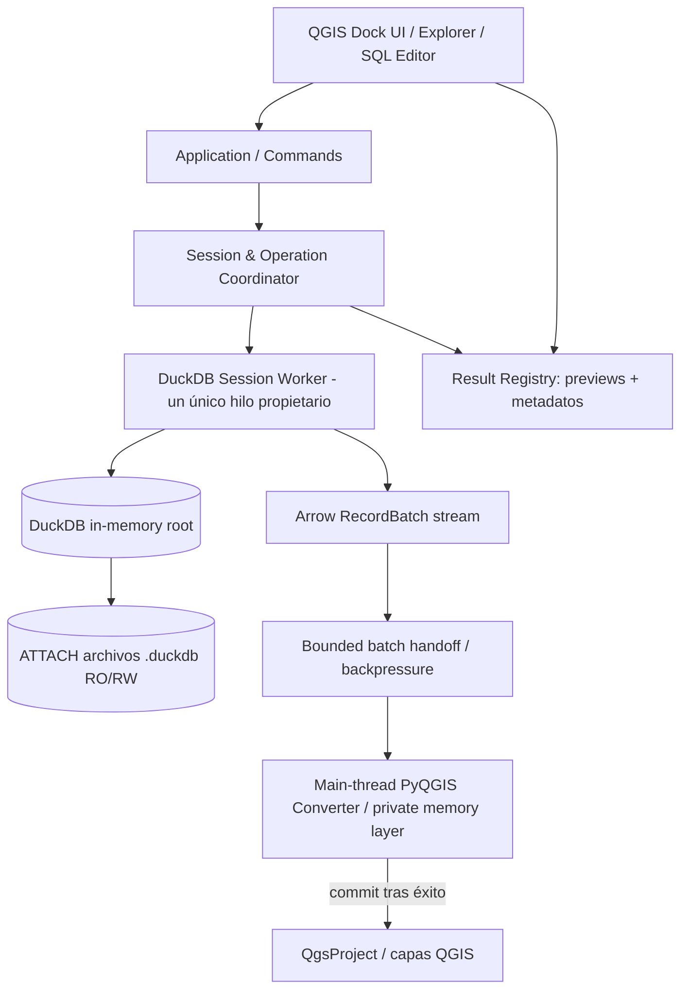

# GeoDuck — Arquitectura de referencia

**Estado:** ADR-001..ADR-004 propuestos como baseline. **Ámbito:** plugin local QGIS con un proceso y un ejecutor de sesión.

## 1. Vista de componentes



## 2. Subsistemas
**UI shell (PyQGIS/Qt):** `QDockWidget`, explorador, editor, inspector de resultados, selectors de geometría y CRS, notificaciones accesibles. Nunca contiene SQL de negocio ni accesos a DuckDB directos.

**Application layer:** comandos `StartSession`, `AttachDatabase`, `DetachDatabase`, `ExecuteScript`, `PreviewResult`, `LoadResultToQGIS`, `CancelOperation`, `CloseSession`; errores tipados y estado del flujo.

**Session Worker:** único propietario de `duckdb.DuckDBPyConnection`, creada expresamente en su hilo. Cola serial de operaciones que cambian estado o consumen lectores. No usar `duckdb.sql()` global ni `:default:`. No usar el mismo objeto `con` simultáneamente desde hilos.

**Result Registry:** guarda metadatos de sentencia, preview limitado, SQL reejecutable cuando procede, contexto y estado de disponibilidad; no contiene un resultado completo en memoria ni un lector Arrow indefinido.

**Arrow Bridge:** transfiere `RecordBatch` con control de presión y cierre garantizado del reader. La conversión final Arrow → `QgsFeature`/`QgsGeometry` implica copia y asignación controlada.

**QGIS Committer:** crea o alimenta una capa temporal no registrada, exclusivamente en hilo principal. Publica todas las capas del pedido tras validar integridad, o descarta todas en fracaso.

## 3. Máquina de estados de sesión
Estados de sesión (fuente única: `session-spec` §5): `DISCONNECTED → CONNECTING → READY ⇄ BUSY`, `READY → DETACHING → READY`, `* → CLOSING → DISCONNECTED`; `ERROR_RECOVERABLE` registra fallos de los que se puede salir reintentando, volviendo a `READY` o cerrando. La tabla de transiciones de `session-spec` §5 es normativa. Los estados de operación y de entrega (`cancelando`, `transfiriendo`, `entrega exitosa`…) pertenecen a la máquina de operación, no a la de sesión.

- `READY`: admite operaciones nuevas.
- `BUSY`: operaciones seriales ocupan la conexión, incluidas lecturas Arrow. `DETACH` entra en cola, espera o pide cancelar la operación anterior.
- `CLOSING`: cerrar lectores, terminar/cancelar trabajos, `DETACH` de las bases que proceda, cerrar la instancia y limpiar referencias.
- Evitar cerrar prematuramente un reader: el contrato de algunas versiones de DuckDB pueden impedir consultas concurrentes mientras está abierto.
- `ERROR_RECOVERABLE`: fallo recuperable. Si la causa es la invalidación de la conexión (`SESSION_INVALIDATED`, `session-spec` §5), solo se sale hacia una sesión nueva o el cierre.

## 4. Secuencia cargar capa
1. UI escoge resultado tabular y su geometría/CRS.
2. Application valida que la consulta puede volver a ejecutarse con seguridad para ese caso; si no, ofrece explicación.
3. Worker prepara relación `con.sql(read_query)`; abre `rel.to_arrow_reader(batch_size=config)` en `with`.
4. Worker entrega lotes sin acceso a objetos Qt/QGIS del hilo principal; cola acotada y ACK mantienen memoria predecible.
5. Main thread valida campos, convierte cada lote y agrega a una capa **privada** de memoria.
6. Si se cancela o falla, limpiar reader y descartar capa privada; ninguna publicación.
7. Al final, cotejar recuentos, esquema y errores; registrar capa(s) en `QgsProject` y emitir éxito.
8. Desde ese momento la propiedad es exclusivamente de QGIS y la capa no retiene referencia a DuckDB.

## 5. Política de concurrencia y cancelación
- Un worker serializado para una sesión: conserva `TEMP`, `USE`, transacciones y contexto del script sin sorpresas.
- Cada operación tiene `id`, token de cancelación cooperativo y estado observable.
- Para consultas largas sin lotes, `interrupt()` se usa solo como excepción controlada y en las versiones exactas de DuckDB verificadas (ADR-0007). En las demás, la cancelación es solo cooperativa. **No asumir** cancelación inmediata ni segura sin prueba.
- Propiedad exclusiva de la conexión, cola serial y lectores Arrow con ciclo de vida explícito: ADR-0006.
- El cierre de GeoDuck o `DETACH` solicita cancelación y espera liberación ordenada; jamás se desprende una base en mitad de la transferencia activa.
- Las funciones de PyQGIS/QObject del proyecto se llaman en main thread; prohibido `QgsVectorLayer`, `QgsProject`, widgets o data providers dentro del worker.
- Backpressure obligatorio: n lotes máximo en tránsito; decidir tamaño con benchmarks.

## 6. Estructura sugerida del código a implementar

```text
geoduck/
  __init__.py
  metadata.txt
  plugin.py
  ui/
    dock.py, sql_editor.py, explorer.py, results.py, dialogs.py
  app/
    commands.py, coordinator.py, state.py, events.py
  duckdb/
    session.py, catalog.py, script_runner.py, relations.py
  bridge/
    transfer.py, arrow_adapter.py, qgis_types.py, geometry.py
  infra/
    compatibility.py, configuration.py, logging.py
  resources/
  tests/
    unit/, integration/, qgis/, perf/
```

Es una estructura orientativa: Claude Code puede simplificar carpetas **sin cambiar fronteras ni requisitos**, registrando el cambio. No crear capas abstractas sin uso real ni usar infraestructura distribuida.

## 7. Riesgos a probar antes de congelar la implementación
1. QGIS 3/4 y librería editor SQL nativa: qué bindings PyQGIS hay por Windows.
2. PyArrow/duckdb DLL y dependencias dentro de Python embebido de QGIS.
3. Devolver RecordBatch de worker a main thread sin degradar latencia/estabilidad.
4. `USE`/`DETACH` en script y revalidación de resultados previos.
5. Materialización de varios millones en `QgsVectorLayer(memory)`: consumo real de RAM.
6. QGIS 4 tipado de campos y manejo de geometrías con CRS.

## 8. Fuente de verdad
`docs/product-spec.md` y `specs/*.md` son los contratos. Esta arquitectura puede refinarse tras un spike, pero ninguna optimización puede violar el límite de responsabilidad con QGIS.
