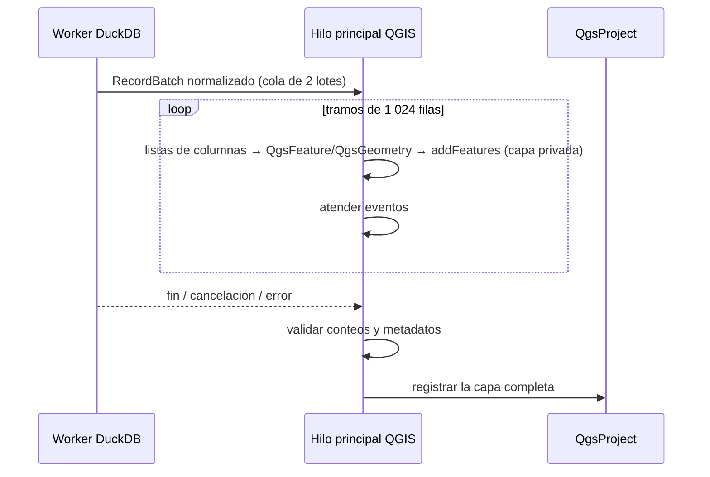

# SPEC GD-BRD — Carga de resultados y tablas DuckDB en QGIS

**Estado:** Alpha, tres modalidades (ADR-0012, 2026-11-02) · **Requisitos:** GD-BRD-001..012 ·
**Contrato principal:** GeoDuck produce; QGIS administra. La modalidad Conectada mantiene un vínculo
explícito con la sesión.

## 1. Objetivo

Llevar a QGIS el resultado **completo** de una consulta de lectura, o una tabla o vista del catálogo, con
control de errores, progreso y cancelación, en una de tres modalidades:

| Modalidad | Nombre en la interfaz | Resultado en QGIS | Vínculo con DuckDB |
|---|---|---|---|
| Memoria | «Copia en memoria» | `QgsVectorLayer(provider="memory")` | Ninguno |
| Instantánea | «Copia rápida» | GeoPackage en `/vsimem/geoduck/…` abierto con el proveedor `ogr` | Ninguno; GeoDuck libera `/vsimem` al quitar la capa |
| Conectada | «Conectada a DuckDB» | Proveedor PyQGIS `geoduck` | Sí, con la sesión y la base adjunta |

**Interfaz (G5, ui-ux-spec §8):** «Cargar en QGIS ▾» muestra las tres modalidades; elegir una abre el diálogo de carga con esa modalidad marcada. La presentación (ventana propia o panel) no cambia nada de este documento: una carga en curso sigue y entrega una sola vez aunque se alterne la presentación.

## 2. Fuente común de lectura

```python
relation = con.sql(read_sql)  # solo una consulta de lectura repetible, ya normalizada (§7)
with relation.to_arrow_reader(batch_size=batch_size) as reader:
    for batch in reader:
        ...  # entregar con contrapresión; comprobar cancelación entre lotes
```

- Sin `COUNT(*)` previo: el progreso cuenta filas recibidas; el total solo se muestra si se conoce sin
  coste extra.
- `batch_size` inicial: 8 192 filas (F-44: el tamaño de lote apenas cambia el total).
- La consulta se ejecuta al consumir la relación; DuckDB 1.5/2.x no ofrece streaming eficiente desde
  `con.execute().to_arrow_reader()`.
- Para un resultado del editor rige sql-editor-spec §5: solo se repite esa consulta de lectura, nunca
  DDL, DML, `RETURNING` ni el resto del script.

## 3. Modalidad Memoria



- Conversión en el hilo principal por tramos de 1 024 filas, atendiendo eventos entre tramos (F-44). El
  worker no crea objetos de QGIS (F-44: no acelera por el GIL).
- Fechas desde enteros (`QDateTime.fromMSecsSinceEpoch`), nunca `QDateTime(datetime)` (F-43).
- Disponible siempre: no depende de GDAL.

## 4. Modalidad Instantánea

- Dentro de la operación del worker, GDAL escribe cada lote con `OGRLayer.WriteArrow` en un GeoPackage
  nuevo en `/vsimem/geoduck/<id>.gpkg`, en una transacción de GDAL. El CRS sale del PROJJSON de GeoArrow.
- Al terminar, el hilo principal abre la capa con el proveedor `ogr` (privada) y la publica.
- Requiere GDAL ≥ 3.8 con el driver GPKG. Si no está, la opción aparece desactivada con el motivo.
- **Ciclo de vida de `/vsimem`:** GeoDuck registra cada archivo y lo libera (`gdal.Unlink`) cuando QGIS
  quita la última capa que lo usa. En error o cancelación lo libera de inmediato. Al descargar GeoDuck,
  los archivos de capas aún presentes se conservan, porque son de QGIS.

## 5. Modalidad Conectada

### 5.1 Fuente y URI

URI: `session=<id>|source=<catálogo.esquema.objeto>|sql=<consulta>|geom=<columna>|geomformat=<geometry|wkb|wkt>|family=<point|line|polygon|collection>|fid=<key|map|rowid|content>|key=<pk>|keys=<json>|type=<WkbType>`,
más los metadatos que permiten abrir la capa sin consultar la sesión (columnas y tipos, CRS, extensión,
conteo). Los valores van codificados como en una URL.

- **Tabla o vista** del explorador: `source`.
- **Resultado del editor:** `sql`, solo lectura.
- **Identificador de entidad (FID)**, como el proveedor `postgres` de QGIS (decisión del propietario,
  2026-11-02). Se elige solo; el usuario no tiene que indicar nada.

  | Fuente | FID | Edición (§5.4) |
  |---|---|---|
  | Tabla con clave primaria, o con `UNIQUE` cuyas columnas son todas `NOT NULL`, entera de una columna | `fid=key`: el valor de la clave | Sí |
  | Tabla con cualquier otra de esas claves (texto, UUID, fecha, varias columnas) | `fid=map`: número asignado en memoria a cada valor de la clave, como `PktFidMap` de QGIS | Sí |
  | Tabla sin clave | `fid=rowid`, como `ctid` en PostgreSQL | Sí |
  | Vista o consulta | `fid=content`: huella del contenido de la fila | No: DuckDB no escribe en ellas |

  Si hay varias claves candidatas, manda la primaria; si no, la `UNIQUE` de menos columnas, y entre
  iguales la entera.

  - **`rowid`:** mientras GeoDuck tiene la base adjunta en escritura, ningún otro proceso puede
    modificarla (DuckDB admite un solo proceso escritor). El `rowid` solo cambia si DuckDB compacta la
    tabla tras borrados en esta misma sesión (SQL del usuario, un guardado, un `CHECKPOINT` automático o
    el cierre). Por eso, después de cada escritura las capas Conectadas se vuelven a dibujar. Al
    guardar, cada fila se comprueba por su huella antes de escribirla: nunca se escribe en otra fila
    (§5.4).
  - **`content`:** `(hash(todas las columnas) >> 1)::BIGINT`. No depende del orden de lectura, de los
    filtros, de `CHECKPOINT` ni de cambios en otras filas (`row_number()` se descartó: depende de un orden
    que DuckDB no garantiza). Límites: filas idénticas comparten FID (QGIS no las distingue, pero se leen
    todas); cambiar una fila cambia su FID; el FID puede cambiar con otra versión de DuckDB; dos filas
    distintas con la misma huella de 63 bits son posibles pero improbables (≈ 10⁻⁶ con 5 M de filas), y
    entonces se ordenan con una segunda huella y se leen ambas.
  - **Memoria e Instantánea** no usan nada de esto: son copias, y QGIS (`memory`) o GDAL (columna `fid`
    del GeoPackage) asignan su propio identificador.
- **Tipo de geometría** (`type`): se declara o se deduce de los datos, porque DuckDB no guarda el
  subtipo (F-71). Con varias familias la capa es `Unknown`, o una capa por familia con `family=`
  (spatial-spec §6).
- **Formato de la geometría** (`geomformat`): `geometry` (tipo `GEOMETRY`, por defecto), o `wkb`/`wkt` para
  una columna `BLOB`/`VARCHAR` marcada como geometría por el usuario (spatial-spec §2.2). La lectura la
  convierte en DuckDB (`TRY(ST_GeomFromWKB(…))`, `TRY(…::GEOMETRY)`, núcleo, sin `spatial`), así que
  extensión y filtro espacial se empujan igual; al guardar se escribe de vuelta con `ST_AsWKB`/`ST_AsText`.
- **Varias geometrías:** una capa Conectada por columna marcada, cada una con su `geom` (spatial-spec §7).

### 5.2 Peticiones de QGIS → SQL

| Petición | SQL |
|---|---|
| Extensión | `st_intersects_extent(geom, <rectángulo>)` (núcleo de DuckDB ≥ 1.5); con `spatial` cargada, `ST_Intersects(geom, ST_MakeEnvelope(…))`, que usa el RTree si existe |
| FID | `FID IN (…)` sobre la clave, el `rowid` o la huella; en `fid=map`, los valores de la clave de esos FID (`(k1, k2) IN (…)`) |
| Atributos pedidos / sin geometría | solo esas columnas; sin la columna de geometría |
| Filtro de la capa (Capa → Filtrar…, `subsetString`) | Condición de DuckDB sobre los campos de la capa, aplicada a la consulta base (`WHERE (filtro)`). Se comprueba en DuckDB antes de aplicarla; si no es válida, se rechaza con el motivo y la capa no cambia. Se guarda en la URI (`subset=`) y sobrevive a la reapertura del proyecto. Con filtro, la extensión de la capa («Zoom a la capa») es la de lo filtrado: `ST_Extent_Agg` si `spatial` está cargada; si no, se recorre la geometría filtrada. Si tarda más de la espera del hilo principal, se cancela, se avisa y se mantiene la de toda la capa; sin filtro vuelve la de la carga |
| Expresión | Compilada a SQL de DuckDB cuando es posible (comparaciones, `AND`/`OR`/`NOT`, `IN`, `IS NULL`, `LIKE`/`ILIKE`, aritmética); si no, se evalúa en Python sobre lo filtrado en SQL |
| `LIMIT`, orden | `LIMIT`; `ORDER BY` cuando la petición lo pide |

Las peticiones van en **páginas** de como mucho 50 000 filas, siempre por el identificador: cada página
empieza después del último leído (`> ? ORDER BY identificador LIMIT n`; en `fid=map`, comparando la
clave entera: `(k1, k2) > (…)`). En `fid=content`, las filas idénticas comparten FID: la página empieza
en el último (`FID >= ? ORDER BY FID, segunda huella LIMIT n + k`) y salta las `k` ya entregadas. Así
ninguna fila se pierde ni se repite. No se usa `OFFSET`.
Entre páginas el worker queda libre.

### 5.3 Contención con el SQL del usuario

- Las páginas del mapa son operaciones del worker con **prioridad** sobre el trabajo en cola. No
  interrumpen la operación en curso.
- Si QGIS cancela el dibujado (`QgsFeedback`) o cierra el iterador, la página pendiente se descarta y la
  operación en curso se cancela.
- Mientras corre una consulta larga del usuario, el dibujado espera sin bloquear la interfaz de QGIS. El
  usuario puede cancelar la consulta desde el panel.

### 5.4 Edición

**Qué es editable** (decisión del propietario, 2026-11-02, como QGIS con PostGIS): toda tabla base de
una base que no es `READ_ONLY`, incluidas las `TEMP`, con o sin clave (§5.1). Las vistas y las consultas
son de solo lectura, porque DuckDB no escribe en ellas; el motivo se muestra. Las columnas que identifican
la entidad (la clave) y las que §7 convierte con pérdida no se pueden cambiar.

**Guardado atómico:** GeoDuck escucha `QgsVectorLayer.beforeCommitChanges`, lee el búfer de edición y, en
una sola operación del worker, ejecuta:

1. `BEGIN`. Si la sesión ya tiene una transacción abierta, se rechaza el guardado con aviso y QGIS
   conserva todos los cambios pendientes para guardarlos después (decisión del propietario, 2026-11-02).
2. **Localizar y comprobar:** cada fila cambiada o borrada se busca por su identificador (clave, valores
   de la clave en `fid=map`, o `rowid`) y se toma su `rowid` y su `hash(fila completa)`. Si falta, o su
   huella difiere de la registrada cuando QGIS la leyó, ROLLBACK y se informa la lista de entidades en
   conflicto. Así, si DuckDB compactó la tabla y un `rowid` pasó a otra fila, se detecta: **nunca se
   escribe en otra fila**.
3. **Validación previa** (antes de tocar DuckDB): tipo de geometría compatible con la capa (y con su
   formato: en `geomformat=wkb|wkt` se escribe de vuelta en ese formato), columnas de
   la clave sin cambios, columnas convertidas por §7 sin cambios, y valor para la clave de cada alta si
   DuckDB no lo pone.
4. **Escrituras por lotes por `rowid`** (estable dentro de la transacción) con tablas Arrow registradas en
   la operación: `UPDATE … FROM`, `DELETE … WHERE rowid IN (SELECT …)` e `INSERT … SELECT`. Altas: con
   clave entera, los ids se piden antes con `nextval` (o los indica el usuario); con otra clave, se
   escriben los valores dados, y una columna sin valor en ninguna alta toma su valor por defecto en
   DuckDB. Si hay altas sin clave entera o borrados, la capa se relee tras el `COMMIT` (los
   identificadores nuevos o movidos se leen de DuckDB).
5. `COMMIT`. Cualquier error o cancelación provoca ROLLBACK.

Después, los métodos del proveedor solo informan el veredicto. **QGIS informa éxito solo si DuckDB
confirmó**, y si no, conserva el búfer entero para corregir o reintentar. Tras un guardado se avanza la
época de datos: las previsualizaciones quedan marcadas como posiblemente obsoletas.

**Resolución de conflictos:** el usuario puede volver a leer las entidades en conflicto y reintentar, lo
que sobrescribe a sabiendas, o descartar sus cambios.

### 5.5 Ciclo de vida

| Situación | Comportamiento |
|---|---|
| DETACH de la base, o cierre de la sesión | Rechazado si una capa conectada de esa base tiene cambios sin guardar. Si no, las capas quedan **no disponibles**: vacías, con aviso y sin errores. El DETACH escrito en el editor se reconoce por el **tipo de sentencia del parser de DuckDB** y su base de destino, nunca por el texto: comentarios, cadenas y otras sentencias no se bloquean. Si se rechaza, no se ejecuta ninguna sentencia del script (decisión del propietario, 2026-11-02) |
| ATTACH de nuevo con el mismo alias | Las capas vuelven a estar disponibles y se repintan |
| Reabrir el proyecto | Disponible si la sesión tiene adjunta esa base; si no, no disponible hasta adjuntarla. Las capas sobre `:memory:` o `TEMP` no sobreviven |
| Cambios sin confirmar del usuario | Visibles en el mapa, porque es la misma conexión. El aviso llega al guardar la capa (paso 1 de §5.4); no hay indicador permanente junto a la capa (decisión del propietario, 2026-11-02) |

## 6. Hilos y estabilidad

- **Worker:** lector Arrow, normalización y escritura de GDAL (Instantánea). Nunca `QgsVectorLayer`,
  `QgsProject`, widgets ni `QObject` del hilo principal.
- **Hilo principal:** capas, `QgsFeature` (Memoria), apertura y publicación de capas, interfaz.
- **Proveedor `geoduck`:** QGIS lo llama desde sus hilos de dibujo. Solo envía operaciones al worker y
  espera su resultado; nunca toca la conexión ni objetos del proyecto.
- Contrapresión: como mucho 2 lotes en vuelo. Cancelación cooperativa y limpieza en `finally`.
- Un consumidor que falla detiene al productor, que nunca queda bloqueado (F-60).

## 7. Tabla de conversión DuckDB → QGIS (normalización común)

GeoDuck envuelve la consulta en `SELECT <expresiones> FROM (<consulta>)` según los tipos de su resultado.
Las expresiones se aplican en DuckDB, antes de Arrow:

| Entrada | Salida | Nota |
|---|---|---|
| `BOOLEAN`, `TINYINT`..`BIGINT`, `UTINYINT`..`UINTEGER` | igual | `UINTEGER` → `BIGINT` |
| `UBIGINT`, `HUGEINT`, `UHUGEINT` | `VARCHAR` canónico | sin pérdida (F-47) |
| `FLOAT`, `DOUBLE` | igual | `NaN`/`Inf` se conservan |
| `DECIMAL(p,s)` con p ≤ 15 | `DOUBLE` | exacto en doble precisión |
| `DECIMAL(p,s)` con p > 15 | `VARCHAR` | sin pérdida |
| `VARCHAR`, `UUID`, `ENUM` | `VARCHAR` | el ENUM conserva su etiqueta (F-47) |
| `DATE` | `DATE` | |
| `TIMESTAMP`, `TIMESTAMP_S/MS/NS` | `TIMESTAMP` (µs) | `TIMESTAMP_NS` pierde sub-µs: se avisa |
| `TIMESTAMPTZ` | `TIMESTAMPTZ` en UTC | se documenta la zona |
| `TIME` | `TIME` (hora del día, ms en QGIS) | ida y vuelta sin perder el tipo y editable en la Conectada (#141); en la Instantánea, texto ISO (GeoPackage no tiene hora) |
| `TIMETZ`, `INTERVAL` | `VARCHAR` ISO | no se inventa fecha (F-47) |
| `BLOB`, `BIT` | igual / `VARCHAR` | un BLOB no es geometría salvo que el usuario lo marque (spatial-spec §2.2) |
| `LIST`, `STRUCT`, `MAP`, `UNION`, `ARRAY` | `VARCHAR` JSON | se avisa la pérdida de estructura |
| Geometría primaria | `geoarrow.wkb` + CRS | ADR-0008 |
| Geometrías no elegidas | se excluyen de los atributos | se avisa; el usuario puede marcarlas para crear sus capas (spatial-spec §7) |
| `NULL` | `NULL` real de QGIS | nunca `"None"` |

La Conectada aplica la misma tabla en la lectura. En la escritura convierte de vuelta solo los tipos que
puede escribir sin pérdida; los campos convertidos a texto son de solo lectura. Toda advertencia de tipo
se muestra antes de publicar la capa.

## 8. Atomicidad e integridad

- Una carga Memoria o Instantánea **no se registra** si alguna fila falla. Mientras se transfiere, la
  capa es privada: no está en `QgsProject`. Si una selección crea varias capas, se registran todas o
  ninguna.
- En cancelación, error u OOM: cerrar el lector, descartar las capas privadas, liberar `/vsimem` y
  registrar el error sin datos sensibles.
- Comprobación de conteos:
  - Memoria e Instantánea: `rows_read == rows_written == layer.featureCount()`;
  - Conectada: lo que el proveedor devuelve sale de DuckDB, y cada página informa su número de filas.
- La atomicidad es sobre la **publicación** (Memoria, Instantánea) y sobre el **guardado** (Conectada).

## 9. IDs, orden y atributos

- **Memoria e Instantánea:** FID nativo de la capa; la columna de id del usuario queda como atributo.
- **Conectada:** FID según §5.1 (`key`, `map`, `rowid` o `content`).
- Un SQL sin `ORDER BY` no garantiza el orden; no se usa para identidad.
- El nombre lo decide el usuario. Por defecto es el título del resultado o el nombre del objeto, con el
  sufijo de la geometría si hay varias.

## 10. Límite de responsabilidad

- **Memoria e Instantánea:** tras `addMapLayer` y la notificación, GeoDuck no refresca la capa ni la
  borra al hacer DETACH; QGIS asume el control. La única excepción es liberar el archivo `/vsimem`
  cuando QGIS quita la capa. Ambas se pierden si el usuario no las guarda según las reglas de QGIS.
- **Conectada:** GeoDuck mantiene el vínculo descrito en §5.5 mientras la capa exista.
