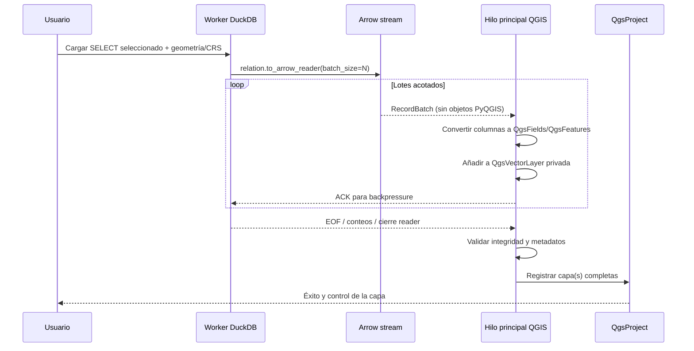

# SPEC GD-BRD — Transporte Arrow y entrega de capas QGIS

**Estado:** baseline Alpha · **Requisitos:** GD-BRD-001..005 · **Contrato principal:** GeoDuck produce; QGIS administra.

## 1. Objetivo
Transferir el resultado **completo** de una consulta DuckDB de lectura a una o varias capas nativas `QgsVectorLayer(provider="memory")`, con control de errores, progreso y cancelación. No se crea una conexión viva DuckDB↔capa y no se crea un proveedor personalizado en esta fase.

## 2. Pipeline normativo



## 3. Precondiciones
- Sesión activa y resultado SQL tabular apto para consulta de lectura; no repetir DML/DDL.
- Columnas conocidas; destino/estrategia geométrica seleccionados; CRS identificado o decisión explícita de usuario.
- Recursos de memoria estimados y advertencia útil cuando el resultado es potencialmente grande. No fingir disponibilidad infinita de RAM.
- Cualquier reader anterior de la conexión está cerrado antes de comenzar.

## 4. API elegida
```python
relation = con.sql(read_query)  # solo para consulta de lectura
with relation.to_arrow_reader(batch_size=batch_size) as reader:
    for batch in reader:
        # entregar mediante cola con backpressure
        ...
```

DuckDB 1.5/2.x: no asumir streaming eficiente desde `con.execute().to_arrow_reader()`; usar relación. La consulta se ejecuta al consumir la relación. `batch_size` es configurable y se perfila; 8 192 / 16 384 filas son valores iniciales de experimento, no optimizaciones probadas.

## 5. Hilos y estabilidad
- Worker DuckDB: lector Arrow, conversión a tipos Arrow estándar, acumuladores de conteos; no usar `QgsVectorLayer`/`QgsProject`/widgets/QObject del hilo principal.
- Main QGIS: `QgsVectorLayer`, `QgsFields`, `QgsFeature`, `QgsGeometry.fromWkb`, `dataProvider().addFeatures`, registro en `QgsProject`.
- Queues y señales: backpressure explícito (máximo 1–3 lotes en vuelo inicialmente); verificar seguridad y latencia con pruebas reales.
- La incorporación en QGIS de grandes lotes debe repartir trabajo en eventos del hilo principal; no ejecutar un bucle enorme que bloquee la interfaz durante segundos.
- Cancelación cooperativa y cleanup `finally`; no llamar APIs de interrupción DuckDB no verificadas desde otro hilo.

## 6. Atomicidad de entrega
Una transferencia **no se registra como completa** si alguna fila falla al convertir o insertar. Mientras se transfiere, usar capa privada no registrada en `QgsProject`. Al éxito, registro del grupo de capas. Si una selección espacial crea dos capas, o se registran ambas completas o ninguna para esa operación, salvo elección explícita posterior del propietario.

En cancelación/error/OOM: cerrar reader, descartar capas privadas, liberar estructuras temporales del bridge, registrar error sin datos sensibles. Los `ATTACH` previos permanecen a menos que el usuario ordene `DETACH`.

La atomicidad es sobre **publicación en el proyecto**, no una transacción en la memoria interna de QGIS.

## 7. Tabla de conversión DuckDB / Arrow → QGIS

| Entrada | Política V1 | Advertencia |
|---|---|---|
| `BOOLEAN` | booleano/QVariant compatible | validar por QGIS3/4 |
| `TINYINT`/`SMALLINT`/`INTEGER` | entero | límites por binding |
| `BIGINT` | entero de 64 bits si es representable; si no, string | sin pérdida silenciosa |
| `UBIGINT`/`HUGEINT` | texto canónico por defecto si rango excede QGIS | preservar exactitud |
| `FLOAT`/`DOUBLE` | `double` | `NaN/Inf` según estrategia explícita |
| `DECIMAL(p,s)` | doble si exactitud controlada; texto cuando pueda perder precisión | **nunca** convertir silenciosamente |
| `VARCHAR`/`ENUM`/`UUID` | texto | codificación UTF-8 |
| `DATE` | QDate o texto ISO validado | nulos |
| `TIMESTAMP`/`TIMESTAMPTZ` | QDateTime o ISO con zona documentada | conservar semántica de zona |
| `TIME`/`INTERVAL` | QTime o texto normalizado | no inventar fecha |
| `BLOB` | hexadecimal o texto base64 explícito | no tratar BLOB como geometría sin metadatos |
| `LIST`/`STRUCT`/`MAP`/`UNION` | JSON canonizado si representable o texto tipado | avisar pérdida de estructura nativa QGIS |
| geometría primaria | WKB → `QgsGeometry` | CRS separado; validar tipo y contenido |
| geometría no primaria | omitir de atributos por defecto, ofrecer WKT/WKB textual opcional | no afecta fuente DuckDB |
| `NULL` | `NULL` real de QGIS | no convertirlo a cadena `"None"` |

La tabla debe refinarse mediante contrato testado por tipo y bindings QGIS concretos, no tomar como garantía universal de QVariant. Rechazar datos imposibles de convertir con motivo explícito en lugar de producir datos inconsistentes.

## 8. IDs, orden y atributos
- Si hay una columna de ID único y compatible, ofrecerla como campo de atributo, **no** confiar automáticamente en ella como FID QGIS.
- Crear FID nativo `QgsFeature` para cada fila y validar conteos; las tablas sin geometría usan capa `None`.
- SQL sin `ORDER BY` no garantiza orden de salida. No usar el orden para producir identidad persistente entre ejecuciones.
- El naming del usuario manda; nombres generados son `Tabla — <geom>`/`Resultado N — <geom>` y se normalizan para QGIS.

## 9. Integridad y comprobación
- `rows_read == rows_converted == rows_added` para cada capa.
- Metadatos de campos, CRS, geometría y valores se verifican antes de registrar capa.
- Para 2 geometrías, comprobar que las 2 capas obtienen el mismo número de filas lógico cuando el contrato así lo establece (salvo nulos con regla documentada).
- No completar silenciosamente con una capa parcial en casos de error o falta de memoria.

## 10. Límite de responsabilidad
Después del `QgsProject.addMapLayer(...)` exitoso y la notificación de entrega: GeoDuck no mantiene referencias al archivo DuckDB, no refresca la capa, no la borra al `DETACH`, ni decide cómo se guarda o se renderiza. QGIS asume el control. La capa memory se puede perder si el usuario no la guarda según las reglas de QGIS.
